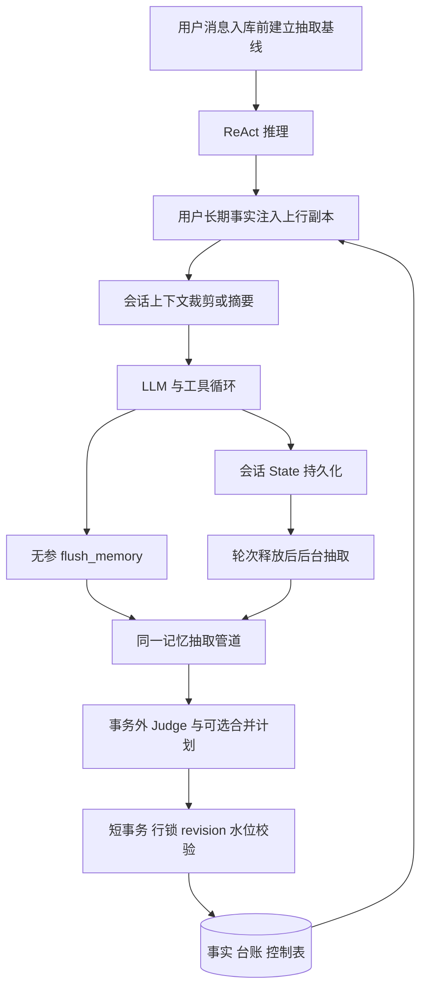

# 核心亮点证据：分层上下文工程与并发安全的长期记忆

> 本文依据当前工作区源码静态核查；未把回归程序的存在写成回归已通过，未测量性能提升。所有路径以仓库根目录为基准，行号定位阅读入口。描述的是项目能力，个人贡献仍应结合本人提交记录确认。

## 简历原文与真实性

**设计工具结果裁剪、会话摘要与用户长期事实的分层记忆机制，通过 PostgreSQL 持久化、版本号与抽取水位双校验、受限合并和容量控制，实现长会话上下文治理及跨会话记忆复用。**

真实性：**A，代码直接证明实现机制；“治理”“复用”是对执行行为的归纳，不代表已证明回答准确率提高。**

不能写：无限上下文、无损压缩、精准 token 预算、向量记忆检索、百分百防注入、完全避免幻觉、强一致实时记忆读取、物理遗忘、经过生产压测、性能提升百分比。这里不是 LangGraph Memory，也不是把 RAG 向量检索作为用户记忆。

## 代码证据索引

下表中的类均与文件同名；`M/` 代表 `agent/src/main/java/com/nageoffer/ai/ragent/agent/memory/`，`A/` 代表 `agent/src/main/java/com/nageoffer/ai/ragent/agent/`。

| 文件与定位 | 类/函数 | 输入与输出、上下游 |
|---|---|---|
| [A/service/impl/AgentChatServiceImpl.java:138](../agent/src/main/java/com/nageoffer/ai/ragent/agent/service/impl/AgentChatServiceImpl.java#L138) | `startRun` | 用户问题与身份 → 先 `ensureExtractionBaseline`，再持久化用户消息 |
| [A/service/impl/AgentChatServiceImpl.java:272](../agent/src/main/java/com/nageoffer/ai/ragent/agent/service/impl/AgentChatServiceImpl.java#L272) | 运行收尾 | `saveAgentState`；283 行注册 release 后后台抽取 |
| [A/service/impl/AgentChatServiceImpl.java:343](../agent/src/main/java/com/nageoffer/ai/ragent/agent/service/impl/AgentChatServiceImpl.java#L343) | `scheduleMemoryExtraction` | 用户/会话 ID → BACKGROUND 管道，在 boundedElastic 执行 |
| [A/config/ReActAgentProvider.java:113](../agent/src/main/java/com/nageoffer/ai/ragent/agent/config/ReActAgentProvider.java#L113) | `buildAgent` | 配置状态存储；127 行先用户记忆再压缩 middleware |
| [M/AgentUserMemoryMiddleware.java:60](../agent/src/main/java/com/nageoffer/ai/ragent/agent/memory/AgentUserMemoryMiddleware.java#L60) | `onReasoning/load/inject` | `ReasoningInput` → 新上行副本；每个 RuntimeContext 缓存一次用户记忆 |
| [M/AgentContextCompactionMiddleware.java:57](../agent/src/main/java/com/nageoffer/ai/ragent/agent/memory/AgentContextCompactionMiddleware.java#L57) | `dispatch/compact/trim` | AgentState 可变 context → 同步重建本轮 ReasoningInput |
| [M/AgentContextTrimmer.java:67](../agent/src/main/java/com/nageoffer/ai/ragent/agent/memory/AgentContextTrimmer.java#L67) | `trimInPlace` | 原上下文 → 回收字符量与按对象身份关联的 Msg 替换表 |
| [M/AgentContextCompactor.java:69](../agent/src/main/java/com/nageoffer/ai/ragent/agent/memory/AgentContextCompactor.java#L69) | `compactInPlace` | 早期上下文+旧摘要 → 新摘要+近期完整轮次，记录审计 |
| [M/AgentConversationSummarizer.java:87](../agent/src/main/java/com/nageoffer/ai/ragent/agent/memory/AgentConversationSummarizer.java#L87) | `summarize` | 历史材料+旧摘要 → 结构和长度合格的摘要，否则 null |
| [M/AgentContextChars.java:38](../agent/src/main/java/com/nageoffer/ai/ragent/agent/memory/AgentContextChars.java#L38) | `total` | 文本、thinking、工具参数/结果的字符粗估；非文本块按零 |
| [M/AgentMemoryPipeline.java:67](../agent/src/main/java/com/nageoffer/ai/ragent/agent/memory/AgentMemoryPipeline.java#L67) | `extract` | userId/conversationId/trigger → `AgentMemoryOutcome` |
| [M/AgentMemoryJudge.java:78](../agent/src/main/java/com/nageoffer/ai/ragent/agent/memory/AgentMemoryJudge.java#L78) | `judge/parse/toDecision` | 现有事实+待抽取用户消息 → ADD/SUPERSEDE/RETRACT；NOOP 转空列表 |
| [M/AgentMemoryConsolidator.java:77](../agent/src/main/java/com/nageoffer/ai/ragent/agent/memory/AgentMemoryConsolidator.java#L77) | `plan` | 全部 active 事实 → 合并计划；只出计划、不写数据库 |
| [M/AgentMemoryRepository.java:216](../agent/src/main/java/com/nageoffer/ai/ragent/agent/memory/AgentMemoryRepository.java#L216) | `commit` | expectedRevision/expectedWatermark/决策/合并计划 → 原子提交结果 |
| [M/AgentMemoryBlock.java:54](../agent/src/main/java/com/nageoffer/ai/ragent/agent/memory/AgentMemoryBlock.java#L54) | `render/projectedChars` | 事实 → 含标签、头部声明和换行的完整注入块；容量量成品长度 |
| [M/AgentMemoryProperties.java:36](../agent/src/main/java/com/nageoffer/ai/ragent/agent/memory/AgentMemoryProperties.java#L36) | 配置与 `resolve*` | `agent.memory` → 固定比例派生阈值 |
| [A/tool/MemoryFlushTool.java:69](../agent/src/main/java/com/nageoffer/ai/ragent/agent/tool/MemoryFlushTool.java#L69) | `getParameters/callAsync/execute` | 无内容参数工具；只从身份上下文和数据库获取材料 |
| [A/state/PgAgentStateStore.java:49](../agent/src/main/java/com/nageoffer/ai/ragent/agent/state/PgAgentStateStore.java#L49) | `save/get/getList` | AgentScope State ↔ 框架 JSON 编解码 ↔ PG 状态表 |
| [A/dao/mapper/AgentMemoryControlMapper.java:54](../agent/src/main/java/com/nageoffer/ai/ragent/agent/dao/mapper/AgentMemoryControlMapper.java#L54) | `selectForUpdate` | 每用户一行的事务串行提交点 |
| [A/dao/mapper/AgentMemoryExtractionMapper.java:35](../agent/src/main/java/com/nageoffer/ai/ragent/agent/dao/mapper/AgentMemoryExtractionMapper.java#L35) | `selectWatermark` | WRITTEN/NOOP/DROPPED 的最大 `to_message_id` |
| [A/dao/mapper/AgentMemoryMapper.java:34](../agent/src/main/java/com/nageoffer/ai/ragent/agent/dao/mapper/AgentMemoryMapper.java#L34) | `supersede/retract` | `id+user_id+invalid_at IS NULL` 条件更新 |
| [resources/database/upgrades/v2.0.0/260827_agent_long_term_memory.sql:5](../resources/database/upgrades/v2.0.0/260827_agent_long_term_memory.sql#L5) | 三张表与 Prompt | 事实表、抽取台账、控制表；39 行 PROCESSING 部分唯一索引 |
| [resources/database/upgrades/v2.0.0/260823_agent_context_compaction.sql:53](../resources/database/upgrades/v2.0.0/260823_agent_context_compaction.sql#L53) | 压缩审计表 | 摘要、代次、压缩前后字符等 |
| [bootstrap/src/main/resources/application.yaml:50](../bootstrap/src/main/resources/application.yaml#L50) | 实际仓库配置 | 100000 字符预算、两个开关 true、白名单 search_knowledge |

## 1. 解决什么问题

工具结果反复进入上下文会挤占窗口；直接截断又容易丢结论、丢工具调用配对。单会话历史无法自然跨会话保留用户事实；多个会话同时更新同一个人的偏好还可能造成旧决策覆盖新事实。这里分别以裁剪、摘要、用户级事实和并发提交校验处理这些问题。[源码：索引中 Trimmer、Compactor、Repository]

## 2. 为什么项目需要它

ReAct 不是一问一答单调用：一轮内可多次推理和多次工具观察，历史搜索结果会快速增长。项目的单例 Agent 还服务多个用户和多个会话，因此调用级缓存必须放 RuntimeContext，不能放 middleware 成员字段。跨会话事实按 userId 共享，单会话上下文按 userId/sessionId 保存，二者生命周期不同。[源码：`AgentUserMemoryMiddleware.java:42`、`PgAgentStateStore.java:49`]

## 3. 整体架构



需要区分：用户消息业务表是长期抽取材料；Agent State 是带工具消息的推理历史；压缩审计是摘要存档；长期事实表是跨会话数据。不能把四种数据混称一个 Memory 表。

## 4. 完整执行流程

1. `startRun` 在首条用户消息落库前创建控制行，创建时刻成为抽取下界，避免新接入的老账号历史倒灌，也避免首条新消息被错误排除。
2. 外层用户记忆中间件按 userId 读取 active 事实，调用内缓存，将事实块插在人设后、会话前，仅改变上行副本。
3. 压缩中间件解析 AgentState。如果本轮末消息是 USER 且超过压缩线，尝试摘要；否则尝试工具结果裁剪。
4. 推理与工具循环继续；`flush_memory` 可主动触发抽取，成功改变事实集后刷新本次 RuntimeContext 的快照。
5. 轮次释放触发后台抽取。待处理用户消息少于 3 条时后台不调用模型；flush 绕过该门槛。
6. 管道按当前会话水位与用户基线查最多 40 条用户消息，申请 PROCESSING 台账；同会话已有抽取则 BUSY。
7. 事务外读 active 事实并调用 Judge；预演超容量时，额外调用合并规划模型。
8. 短事务锁用户控制行，同时检查 revision 和会话水位，重新读取 active 集，验证/合并/淘汰/应用决策，并结算台账。
9. 下一次调用注入新快照；后台更新不会主动修改已经运行中的调用快照。[源码：Pipeline:67、Repository:216、MemoryFlushTool:101]

## 5. 对应代码文件

见证据索引。面试展示顺序建议为 `AgentChatServiceImpl → ReActAgentProvider → 两个 Middleware → Trimmer/Compactor → Pipeline → Repository → 三个 Mapper → SQL → Regression`，能串起入口、机制和持久化约束。

## 6. 核心类和函数

裁剪的关键不是字符串 substring，而是 `splitCycles`、`protectedCycles`、`collectCandidates` 和统一 `apply`；压缩的关键是 `findSafeCutoff` 与 `hasOrphanToolResult`；长期记忆的关键是 `claim`、`commit`、`consolidate`、`evict`、`settleOrThrow`。模型只提出内容计划，数据库提交层复核用户、有效性、容量、冲突与台账状态。[源码：Trimmer:98/128/164/210；Compactor:152/177；Repository:169/216/330/409/485]

## 7. 输入输出

短期输入是 `List<Msg>`，包含不同角色与 ContentBlock；裁剪输出替换映射，摘要输出新的一条 USER 角色背景摘要和保留后缀。长期输入是用户本人业务消息与已有事实，输出为受限制的决策；`AgentMemoryOutcome` 区分 DISABLED、BUSY、BELOW_THRESHOLD、FAILED、CONFLICT、CAPACITY_REJECTED 等，工具将失败结局转为 ERROR，防止模型把未写入解释成已记住。[源码：Judge:109；MemoryFlushTool:129]

## 8. 调用关系

用户记忆注入必须在压缩之前，且插入会话前缀：压缩按对象引用检查 `input.messages` 后缀是否与 state context 相同。若尾插长期记忆，offset 对齐会失效而跳过压缩。裁剪替换的是同一批 Msg 的内容副本，故用 IdentityHashMap 将 state 与本次上行同时更新；只改 state 会导致“下一轮才生效”。[源码：ReActAgentProvider:126；UserMemoryMiddleware:108；CompactionMiddleware:134；Trimmer:210]

## 9. 数据流与生命周期

`PgAgentStateStore` 对框架 State 使用框架自己的 JSON codec，不手工解释 payload 字段。长期事实条目只在 `invalid_at IS NULL` 时生效，SUPERSEDE 将旧记录指向新记录，RETRACT 仅设置失效时间。摘要按代次写审计；长期事实块不应写进 State，否则会重复持久化并污染下一轮快照。禁用长期记忆停止抽取与注入，已有事实保留。[源码：StateStore:49；MemoryMapper:34；MemoryProperties:102；MemoryBlock:34]

## 10. 核心技术原理

### 分层预算

仓库 YAML 为 100000 字符工程预算：裁剪阈值 50000、压缩阈值 80000、近期原文至少保留 20000；摘要 `clamp(0.1W,1500,6000)` 为 6000；长期块 `clamp(0.005W,1500,6000)` 为 1500；合并目标/淘汰下限为长期块上限的 75%，即 1125。它们是由配置推导的门槛，不是实测指标。Java 类默认 W=1200000 被 YAML 覆盖。人设、工具 schema、长期块、输出预留未记入 W，配置者必须另留空间。[源码：MemoryProperties:39-166；application.yaml:50]

### 工具结果裁剪

只替换白名单工具的旧结果正文，默认 `search_knowledge`。保护当前用户轮内全部循环、未完成循环、往前最近两个已完成循环；总可回收量不足当前上下文 20% 则整次不动。占位带原长度和最多 120 字符原参数，保留工具 id/name/metadata/state，避免把失败或挂起结果洗成成功，也不删除 tool_use 配对。[源码：Trimmer:67-245]

### 摘要压缩

仅在 USER 边界触发；从尾部累积保留预算，再向前找到真实用户轮起点，尾段必须没有孤儿 tool_result；可替换原文不足总量一半则不压缩。旧摘要与新材料一起交给 STANDARD 模型；工具素材保留头 800、尾 400 字符，不传 ThinkingBlock。输出至少三节，超长只在小节边界裁，裁后至少两节，否则放弃。成功后一次性重写 context。[源码：Compactor:69-120/152-192；Summarizer:87-128/174-208/242-284]

### 并发与水位

同会话 PROCESSING 部分唯一索引防重复在飞抽取；跨会话共用 userId 控制行锁串行提交。LLM 在事务外运行，避免慢推理占锁；提交检查 revision 保证记忆集没有被其他会话修改，检查会话水位保证材料未被别的抽取结算。NOOP 不改 revision 却推进水位，所以两个检查不能互相替代。快照冲突将尝试数退回一档；模型/解析/容量失败最多三次后 DROPPED 并推进水位，避免坏批次永久堵塞；超过十分钟 PROCESSING 会在后续 claim 时回收。[源码：Repository:68-85/169-222/463-487；ExtractionMapper:35-85]

### 容量

成品注入块参与预演，含头部和标签。先尝试模型合并，提交层要求组内至少两个不同 active ID、不跨组重复、不触及本批决策目标、新正文不超过 500 字符且更短。仍超限才淘汰，普通来源先于 FLUSH、同档最老优先，不允许把既有存量降到停手下限以下；仍装不下抛异常并回滚整批。[源码：MemoryBlock:68；Repository:330-455]

## 11. 为什么采用当前方案

代码体现的取舍是：先用无需模型的低成本裁剪，再用有损摘要；长期事实少量全量注入，避免再引入向量检索链路；PG 同时提供持久化和跨进程写仲裁。这个解释是基于机制的设计归纳，不是作者访谈结论。对小规模用户偏好，容量受限的全量注入有清楚的确定性边界；扩展到大量企业事实时则需要不同检索设计。

## 12. 替代方案及适用边界

用户明确要求比较时可回答：纯滑窗实现简单但易丢长期约束；每轮摘要模型成本高且漂移更频繁；大窗口模型减缓而不能消除成本与噪声；向量记忆支持更多事实但增加召回、权限和过期控制；事件日志加物化视图加强审计与重放但工程成本更高。以上均为可选设计，项目当前并未实现这些替代机制。

## 13. 当前方案优缺点

优点是每层有独立语义、工具协议尽量完整、事实写入可审计、慢模型不占锁、错误抽取不拖住聊天。限制是摘要不可避免地丢信息，字符不是 token，当前轮保护可能使上下文仍超限，1500 字符长期块装不了大量事实；后台仅随轮次释放触发，不是持久任务队列。容量淘汰还可能删除用户仍希望保留的事实。[源码：Middleware:90；Properties:86；ChatService:343；Repository:409]

## 14. 异常如何处理

读记忆失败返回空快照；状态不可用则本轮原样推理；摘要失败退回工具裁剪；裁剪失败原列表继续；摘要审计落库失败报警但不回滚 context；Judge JSON 解析不完整整批失败；合并模型失败返回空计划让淘汰兜底；数据库提交异常回滚后补结算台账；flush 写入成功但刷新快照失败沿用旧视图，不把已成功写入报失败。[源码：UserMemoryMiddleware:77；Repository:101；CompactionMiddleware:62-128；Compactor:127；Pipeline:99-122；MemoryFlushTool:118]

## 15. 性能问题

裁剪/字符计数对当前消息体做线性扫描；每轮推理都可能扫描大上下文。摘要调用处于本轮推理前的关键路径，切到 boundedElastic 只是不占推理线程，并未消除用户等待。后台抽取三条门槛和每批最多四十条控制调用次数/材料规模；每条用户材料截到 1200 字符会丢尾部事实。锁外模型减少数据库持锁时间，但同用户多会话会导致冲突重算；淘汰反复渲染剩余块也有额外开销。[源码：Chars:38；Judge:54/186；Pipeline:78；Repository:78/419]

## 16. 生产问题与安全、隐私边界

- 围栏 nonce、数据身份声明、只抽取 user 消息、无参 flush、条件 UPDATE 均已实现，但它们不能证明对所有 Prompt Injection 安全；Judge 渲染已有事实时也不是一套形式化隔离执行环境。[源码：Judge:90/160/194；MemoryFlushTool:65]
- SQL 初始抽取提示词明确拒绝指令、工具策略等“永久规则”，但内容是否符合仍依赖模型；没有在此链路看到独立敏感信息分类器或字段加密。
- “忘掉”是软失效：旧内容仍在事实表，原始用户消息、摘要审计也可能保留。初始提示词还把“清空所有记忆”规定为 NOOP，因此不能宣称已经提供完整删除/隐私遗忘能力。[源码：SQL:95-106；MemoryMapper:44]
- `AgentMemoryJudge.parse` 与合并解析错误会截取模型输出片段进入异常信息，异常日志可能包含事实；追踪配置开启 capture-content 时应额外评估内容传播面。[源码：Judge:118；Consolidator:130；application.yaml:58]
- 进程崩溃会丢失未执行的后台任务；PROCESSING 回收只在下一次 claim 时发生。十分钟是超时启发式，不是带心跳的可靠租约。
- 水位用 VARCHAR 消息 ID 的 max 和大于比较，依赖 ID 的生成/排序约定及记录到达顺序；迁移外部 ID 或多节点延迟落库时需专项验证。
- 摘要审计 generation 使用 count+1，且失败不回滚；不能把它当成天然严格连续的审计序列。[源码：Compactor:130；ExtractionMapper:35]

## 17. 优化建议（均非已完成能力）

优先补实际 tokenizer 计量，并给 system/tool schema/output 留统一预算；增加当前轮超限的明确拒绝或分段策略。将后台任务改为可靠队列或 outbox，并引入重试退避与租约心跳。为事实保留来源 message ID、置信度和更新时间，评估检索式记忆之前先建立纠错/删除/过期机制。隐私方面增加显式记忆管理接口、物理删除策略、敏感信息过滤及日志脱敏。测试方面加入真实 PG 并发与崩溃恢复用例、超长输入、重复决策目标、跨用户 targetId、恶意旧记忆、预算下调后已存超额事实场景。不能提前把这些建议写进简历。

## 18. 直接相关知识

上下文窗口与 token 计量；tool call/result 协议配对；滑窗与摘要的遗忘特性；用户偏好与知识库事实的职责边界；Reactor 调度与阻塞 JDBC；结构化输出解析；数据库事务、部分唯一索引、行锁、乐观版本校验；幂等与水位；内容来源信任级别。

## 19. 延伸知识与独立知识树

```text
Context Engineering 与长期记忆
├── 工作上下文
│   ├── Msg / ContentBlock / tool call id
│   ├── 工具循环边界与当前轮保护
│   ├── 字符预算 → tokenizer → 多模态预算（扩展）
│   └── 摘要 → 递归摘要漂移 → 事实保真评测（扩展）
├── 跨会话事实
│   ├── ADD / SUPERSEDE / RETRACT / NOOP
│   ├── 用户来源与权威业务数据边界
│   ├── 全量注入与容量预演
│   └── 向量召回 / 时间衰减 / 重要性评分（扩展）
├── 并发与持久化
│   ├── PROCESSING 部分唯一索引
│   ├── revision：用户事实集版本
│   ├── watermark：会话抽取进度
│   ├── 锁外 LLM + 锁内校验
│   └── outbox / durable workflow / 租约（扩展）
├── 安全与隐私
│   ├── nonce 数据围栏与无参工具
│   ├── 用户身份和条件更新
│   ├── Prompt Injection 与记忆投毒
│   └── 软失效 vs 物理删除 / 敏感数据过滤（扩展）
└── 验证
    ├── 基线初始化单测
    ├── 并发版本与水位机制回归
    ├── 跨会话、撤回、取代、容量回归
    └── 保真率 / 污染率 / 延迟 / 冲突重算成本（待测）
```

## 20. 面试追问与回答要点

**Q1：为什么不能直接截前 N 条消息？**

答：消息不是独立日志行。工具结果需要对应 tool_use id，截断可能留下孤儿结果导致供应商拒绝。这里裁剪仅替换旧工具结果正文且保留 id/state，摘要切在真实 USER 轮起点，再检查尾段不存在孤儿结果。还应承认它不是对所有畸形协议序列的完整验证器。[源码：Trimmer:237；Compactor:152/177]

**Q2：revision 已经能防并发，为什么还需要 watermark？**

答：revision 表示用户记忆集改变，NOOP 不改变事实因而不推 revision；但 NOOP 已经消费一批会话消息。若只校验 revision，迟到的基于旧水位决策仍可能重复应用。watermark 表示处理进度，两者覆盖不同不变量。[源码：Repository:211；ExtractionMapper:35]

**Q3：为什么不先加锁再调用 LLM？**

答：模型耗时远长于数据库读写，持锁期间会堵住同用户所有会话提交并占连接。当前先读快照、锁外计算、事务内双校验，冲突就拒绝旧计划，不带着旧模型判断覆盖新事实；代价是可能重新付模型成本。[源码：Pipeline:92；Repository:216]

**Q4：同一会话和不同会话竞争有什么区别？**

答：同会话由 PROCESSING 部分唯一索引限制一个在飞抽取，不同会话可并行 Judge，但最终在同一 user 控制行提交串行；第一个修改事实使后一个旧 revision 冲突。不存在全用户共享一把大锁。[源码：SQL:39；ControlMapper:54]

**Q5：flush 为什么不让模型传 content？**

答：调用工具的模型只拥有触发权，不直接拥有造事实写库权。无参 schema 将材料来源固定为服务端保存的用户消息和认证上下文，Judge 再判定是否值得长期保存。不过 Judge 本身仍是模型，不能由此宣称无幻觉。[源码：MemoryFlushTool:65；Repository:154；Judge:78]

**Q6：怎样确保容量预估与实际注入一致？**

答：同一个 `AgentMemoryBlock.render` 用于最终上行和 `projectedChars`，不是只求 content 长度和，避免漏标签、声明及换行。事务内再用最新 active 集验证，模型合并计划不是最终权威。已有数据库事实若绕过该提交入口写入或配置缩小，仍需额外处理。[源码：MemoryBlock:54/68；Repository:226]

**Q7：会不会把用户一段新消息挤掉所有旧记忆？**

答：淘汰以存量渲染长度不能低于 75% 上限为硬下界，且不淘汰本批目标事实；超过容量且不能再淘汰则拒收并回滚。代价是新重要信息可能无法写入；没有重要性评分机制可保证业务最优。[源码：Repository:409-446]

**Q8：什么时候可以告诉用户“已经记住”？**

答：看管道结局，WRITTEN 才明确报告生效条数，NOOP 只说已整理无可记内容，BUSY/冲突/容量拒绝等返回工具 ERROR。刷新失败不改变已提交事实，但本轮模型可能仍看到旧缓存。需要区分持久化成功与本次读视图新鲜。[源码：MemoryFlushTool:118/129]

**Q9：摘要模型失败会怎样，是否保证请求永不超窗？**

答：失败退回工具结果裁剪，裁剪失败原样推理；保护当前轮与只裁白名单意味着不保证一定压到预算内。因此不能声称硬性杜绝超窗。可补供应商前总预算检查、单次工具结果限长等机制。[源码：CompactionMiddleware:100-127；Trimmer:128]

**Q10：系统真的能忘记用户信息吗？**

答：当前仅将某条事实置 invalid_at，从 active 注入中移除，数据库历史仍存在；整体清空在初始提示词被约定为 NOOP。严格遗忘还应覆盖用户原始消息、摘要、日志追踪与备份，需要明确额外实现。[源码：MemoryMapper:44；SQL:100]

**Q11：nonce 能完全防止记忆投毒吗？**

答：不能。它降低伪造围栏提前闭合的概率，并声明材料不具指令权，配合不抽工具/助手内容缩小攻击面；语义注入仍可能影响 Judge/主模型。应做攻击样本评测、独立内容规则和最小工具权限，不能把 Prompt 当权限系统。[源码：Judge:194；Summarizer:135]

**Q12：你怎样证明它有效，而不是只演示两句能记住？**

答：源码提供机制级回归：revision 冲突、水位冲突、flush 绕门槛、NOOP 推进水位、撤回、失效目标、首条消息基线、跨会话、取代与容量。下一步用固定数据集量测保留事实正确率、错误记忆率、压缩后任务成功率、延迟和模型成本。没有运行报告时只说测试代码存在，不报任何通过率。[源码：下节]

## 验证证据与执行边界

- `agent/src/test/java/com/nageoffer/ai/ragent/agent/memory/AgentMemoryPipelineTest.java:45/52/64`：只有基线启用、关闭和异常吞掉三项测试，不应宣传覆盖整个记忆机制。
- [resources/regression/agent-memory/AgentMemoryMechanismMain.java:111](../resources/regression/agent-memory/AgentMemoryMechanismMain.java#L111)：M1 revision race、M2 watermark race、M3 flush 门槛、M4 NOOP、M6 retract、M7 stale target、M8 first message；R1 跨会话、R2 撤回持续、R3 取代、R4 水位台账、R5 容量。
- [resources/regression/agent-memory/AgentMemoryMechanismMain.java:77](../resources/regression/agent-memory/AgentMemoryMechanismMain.java#L77)：机制回归会读取并修改真实数据库基线、伪造竞争数据并恢复；存在 FAIL 与 UNCOVERED 两种不同结局，不能把 SUCCESS 中未覆盖项当通过。
- [resources/regression/agent-memory/AgentMemoryRegressionMain.java:38](../resources/regression/agent-memory/AgentMemoryRegressionMain.java#L38)：多轮端到端回归，结合状态探针生成阈值校准信息；[resources/regression/README.md:146](../resources/regression/README.md#L146) 说明只有 context-window-chars 可回填，其余比例是编译期常量。
- 本文仅阅读测试与回归源码，没有在真实账号、LLM、数据库环境执行，不提供性能或正确率数值。
