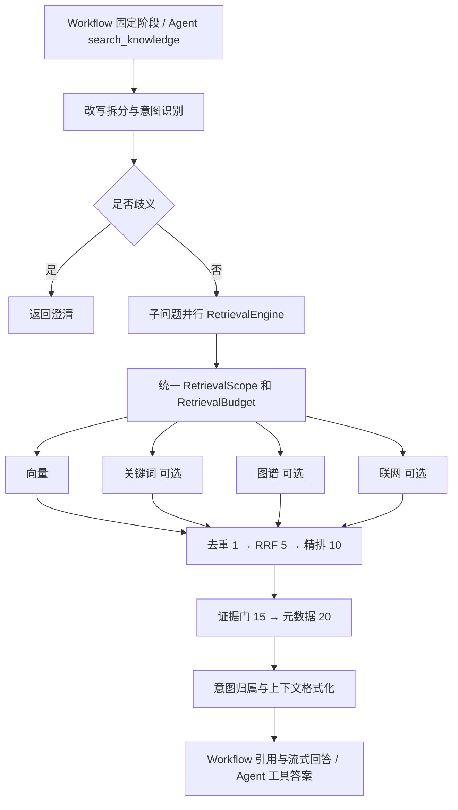

# 多通道 RAG 检索：源码证据与面试深挖

> 研究范围：当前工作区源码静态审阅。配置值来自仓库 [bootstrap/src/main/resources/application.yaml](../bootstrap/src/main/resources/application.yaml)，不代表线上实际配置；本分项未执行测试、未连接模型或检索后端。以下“实现”不等于“默认启用”，也不等于真实效果已验证。

## 简历原文与真实性

**构建可插拔多通道 RAG 检索链，以意图作用域与补充召回、加权 RRF、模型精排和证据闸门串联检索漏斗，独立控制召回、候选池及上下文预算，并向 Agent 暴露知识检索工具。**

真实性等级 **A（代码直接证明）**。可写“实现多通道框架”，不可写“默认四路并行线上运行”；可写“控制候选和上下文规模”，不可写未经压测的延迟、吞吐或召回提升数字。不能写“自研向量数据库”“训练了 Reranker”“完全消除幻觉”“多租户知识权限隔离”“实现 LangGraph”。

## 代码证据索引

下表路径均相对于仓库根目录。为便于阅读，`R` 表示 `rag/src/main/java/com/nageoffer/ai/ragent/rag/`，`I` 表示 `infra-ai/src/main/java/com/nageoffer/ai/ragent/infra/`；后文引用沿用这两个精确前缀。行号是本次审阅定位点。

| 证据位置 | 类／函数 | 上下游与作用 |
|---|---|---|
| [R/service/KnowledgeSearchFacade.java:65](../rag/src/main/java/com/nageoffer/ai/ragent/rag/service/KnowledgeSearchFacade.java#L65) | `search` | Agent 工具入口；改写、意图、歧义、检索、合成；返回答案字符串 |
| [R/service/pipeline/StreamChatPipeline.java:82](../rag/src/main/java/com/nageoffer/ai/ragent/rag/service/pipeline/StreamChatPipeline.java#L82) | `execute` | Workflow 固定流水线；记忆→改写→意图→检索→来源→流式回答 |
| [R/core/rewrite/MultiQuestionRewriteService.java:78](../rag/src/main/java/com/nageoffer/ai/ragent/rag/core/rewrite/MultiQuestionRewriteService.java#L78) | `rewriteWithSplit` | 术语归一化，LLM 改写与拆分，失败回退 |
| [R/core/intent/IntentResolver.java:52](../rag/src/main/java/com/nageoffer/ai/ragent/rag/core/intent/IntentResolver.java#L52) | `resolve` | 子问题并行分类与总意图数量控制 |
| [R/core/intent/DefaultIntentClassifier.java:151](../rag/src/main/java/com/nageoffer/ai/ragent/rag/core/intent/DefaultIntentClassifier.java#L151) | `classifyTargets` | 意图树叶子分类；AGENT 模式仅 KB 候选 |
| [R/core/guidance/IntentGuidanceService.java:68](../rag/src/main/java/com/nageoffer/ai/ragent/rag/core/guidance/IntentGuidanceService.java#L68) | `detectAmbiguity` | 歧义决策，命中则返回澄清而不检索 |
| [R/core/retrieval/RetrievalEngine.java:87](../rag/src/main/java/com/nageoffer/ai/ragent/rag/core/retrieval/RetrievalEngine.java#L87) | `retrieve` | 生成三段预算；并行构建子问题上下文 |
| [R/core/retrieval/MultiChannelRetrievalEngine.java:80](../rag/src/main/java/com/nageoffer/ai/ragent/rag/core/retrieval/MultiChannelRetrievalEngine.java#L80) | `retrieveKnowledgeChannels` | 单子问题统一作用域、并行通道、顺序后处理 |
| [R/core/retrieval/channel/RetrievalScopeResolver.java:54](../rag/src/main/java/com/nageoffer/ai/ragent/rag/core/retrieval/channel/RetrievalScopeResolver.java#L54) | `resolve` | 有效库范围、意图置信阈值、主／补充库集 |
| [R/core/retrieval/channel/KbCollectionProvider.java:45](../rag/src/main/java/com/nageoffer/ai/ragent/rag/core/retrieval/channel/KbCollectionProvider.java#L45) | `listActiveCollections` | 知识库表 `deleted=0`，不是用户 ACL |
| [R/core/retrieval/channel/VectorSearchChannel.java:113](../rag/src/main/java/com/nageoffer/ai/ragent/rag/core/retrieval/channel/VectorSearchChannel.java#L113) | `retrieveDirected` | 一次 Embedding，定向与补充范围检索 |
| [R/core/retrieval/channel/ScopeQuota.java:45](../rag/src/main/java/com/nageoffer/ai/ragent/rag/core/retrieval/channel/ScopeQuota.java#L45) | `split` | 固定保留补充路额度 |
| [R/core/retrieval/postprocessor/DeduplicationPostProcessor.java:56](../rag/src/main/java/com/nageoffer/ai/ragent/rag/core/retrieval/postprocessor/DeduplicationPostProcessor.java#L56) | `process` | 按 Chunk ID／文本摘要去重 |
| [R/core/retrieval/postprocessor/FusionPostProcessor.java:100](../rag/src/main/java/com/nageoffer/ai/ragent/rag/core/retrieval/postprocessor/FusionPostProcessor.java#L100) | `fuseByRrf` | 按各通道原始名次加权累计 |
| [R/core/retrieval/postprocessor/RerankPostProcessor.java:64](../rag/src/main/java/com/nageoffer/ai/ragent/rag/core/retrieval/postprocessor/RerankPostProcessor.java#L64) | `process` | 候选送模型精排，取最终 Top-K |
| [R/core/retrieval/postprocessor/EvidenceGatePostProcessor.java:76](../rag/src/main/java/com/nageoffer/ai/ragent/rag/core/retrieval/postprocessor/EvidenceGatePostProcessor.java#L76) | `process` | 批级最高精排分门槛 |
| [R/core/retrieval/postprocessor/MetadataEnrichmentPostProcessor.java:66](../rag/src/main/java/com/nageoffer/ai/ragent/rag/core/retrieval/postprocessor/MetadataEnrichmentPostProcessor.java#L66) | `process` | 精排后批量补文档元数据 |
| [R/core/retrieval/KnowledgeRetrievalResult.java:60](../rag/src/main/java/com/nageoffer/ai/ragent/rag/core/retrieval/KnowledgeRetrievalResult.java#L60) | `eligibleIntentIds` | 定向意图需有最终存活证据才继续具备提示词资格 |
| [R/core/prompt/DefaultContextFormatter.java:51](../rag/src/main/java/com/nageoffer/ai/ragent/rag/core/prompt/DefaultContextFormatter.java#L51) | `formatKbContext` | 证据去重、按文档组织、限制最终条数 |
| [R/core/prompt/RAGPromptService.java:98](../rag/src/main/java/com/nageoffer/ai/ragent/rag/core/prompt/RAGPromptService.java#L98) | `buildStructuredMessages` | system、history、证据与问题合并的 user 消息 |
| [R/core/source/SourcesAssembler.java:61](../rag/src/main/java/com/nageoffer/ai/ragent/rag/core/source/SourcesAssembler.java#L61) | `assemble` | Workflow 来源编号与来源面板资料 |

## 1. 这个功能解决什么问题

语义召回擅长近义表达，却可能遗漏精确术语；关键词召回能补专有名词但缺乏语义泛化。意图收窄能减少噪声，又可能把正确库排除。单纯返回“最相似十条”无法证明库里真的有答案。项目将范围、召回模态、融合、精排和证据可用性分开处理，而不是一个向量查询直接拼 Prompt。证据见作用域解析器、各通道和后处理链。

## 2. 为什么项目需要它

项目同时保留 Workflow 与 Agent 两种编排。检索是可复用的知识能力：Workflow 在固定阶段调用；Agent 通过 `KnowledgeSearchFacade.search` 将它作为工具调用。门面不携带历史，依赖主 Agent 传入消解指代后的查询，再返回合成答案；因此这里是 Agent 工具内部的检索流水线，不是独立的 ReAct 循环（`KnowledgeSearchFacade.java:65`）。

## 3. 整体架构



顺序以 `getOrder()` 为准。`RerankPostProcessor` 注释说“最后执行”，但实际还有 order=15 与 20，面试应依据实现解释。

## 4. 完整执行流程

1. `KnowledgeSearchFacade.search(query)` 或 `StreamChatPipeline.execute(ctx)` 接收查询。
2. `MultiQuestionRewriteService.rewriteWithSplit` 先术语归一化；启用改写时调用 FAST 档模型返回 `rewrite/sub_questions`；调用或解析失败回退归一化原问题。
3. `IntentResolver.resolve` 为子问题异步分类；`DefaultIntentClassifier` 在 AGENT 模式只识别 KB 叶子节点，Workflow 保留 SYSTEM/KB/MCP。
4. 歧义引导命中则停止知识召回。Workflow 还会将纯 SYSTEM 问题交给系统回答路径。
5. `RetrievalEngine.retrieve` 统一计算预算，并在 `ragContextExecutor` 并行构造每个子问题上下文。
6. `MultiChannelRetrievalEngine` 为该子问题计算一次 `RetrievalScope`，确保向量、关键词和图谱范围同源。
7. 启用通道并行执行。向量定向与补充路共用一次查询向量；关键词按 collection_name 过滤；图谱调用外部 LightRAG；联网调用 You.com。
8. 去重→融合粗排并截候选池→精排→证据门→元数据富化。
9. 按最终存活 Chunk 的 collection 推导意图归属；定向检索未命中的意图不再拥有专属 Prompt 资格。
10. 按子问题组织 KB/MCP 上下文。AGENT 模式此检索引擎不执行 MCP；Workflow 可以执行。
11. Workflow 建来源编号、注入引用、调用 `streamChat`；Agent 门面移除内部 docId，禁止角标规则，调用 `chat` 返回纯文本工具结果。

## 5. 对应代码文件

除上方索引外，后端文件为 [R/core/vector/PgVectorRetrieverService.java:71](../rag/src/main/java/com/nageoffer/ai/ragent/rag/core/vector/PgVectorRetrieverService.java#L71)、[R/core/vector/MilvusVectorRetrieverService.java:58](../rag/src/main/java/com/nageoffer/ai/ragent/rag/core/vector/MilvusVectorRetrieverService.java#L58)、[R/core/keyword/EsKeywordRetrieverService.java:57](../rag/src/main/java/com/nageoffer/ai/ragent/rag/core/keyword/EsKeywordRetrieverService.java#L57)、[R/core/graph/LightRagClient.java:87](../rag/src/main/java/com/nageoffer/ai/ragent/rag/core/graph/LightRagClient.java#L87) 和 [R/core/retrieval/channel/WebSearchChannel.java:103](../rag/src/main/java/com/nageoffer/ai/ragent/rag/core/retrieval/channel/WebSearchChannel.java#L103)。持久化实现为 [R/core/vector/PgVectorStoreService.java:42](../rag/src/main/java/com/nageoffer/ai/ragent/rag/core/vector/PgVectorStoreService.java#L42) 与 [R/core/vector/MilvusVectorStoreService.java:55](../rag/src/main/java/com/nageoffer/ai/ragent/rag/core/vector/MilvusVectorStoreService.java#L55)；统一存取接口使业务检索无需直接依赖具体数据库 SDK。

## 6. 核心类和函数

最关键的接口边界是 `SearchChannel`（召回）、`SearchResultPostProcessor`（后处理）与 `VectorRetrieverService`（后端）。`MultiChannelRetrievalEngine` 管派发和融合，不关心 PG/Milvus 的查询语法。`RetrievalScopeResolver` 管范围而非模态。`KnowledgeRetrievalResult` 同时带证据与归属，避免仅凭“意图分高”启用不相关专属提示词。

[R/core/retrieval/MultiChannelRetrievalEngine.java:104](../rag/src/main/java/com/nageoffer/ai/ragent/rag/core/retrieval/MultiChannelRetrievalEngine.java#L104) 按库而不是按召回来源归属意图：一个库绑定多个意图时可以多归属；来自补充库的证据无定向意图归属；全局作用域整体无归属。但 `eligibleIntentIds` 对未进入定向范围的候选意图并非一概删除，不能将其简化成“所有 Prompt 必须严格有证据”。

## 7. 输入输出

| 层 | 输入 | 输出 |
|---|---|---|
| 改写 | 原问题、可选历史 | `RewriteResult(rewrittenQuestion, subQuestions)` |
| 意图 | 每个子问题 | `SubQuestionIntent(question, nodeScores)` |
| 作用域 | 子问题意图、有效库 | `RetrievalScope(directed, topScore, intents, targetCollections, supplementCollections)` |
| 通道 | `SearchContext` | `SearchChannelResult(chunks, channelType, latencyMs, metadata)` |
| 多通道引擎 | 单子问题、预算 | `KnowledgeRetrievalResult(chunks, intentIdsByChunkKey, directedIntentIds)` |
| 检索引擎 | 所有子问题 | `RetrievalContext(kbContext, mcpContext, intentChunks, eligibleIntentIds)` |
| Agent 门面 | 独立查询字符串 | 合成答案／澄清／无结果提示字符串 |

## 8. 调用关系

```text
KnowledgeSearchFacade.search
  → QueryRewriteService.rewriteWithSplit
  → IntentResolver.resolve → DefaultIntentClassifier.classifyTargets
  → IntentGuidanceService.detectAmbiguity
  → RetrievalEngine.retrieve
    → buildSubQuestionContext → retrieveAndRerank
      → MultiChannelRetrievalEngine.retrieveKnowledgeChannels
        → RetrievalScopeResolver.resolve
        → executeSearchChannels → SearchChannel.search
        → executePostProcessors → process（按 order）
        → deriveAttribution
      → KnowledgeRetrievalResult.eligibleIntentIds / groupByIntent
      → DefaultContextFormatter.formatKbContext
  → CitationContextEnricher.stripDocIdAnchors
  → RAGPromptService.buildStructuredMessages(..., false)
  → LLMService.chat → 工具文本返回主 Agent
```

## 9. 数据如何流转

向量和 ES 的 Chunk ID 与本地分块主键对齐。[framework/src/main/java/com/nageoffer/ai/ragent/framework/convention/RetrievedChunkKey.java:30](../framework/src/main/java/com/nageoffer/ai/ragent/framework/convention/RetrievedChunkKey.java#L30) 优先 ID，缺 ID 才 SHA-256(text)。因此这里只能保证键相同的去重，不是语义去重，也不保证不同 ID 的相同内容被去掉。

通道原始结果保留名次，去重只是生成代表列表；RRF 从原始各路结果累计贡献。精排 `BaiLianRerankClient.java:166` 用 `toBuilder()` 保留 collection/doc 字段，将结果写入 `score` 和独立 `rerankScore`，后者专供证据门。元数据富化延迟到候选收敛之后，降低回表范围。最终 `DefaultContextFormatter.java:211` 限条数并按文档合并；Workflow `SourcesAssembler` 构造文档来源。

## 10. 核心技术原理

**RRF：** `score(d)=Σ w_c/(k+rank_c(d))`，rank 从 1 起。项目 k=20，向量/关键词权重1，YAML 图谱0.8、联网0.5；Java 属性类图谱初值0.5，不能与 YAML 覆盖值混淆（`SearchChannelProperties.java:315`）。余弦与 BM25 量纲不一致，直接相加没有稳定意义；RRF 只比较各路名次。代价是忽略原分数差距，不能表达头名遥遥领先。

**示例：** 同一 Chunk 向量第1、关键词第3，等权时融合分为 `1/21+1/23≈0.0911`；仅向量第1约0.0476。该值是融合排序分，不是答案正确概率。单通道走候选截断，不做多路名次融合。

**预算：** 默认召回20、候选池40、最终10。预算不是严格“20→40→10”单调数字链：20是每通道产出基数，多路并集可以大于40。约束是 recall≥context 且 candidate≥context；候选池≤0表示不限。多子问题分别有Top-K，因此整请求上下文可达子问题数×10，不是总请求最多10。配置与构造证据：`application.yaml:152`、`RetrievalEngine.java:97`。

**补充召回：** 高置信定向时，从通道预算中固定切25%给未命中库；20条常为15主路+5补充。它保证通道出口候选席位，不保证经过 RRF/精排后仍保留。向量节点 `topK` 可覆盖定向深度，随后受候选池上限钳制，不会抬高最终上下文Top-K。

**证据门：** 最高有限 `rerankScore<0.2` 则整批丢弃；只要一条过线就保留整批，因此不能说“逐条过滤低分证据”。缺分/NaN等全无有效分时告警放行；阈值需要按精排模型与语料校准。启用门却禁用精排会启动失败（`EvidenceGatePostProcessor.java:50`）。

**向量检索：** PG 使用 `1-(embedding <=> query)` 得余弦相似度；按 collection IN 过滤后 LIMIT 总Top-K，代码尝试配置 `hnsw.ef_search=200`、`hnsw.iterative_scan=relaxed_order`（`PgVectorRetrieverService.java:71`）。通道层重新按分排序后截断。Milvus 使用共享物理集合，逻辑库字段过滤。Embedding 维度相同不保证不同模型向量空间可互换，不能把多模型路由自然等同于索引兼容。

## 11. 为什么采用当前方案

维护性：通道新增主要实现接口，不需要修改每个调用方。稳定性：通道错误降为空，补充路失败不会带走主路。成本：模型精排前限制候选池，回表在精排后。可解释性：意图分控制范围，融合分控制候选排名，精排分控制证据门，三把尺子分开。

这是由架构合理归纳出的设计取舍（B），不能声称作者做过某个未提供的 A/B 实验。源码明确落实的是这些机制（A）。

## 12. 有哪些替代方案

当前推荐仍是保留可插拔召回与精排漏斗，通过真实标注集调参。面试比较时：仅向量更简单但术语弱；归一化分数加权能利用分差但需跨路校准；学习排序依赖训练数据；端到端 LLM 对所有候选排序成本高；统一检索后端的原生混合搜索可减少网络调用但提高后端耦合；Agent 自主反复改写检索更灵活，也增加延迟与循环终止问题。本项目内部是确定的检索流水线，是否再次搜索由上层 Agent 决策。

## 13. 当前方案优缺点

优点包括职责解耦、预算可独立调节、意图误判有补充召回、结果附带归属、失败可降级。限制包括串行的改写与分类 LLM 开销、各通道截断损失、RRF 不保留分差、模型精排收费、批级门槛容许弱证据混入。所有这些是机制分析，不代表测得的线上瓶颈排名。

默认运行形态必须明确：`application.yaml:83` 为 PG；keyword.type=none，graph.type=none；向量开、关键词/图谱/联网关（`:164`起）；改写、精排和引用开（`:109`起）。所以默认只有向量召回，不应把多通道潜能写成当前四通道实测成果。

## 14. 异常情况怎么处理

改写请求或 JSON 解析失败用归一化问题回退；子问题分类异常回空意图，从而允许全局检索；无有效绑定库回全局有效库。通道异常返回空结果；后处理器异常由引擎 catch 后跳过该处理器继续执行（`MultiChannelRetrievalEngine.java:201`），这不是严格 fail-closed。精排可路由 noop：只截断、不出精排分，证据门因无分放行（[I/rerank/NoopRerankClient.java:37](../infra-ai/src/main/java/com/nageoffer/ai/ragent/infra/rerank/NoopRerankClient.java#L37)）。所有知识为空时门面返回无结果提示。

Workflow MCP 提参缺必填项不调用远端、注入澄清文本；提参失败生成错误内容；AGENT 下检索链不执行 MCP，避免绕过 Agent 的工具确认/技能可见性路径（`RetrievalEngine.java:175`起）。

## 15. 性能问题

分层并发包括子问题、通道、通道内补充／跨库，能缩短等待链但会放大后端请求数。`MultiChannelRetrievalEngine.java:251` 的 `orTimeout` 只放弃结果，后台任务仍继续，15秒不能解释为“已释放所有后端资源”。精排、回表和多个子问题总耗时也不受这一个通道期限完全约束。

PG 的 SET 语句通过独立 `JdbcTemplate.execute` 发出，紧接着另一次 `query`；这里未见事务绑定，不能仅凭连续调用断言这些设置一定作用在同一连接。需实测连接池下的会话设置，生产可在同一事务/连接上设本地参数。此处是静态代码风险，不是已复现缺陷。

## 16. 生产环境可能遇到的问题

1. 权限：`KbCollectionProvider` 仅过滤未删除库，没有用户/租户字段条件。因此“作用域一致”是相关性范围，不是权限边界。后续若做私有库，必须把授权库集与范围求交，并让每个后端强制过滤。
2. 图谱：LightRAG 单实例全图查询后按 file_path 过滤，不是请求级子图隔离（`LightRagClient.java:350`）。定向场景 `GraphSearchChannel` 将 unmatched 作为补充候选，而 unmatched 也可能包含已删除库或无法解析归属的证据；需先限定为有效且授权的补充库。默认图谱关闭，不能把此风险描述为已发生线上泄露。
3. 提示词注入：检索文本被放在 user 证据区域有助角色分离，但不等于清除了文档中的恶意指令（`RAGPromptService.java:98`）。
4. 超时堆积：请求已返回而底层任务占池，可能降低后续请求容量。
5. 多库模型兼容：不同模型即便同维度也不能无条件混查；需要索引版本、Embedding 模型标识与重建流程。
6. 默认模型API密钥、ES/LightRAG服务与真实语料可用性不在静态代码证明范围内。

## 17. 可以怎么优化

优先建立标注集，包含正确库、正确分块、跨库问题、无答案问题、歧义问题和攻击文档。分别记录 Recall@K、MRR/nDCG、拒答精确率/召回率、最终答案有据率、首字/总耗时和调用成本，再调补充比例、候选池与门槛。

接着统一用户授权库过滤；修正图谱补充候选的有效库边界；实施请求总 deadline、底层 HTTP/数据库超时和可取消任务；对子问题数与总上下文 token 设置上限；确保 PG 参数在同一连接生效；把空结果区分成“无资料”“后端超时”“被证据门拒绝”。这些是改进建议，不能提前写成已完成能力。

## 18. 直接相关知识

需要讲清：dense retrieval 与 BM25、余弦相似度、ANN近似召回、HNSW搜索参数、RRF、粗排与精排、query rewriting、query decomposition、scope routing、候选预算、批级相关性门槛、文档来源归因。精排模型由外部服务提供；当前代码没有证明其训练方法或内部网络结构，不能将通用 cross-encoder 知识说成仓库自行实现。

## 19. 延伸知识

可进一步讨论 HyDE、multi-query、查询扩展、late interaction、学习排序、跨语言检索、过滤ANN召回下降、索引版本迁移、答案与引用一致性评估、Prompt injection、检索侧ABAC、全局deadline传播、bulkhead隔离、背压、观察数据分布漂移。以上为面试延伸，不在本仓库实现清单中自动打勾。

## 20. 八个深度面试问答

**Q1：为什么不用向量分加 BM25 分？**

A：不同检索器分数尺度和分布不一致，直接加权可能使某一路因数值范围占优。项目使用各通道原始排名做加权RRF，消除尺度依赖；代价是丢失分差信息。`FusionPostProcessor.fuseByRrf` 按键累加 `w/(k+rank)`，不是把归一化分数相加。若进一步追问：可用标注集校准归一化权重或训练排序，但这不是当前实现。

**Q2：先去重为什么不会失去多路命中奖励？**

A：去重产生最终代表列表，但原始 `SearchChannelResult` 列表仍保留；RRF从各原始列表读取排名，向同一key累加贡献。ID相同时保留首次对象，之后统一回写融合分。注意ID是语义契约，不同通道同一资料ID不同无法自然合并；当前没有语义去重。

**Q3：意图识别错了怎么办？**

A：置信不足全局检索；达到0.6才收窄，参与判断的意图最低0.4；定向仍给未命中库25%名额，弥补高置信误判。补充名额只保证进入通道输出，可能被融合或精排淘汰。LLM给的意图分不等于经过统计校准的置信概率，需要离线校准和错例分析。

**Q4：20、40、10为什么不是一路严格递减？**

A：20是每通道召回基数，多路合并可能超过40；40约束精排入参成本；10约束单子问题最终上下文。默认只开向量时可能召回20后全部进入精排。多子问题总量并非10，所以还应新增整请求token预算。node.topK只覆盖向量定向召回，不能推高最终上下文。

**Q5：证据门如何保证不幻觉？**

A：它不能保证。它只在批次最高有效精排分不足0.2时丢弃整批，降低无答案时噪声入Prompt机会。任何一条过线全批通过，noop无分也放行。因此它是可用性优先的相关性启发式。必须评估不同阈值的误拒答/误回答，不能将模型分看成事实正确概率。

**Q6：15秒超时是否真正取消查询？**

A：没有。`orTimeout` 让未来结果异常完成，`exceptionally` 转空结果，底层供应任务未被中断；返回快不等于资源释放。需要把总deadline传到底层HTTP/JDBC，并结合可取消句柄、连接超时和并发隔离。Workflow输出阶段绑定的流式取消句柄也不能证明前面所有检索任务已取消。

**Q7：图谱是否支持多租户隔离与多跳推理？**

A：这里只能说接入了LightRAG图谱召回适配器。单实例查询全图，按引用file_path结果侧分组；没有实现本地多跳图算法，也未实现请求级子图/租户隔离。图谱默认关闭。真正隔离需要授权范围过滤甚至按租户实例/工作空间，不能拿相关性scope冒充安全权限。

**Q8：Agent为什么工具里还要调一次LLM合成，不能直接返回chunks吗？**

A：当前门面选择返回本次证据下的知识答案，使上层Agent得到较紧凑工具文本；缺点是增加模型调用，并可能在“证据→工具答案→最终答案”二次压缩中丢失来源和细节。门面特意不加载历史、不输出角标，并清除docId，主Agent负责指代与最终编排。若重视可追溯，可让工具返回结构化证据及source id，但那需要明确改造工具契约，当前没有。

## 独立知识树

```text
多通道 RAG 检索
├── 查询理解
│   ├── 术语归一化、指代消解、拆分
│   ├── 结构化 JSON 解析与失败回退
│   └── 意图分类、歧义澄清、分数校准
├── 检索范围
│   ├── 有效库、定向库、补充库
│   ├── 固定补充名额与检索预算
│   └── 相关性范围 ≠ 用户授权范围
├── 召回
│   ├── 向量：Embedding、余弦、HNSW、PG/Milvus
│   ├── 关键词：BM25、分词、ES filter
│   ├── 图谱：LightRAG references、结果侧归属
│   └── 联网：外部 API、超时与降级
├── 排序与证据
│   ├── ID/文本摘要去重
│   ├── 加权 RRF、原始通道排名
│   ├── 候选池→模型精排→Top-K
│   ├── 独立 rerankScore、批级证据门
│   └── 意图归属、文档元数据、引用
├── 工程
│   ├── 插件接口、条件装配、配置校验
│   ├── 分层并发、超时非取消、总deadline
│   ├── noop降级与fail-open权衡
│   └── Agent门面 / Workflow复用
└── 评估延伸
    ├── Recall@K、MRR、nDCG
    ├── 无答案与阈值校准
    ├── 延迟、成本、通道存活率
    └── 权限、注入防护、索引模型版本
```

## 已有测试证据与未验证边界

以下是已检查的测试源代码，不表示本次测试执行成功。

| 测试文件（相对根目录） | 关键证据 |
|---|---|
| [rag/src/test/java/com/nageoffer/ai/ragent/rag/service/KnowledgeSearchFacadeTest.java:77](../rag/src/test/java/com/nageoffer/ai/ragent/rag/service/KnowledgeSearchFacadeTest.java#L77) | docId移除；`:96` 无历史；`:118` 无意图仍保留以便全局召回；`:149` 歧义不检索 |
| [rag/src/test/java/com/nageoffer/ai/ragent/rag/core/retrieval/MultiChannelRetrievalEngineTest.java:55](../rag/src/test/java/com/nageoffer/ai/ragent/rag/core/retrieval/MultiChannelRetrievalEngineTest.java#L55) | 最终证据归属；`:90` 同库多归属；`:107` 全局无归属；`:122` 定向超时保留范围并降为未命中 |
| [rag/src/test/java/com/nageoffer/ai/ragent/rag/core/retrieval/channel/RetrievalScopeResolverTest.java:43](../rag/src/test/java/com/nageoffer/ai/ragent/rag/core/retrieval/channel/RetrievalScopeResolverTest.java#L43) | 高分收窄、低分全局、已删除绑定、意图去重与最高分 |
| [rag/src/test/java/com/nageoffer/ai/ragent/rag/core/retrieval/postprocessor/EvidenceGatePostProcessorTest.java:65](../rag/src/test/java/com/nageoffer/ai/ragent/rag/core/retrieval/postprocessor/EvidenceGatePostProcessorTest.java#L65) | 无分放行；`:79` 低分整批拒绝；`:86` 批最高值；`:93` 阈值边界；`:122` 禁精排却开门启动拒绝 |

目录中另有 VectorSearchChannel、KeywordSearchChannel、GraphSearchChannel、ScopeQuota、Deduplication 与 PG 检索单测；它们的存在不是生产有效性的证明。尚未获得真实服务联调、标注集效果、压测、租户攻击测试或线上指标，简历不可补写这些结果。
