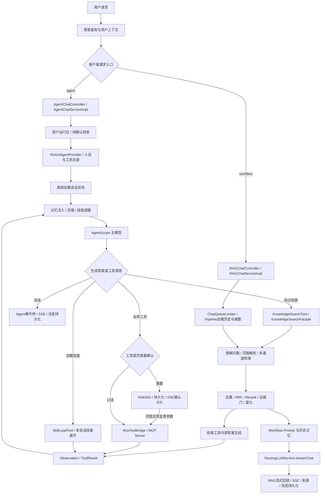
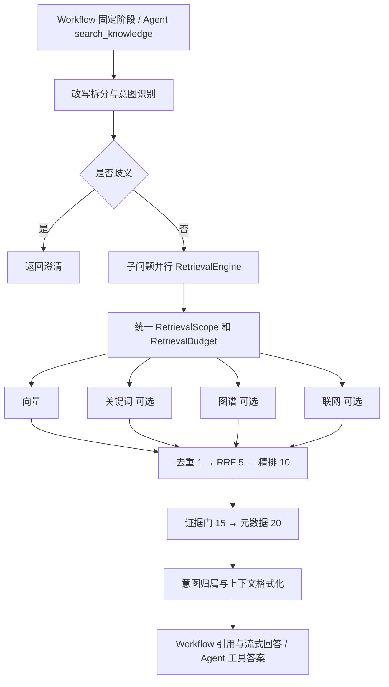
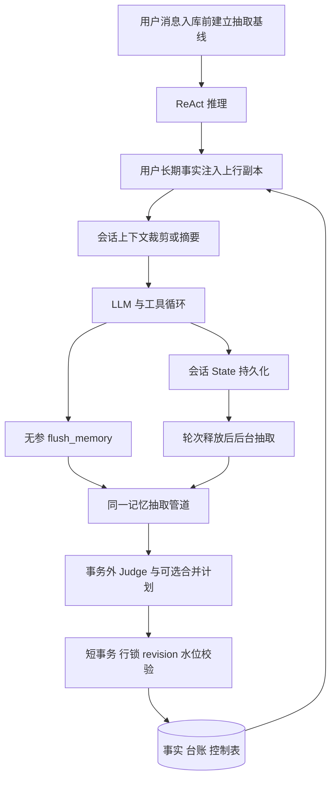
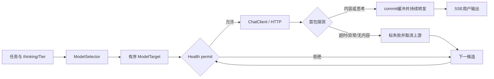

# Ragent：AI Agent 岗位五个核心亮点与源码面试手册

> 分析日期：2026-09-21。源码基线：`bffe0e80`。本文以当前工作区源码和配置为准，不以 README 宣传语代替实现证据。分析对象是项目能力，仓库不能证明候选人的个人贡献；下面五条只有在实际实现或实质改造过对应模块时，才能以个人项目经历使用。没有实测支撑的性能数字不写入简历。

## 阅读导航

- [最终简历五点](#resume)
- [全项目扫描与完整调用链](#scan)
- [核心点 1：ReAct 执行架构](#point-1)
- [核心点 2：MCP 工具与人工确认](#point-2)
- [核心点 3：多通道 RAG 检索](#point-3)
- [核心点 4：上下文与长期记忆](#point-4)
- [核心点 5：模型路由与流式容错](#point-5)
- [面试演练与验证计划](#practice)

本手册的每个核心点都包含：简历原文、真实性等级、代码证据、表述边界、20 项深挖、独立知识树及面试问答。源码定位补充见 [Agent / MCP 证据](ai-agent-evidence-agent-tools.md)、[检索证据](ai-agent-evidence-retrieval.md)、[记忆证据](ai-agent-evidence-memory.md)。

<a id="resume"></a>

## 一、最终简历五点

**项目名称：Ragent——基于 Java 的 Agentic RAG 与业务工具执行平台。**

**项目简介：** 面向知识问答与业务办理，提供固定 RAG Workflow 和 AgentScope ReAct 两种执行入口，将知识检索、远程 MCP 工具、按需加载的技能、会话状态和人工确认串成可追踪的任务链路。

**技术栈：** Java 17、Spring Boot 4.1.0、AgentScope Java 2.0.2、Reactor、MCP Java SDK 1.1.2、PostgreSQL / pgvector、Redis / Redisson、MyBatis-Plus、SSE、RocketMQ、React 18 / TypeScript。可选能力包括 Milvus、Elasticsearch、LightRAG / Neo4j、OpenTelemetry / Langfuse、S3 兼容存储 / OSS。版本来自项目依赖声明，表示源码依赖，不表示本机安装或兼容性测试通过。

1. **构建 AgentScope ReAct 执行链路，将知识检索、MCP 与 Skills 纳入统一工具目录，结合 PostgreSQL 会话状态、迭代约束和 SSE 事件桥，支持多轮工具决策与可中断任务执行。**
2. **打通 MCP 工具发现、Schema 桥接与身份透传，对写操作及未知只读属性工具接入人工确认，从服务端持久化状态恢复调用参数，降低客户端篡改与未确认执行风险。**
3. **构建可配置的向量、关键词、图谱与联网多通道检索，串联去重、加权 RRF、Rerank 和证据门控，以分阶段候选预算及通道超时隔离约束检索成本与故障影响。**
4. **设计工具结果裁剪、会话摘要和用户长期记忆三层上下文机制，以 revision 与会话水位双校验提交记忆变更，并通过容量合并与淘汰控制跨会话事实积累。**
5. **为 RAG 模型调用构建档位路由、候选降级与三态熔断，流式首包探测成功后再提交输出，并区分取消与故障，避免失败候选污染输出及取消误伤模型健康状态。**

这些结果是“支持什么行为、约束什么风险”的机制性结论，不是准确率、QPS、延迟改善的实测结论。若仅做源码学习，应把项目性质写成“开源项目研读与复现实验”，并将动作替换为真实完成的验证或改造，不直接冒认原作者的实现。

<a id="scan"></a>

## 二、全项目扫描与选点依据

### 2.1 分析方法与实施记录

实施顺序为：盘点目录与依赖 → 核对启动配置 → 追踪两条问答链路 → 阅读工具、记忆、检索、模型和测试 → 核对摄取、鉴权、并发、追踪与部署 → 筛选五点 → 编写证据与面试材料 → 静态自检。

这是文档任务，不修改业务行为、不新增依赖。文件级扫描覆盖七个后端模块和前端、资源、测试目录；核心执行链路逐函数分析，普通管理 CRUD 只做职责与边界核对，不能把“全项目扫描”理解为所有代码均通过审计。已有三份未提交简历文档保持不变。

| 模块 | Java 主源码文件 | Java 测试目录文件 | 与五点的关系 |
|---|---:|---:|---|
| framework | 44 | 7 | SSE、取消协议、用户上下文、幂等、MQ 基础能力 |
| infra-ai | 52 | 4 | 模型客户端、路由、熔断、Embedding、Rerank |
| system | 41 | 0 | 登录认证、用户上下文、审计 |
| rag | 467 | 61 | Workflow、检索、知识摄取、MCP 客户端、Prompt、评测入口 |
| agent | 95 | 29 | ReAct 装配、状态、工具、Skills、记忆、事件与确认 |
| bootstrap | 1 | 0 | 启动类和主配置 |
| mcp-server | 63 | 9 | 独立 MCP 服务及业务工具示例 |

统计来自本次工作区文件扫描；测试目录文件数不等于测试类数或通过数。检测到 644 个 `@Test` 标记，不包括参数化用例展开，也不是覆盖率。前端 `src` 有 143 个文件。项目使用 Maven，没有将其误判为 Python / LangChain 项目；未发现项目级 `requirements.txt` 或 `pyproject.toml`。

### 2.2 扫描覆盖表

以下路径均相对仓库根目录，完整类路径可在文末源码索引查询。

| 关注项 | 实际证据与结论 | 面试归属 |
|---|---|---|
| README、依赖、入口 | 根 [README.md](../README.md)、各模块 [pom.xml](../pom.xml)、[frontend/package.json](../frontend/package.json)、`RagentApplication` | 架构背景 |
| 配置与模式 | [bootstrap/src/main/resources/application.yaml](../bootstrap/src/main/resources/application.yaml)，`ragent.engine.type=agent`；Agent 入口按引擎条件装配，RAG `/rag/v3/chat` 仍注册 | 点 1 |
| Agent / Planning | `ReActAgentProvider` 构造框架 `ReActAgent`；没有据此推断另有 Planner / Critic Agent | 点 1 |
| Workflow | `StreamChatPipeline`；固定问题理解、检索、生成流程 | 点 1 / 3 |
| Prompt | `AgentPromptResolver`、`RAGPromptService`、`rag/src/main/resources/prompt/*.st`；部分人设、技能、摘要规则来自数据库槽位 | 点 1 / 3 / 4 |
| Tool / MCP | `AgentToolCatalog`、`McpToolBridge`、`McpClientAutoConfiguration`、`McpClientToolExecutor`、独立 `mcp-server` | 点 2 |
| Memory / Context | `agent/memory`；另有 Workflow 的 `JdbcConversationMemory*`，不可混为同一机制 | 点 4 |
| Embedding / Vector | `RoutingEmbeddingService`、`PgVectorRetrieverService`、`MilvusVectorRetrieverService`；当前 `rag.vector.type=pg` | 点 3 / 5 |
| Reranker | `RerankPostProcessor`、`RoutingRerankService`；已配置 rerank-noop 候选，降级仅截断、不产生精排分 | 点 3 / 5 |
| 摄取 | `DefaultIngestionKernel.run`：类型识别→解析→分块→向量化→索引；`KnowledgeDocumentChunkConsumer` 消费任务 | 点 3 的上游 |
| Pipeline | `IngestionEngine.execute` 实现链式执行和环检测；`KnowledgeDocumentServiceImpl.executeChunk` 对 PIPELINE 模式显式报“管道模式重构中，暂不可用” | 不作为独立亮点 |
| Database | [resources/database/schema_pg.sql](../resources/database/schema_pg.sql)、升级脚本、Mapper；保存知识、消息、Agent 状态、记忆和追踪 | 点 1 / 3 / 4 |
| Cache | Redis 取消标记/属主/限流；人设、Skills、意图缓存和 Provider 实例缓存各有生命周期 | 点 1 / 2 / 4 |
| Async / Concurrency | `ThreadPoolExecutorConfig`、Reactor、CompletableFuture、`AgentRunGate`；线程隔离不自动等于全局限流 | 五点共同约束 |
| Streaming | Agent 事件桥与 RAG 回调两套适配；`SseEmitterSender`；前端 `agentService.ts` / `chatService.ts` 消费事件 | 点 1 / 5 |
| Evaluation | `EvalController` 返回检索 ID、文本与耗时；`resources/regression/agent-memory` 提供真实服务回归脚本 | 验证计划 |
| Logging / Tracing | RAG AOP Trace、Agent OTel；`agent.trace.enabled=false`，不能说默认已上报 Langfuse | 点 1 / 5 的诊断 |
| Security | Sa-Token、会话属主、确认参数恢复、业务工具校验；尚不能宣称完备多租户知识 ACL / 防注入体系 | 点 2 / 3 / 4 |
| Docker / Deployment | `resources/docker` 提供 Milvus、RocketMQ、LightRAG、Langfuse 等 Compose；配置文件存在不等于生产 HA 已验证 | 部署背景 |
| Tests | 工具、记忆、检索、路由、取消等测试；本机缺 Java Runtime，未执行 JVM 测试或在线压测 | 验证边界 |

### 2.3 两条完整请求链路



Workflow 还包含 SYSTEM 回答与歧义澄清的早退分支；图中聚焦进入检索的主路径。图中的 `RET/F` 表示复用的检索组件，分支由各自调用者决定，不表示同一次请求同时进入所有出口。Agent 的知识工具会内部合成回答，再把文本作为观察返回主 Agent；不是把原始 TopK 文本直接原样注入主 Agent。Workflow 中也存在意图驱动的 MCP 编排，不能因此认定其等同于 ReAct 自主循环。

两条链路共享部分基础组件，但**入口限流、记忆模型、流式回调和模型调用路径均不能互相代领能力**。主 Agent 的 `OpenAIChatModel` 直接取 `agent.chat` 配置，RAG 内部生成和部分辅助任务才使用 `RoutingLLMService`。

### 2.4 为什么选这五点

| 候选能力 | Agent 技术含量 / 岗位匹配 | 工程与架构深度 | 代码证据 | 选择 |
|---|---|---|---|---|
| ReAct + Skills + 状态/流 | 高，直接回答 Agent 怎么运行 | 高，装配、状态、事件和并发边界 | 明确 | 第 1 点 |
| MCP + HITL | 高，连接真实外部行动 | 高，协议适配、身份、确认与恢复 | 明确 | 第 2 点 |
| 多通道 RAG | 高，直接影响证据质量 | 高，作用域、融合、预算和故障隔离 | 明确，但多通道需启用 | 第 3 点 |
| Context + 长期记忆 | 高，涉及长任务与跨会话行为 | 高，压缩、事实治理与并发一致性 | 明确 | 第 4 点 |
| 模型路由与流式容错 | 高，体现 AI 服务可靠性 | 高，首包提交边界、熔断和取消 | 明确，范围限定 RAG | 第 5 点 |
| 文档摄取 | 有价值，但与 Agent 自主决策关联较弱 | 较高，当前 Pipeline 上传入口受限 | 部分路径有约束 | 纳入点 3 上游 |
| Trace / SSE / 限流 | 工程价值高 | 较高 | 明确，启用与入口各异 | 融入五点，不再占名额 |
| CRUD / 控制台 | AI 区分度较低 | 常规工程 | 明确 | 不独立写 |
| LangGraph / Multi-Agent / 自研训练 | 名词匹配不足以构成项目经历 | 本项目无相应主链证据 | 不足 | 不写 |

<a id="point-1"></a>

## 三、核心点 1：ReAct 执行架构与按需技能

### 简历原文

> 构建 AgentScope ReAct 执行链路，将知识检索、MCP 与 Skills 纳入统一工具目录，结合 PostgreSQL 会话状态、迭代约束和 SSE 事件桥，支持多轮工具决策与可中断任务执行。

### 真实性等级

**A：代码直接证明上述机制；目的与风险改善的归纳为 B。** A=代码直接证明，B=合理归纳，C=需补实现或证据，D=不能写。个人贡献不在该等级自动证明范围内。

### 为什么可以这样写

框架构造、工具注册、状态存储与事件生命周期形成直接调用链。“支持多轮决策”来自已集成的 AgentScope，不是本仓自研算法；Redis 用户运行位跨节点互斥，但 TTL 无续租，不保证任意停顿下的严格互斥。

### 哪些词不能写

自研 ReAct 引擎、LangGraph、Multi-Agent、独立 Planner / Reflection、主 Agent 多模型熔断切换、断线无损续传、取消即回滚。

### 代码证据
|文件:行号|类/方法|直接证据|
|---|---|---|
|[agent/src/main/java/com/nageoffer/ai/ragent/agent/controller/AgentChatController.java:46](../agent/src/main/java/com/nageoffer/ai/ragent/agent/controller/AgentChatController.java#L46)|`chat/confirm/stop`|GET SSE 首问、POST 确认续跑、停止入口|
|[agent/src/main/java/com/nageoffer/ai/ragent/agent/service/impl/AgentChatServiceImpl.java:83](../agent/src/main/java/com/nageoffer/ai/ragent/agent/service/impl/AgentChatServiceImpl.java#L83)|`streamChat`|用户运行闸门、等待确认时禁止新问|
|[agent/src/main/java/com/nageoffer/ai/ragent/agent/service/impl/AgentChatServiceImpl.java:138](../agent/src/main/java/com/nageoffer/ai/ragent/agent/service/impl/AgentChatServiceImpl.java#L138)|`startRun`|解析 Agent、建立会话、写用户消息、构建输入|
|[agent/src/main/java/com/nageoffer/ai/ragent/agent/service/impl/AgentChatServiceImpl.java:221](../agent/src/main/java/com/nageoffer/ai/ragent/agent/service/impl/AgentChatServiceImpl.java#L221)|`launchStream`|RuntimeContext、任务注册、streamEvents 订阅与取消句柄|
|[agent/src/main/java/com/nageoffer/ai/ragent/agent/config/ReActAgentProvider.java:71](../agent/src/main/java/com/nageoffer/ai/ragent/agent/config/ReActAgentProvider.java#L71)|`getAgent/buildAgent`|persona 与目录指纹懒重建，Agent 与目录成对快照|
|[agent/src/main/java/com/nageoffer/ai/ragent/agent/config/ReActAgentProvider.java:113](../agent/src/main/java/com/nageoffer/ai/ragent/agent/config/ReActAgentProvider.java#L113)|`buildAgent`|ReAct 模型、工具、迭代与重试上限、PG Store、中间件|
|[agent/src/main/java/com/nageoffer/ai/ragent/agent/config/AgentEngineConfiguration.java:45](../agent/src/main/java/com/nageoffer/ai/ragent/agent/config/AgentEngineConfiguration.java#L45)|`agentChatModel`|独立 OpenAIChatModel、DeepSeek formatter、流式及结构化兼容选项|
|[agent/src/main/java/com/nageoffer/ai/ragent/agent/tool/AgentToolCatalog.java:79](../agent/src/main/java/com/nageoffer/ai/ragent/agent/tool/AgentToolCatalog.java#L79)|`resolve/buildToolkit`|知识检索、记忆刷写、技能加载、MCP 注册|
|[agent/src/main/java/com/nageoffer/ai/ragent/agent/skill/SkillLoadTool.java:113](../agent/src/main/java/com/nageoffer/ai/ragent/agent/skill/SkillLoadTool.java#L113)|`execute/success`|调用时获取手册正文，成功结果 metadata 标记技能|
|[agent/src/main/java/com/nageoffer/ai/ragent/agent/skill/AgentSkillMaskingMiddleware.java:77](../agent/src/main/java/com/nageoffer/ai/ragent/agent/skill/AgentSkillMaskingMiddleware.java#L77)|`onReasoning/maskedTools`|推理前过滤工具 schema；映射存于 RuntimeContext|
|[agent/src/main/java/com/nageoffer/ai/ragent/agent/skill/AgentSkillMaskingMiddleware.java:122](../agent/src/main/java/com/nageoffer/ai/ragent/agent/skill/AgentSkillMaskingMiddleware.java#L122)|`loadedSkillCodes`|只认成功且未被裁剪的 TOOL 结果标记|
|[agent/src/main/java/com/nageoffer/ai/ragent/agent/state/PgAgentStateStore.java:49](../agent/src/main/java/com/nageoffer/ai/ragent/agent/state/PgAgentStateStore.java#L49)|`save/get/getList`|框架 State JSON 编解码与持久化|
|[agent/src/main/java/com/nageoffer/ai/ragent/agent/dao/mapper/AgentStateMapper.java:36](../agent/src/main/java/com/nageoffer/ai/ragent/agent/dao/mapper/AgentStateMapper.java#L36)|`upsert`|以 user_id/session_id/state_key 冲突键保存 JSONB|
|[agent/src/main/java/com/nageoffer/ai/ragent/agent/service/handler/AgentRunGate.java:53](../agent/src/main/java/com/nageoffer/ai/ragent/agent/service/handler/AgentRunGate.java#L53)|`acquire/release`|Redis setIfAbsent、TTL 与按值比较释放|
|[agent/src/main/java/com/nageoffer/ai/ragent/agent/service/handler/AgentStreamEventBridge.java:151](../agent/src/main/java/com/nageoffer/ai/ragent/agent/service/handler/AgentStreamEventBridge.java#L151)|`onEvent`|正文、思考、工具、提示、确认、终答事件适配|
|[agent/src/main/java/com/nageoffer/ai/ragent/agent/service/handler/AgentRunHandle.java:169](../agent/src/main/java/com/nageoffer/ai/ragent/agent/service/handler/AgentRunHandle.java#L169)|`interruptUpstream/settle`|先框架中断等存盘，再强制 dispose；唯一收尾|

配置：[pom.xml:31](../pom.xml#L31) MCP SDK 1.1.2，`:32` AgentScope 2.0.2；[bootstrap/src/main/resources/application.yaml:43](../bootstrap/src/main/resources/application.yaml#L43) 主 Agent 固定 DeepSeek 模型、max-iters=10、max-retries=1、SSE 超时 900000ms。`AgentProperties.java:25` 明确单模型无 fallback；`:40` 说明重订阅会重放已发送文本。RAG 子系统的模型路由不能移植为主 Agent 特性。

### 1. 解决什么问题

复杂问题往往需要先检索、再查业务状态、再操作，单次 LLM 文本回答无法实际办事；同时工具多而描述长，全部暴露会增加误选与跳过前置步骤的机会。

### 2. 为什么项目需要

知识问答与购物、请假、预订等业务工具共享入口。Agent 需要根据观察结果决定下一步，也必须把等待确认、取消、部分失败展示为可信业务状态。

### 3. 整体架构

Spring MVC API → AgentChatServiceImpl → ReActAgentProvider → AgentScope ReActAgent；模型侧经过记忆、压缩、拒绝解释、技能遮蔽中间件，动作侧通过 Toolkit 调用知识检索/MCP；框架事件进入 AgentStreamEventBridge → SSE 与业务消息库。框架内部状态单独保存于 t_agent_state。

### 4. 完整执行流程

1. 从登录上下文读取 userId，生成 conversationId/taskId，取得用户级运行位。
2. 读取一次 prompt/目录快照，按指纹复用或重建 Agent；写入用户消息。
3. RuntimeContext 明确携带 userId/sessionId/taskId 及工具事实源。
4. 先发送 meta、登记任务取消回调，再订阅 `agent.streamEvents`。
5. 每次推理前注入用户记忆、压缩上下文、解释历史拒绝、重新计算技能遮蔽。
6. LLM 输出正文或工具调用；load_skill 返回操作手册，下一轮解锁相关工具；search_knowledge 返回检索后合成的答案文本；MCP 返回业务观察。
7. 框架把工具结果纳入后续推理，直到终答、要求确认或达到迭代边界。
8. Bridge 固化正文/思考/工具块，保存业务消息并发送终态；框架保存状态。释放时必要补存、清本轮 Agent 缓存、释放闸门、异步记忆抽取。

### 5. 对应文件

见证据索引；主链重点为 Controller、ServiceImpl、Provider、Catalog、SkillMaskingMiddleware、EventBridge、RunHandle、PgAgentStateStore。框架 ReAct 内部循环不在本仓业务源码中。

### 6. 核心类和函数

`getAgent()` 管构建快照一致性；`onReasoning()` 管当前推理可见工具；`launchStream()` 管启动交接；`onEvent()` 管协议适配；`settle()` 管唯一收尾。把这些职责分别解释，比泛称“搭建 Agent”更能体现个人工程设计。

### 7. 输入输出

用户输入 question/conversationId；框架输入 UserMessage 与 RuntimeContext；模型输入 messages/tools/options。工具结果以 ToolResultBlock 关联 toolCallId。用户输出是 meta/message/tool/confirm/finish/cancel/done 等事件，而非只有字符串。

### 8. 调用关系

`chat → streamChat → startRun → getAgent → launchStream → streamEvents → Toolkit → ToolResult → next reasoning → onComplete`。具体知识检索算法隐藏在 `KnowledgeSearchTool → KnowledgeSearchFacade` 之后，不应把搜索工具说成另一个自主 Agent。

### 9. 数据流转

Prompt/目录决定实例配置；技能正文成为 TOOL 消息；成功标记决定可见工具；框架上下文保存推理与工具配对；业务消息表保存前端回放块。两套持久化服务不同读者，不是双写同一张表。

### 10. 核心原理

ReAct 是推理—动作—观察的迭代控制，原理见 [ReAct 论文](https://arxiv.org/abs/2210.03629)。这里依据框架结构化 ToolUse/ToolResult 工作，不依赖正则解析“Action:”文本。技能遮蔽定义为 G−L：G 是所有启用技能绑定工具并集，L 是当前有效手册解锁并集；一个工具被多个手册绑定时任一加载即可解锁。遮蔽修改本次 ReasoningInput，不修改共享 Toolkit，避免会话间全局开关污染。

### 11. 采用当前方案的理由

复用 Java/Spring 技术栈与 AgentScope 循环、状态接口；保留本仓知识搜索与 MCP 门面；使用 RuntimeContext 代替跨线程 ThreadLocal；共享 Agent 减少反复组装但以会话状态和调用上下文隔离运行数据。以上是对代码结构的合理技术归纳，不声称作者做过特定性能实验。

### 12. 替代方案

固定工作流适合审批链明确且可验证的任务，但动态问题灵活性较弱；每请求创建 Agent 简化隔离却重复组装；一次性全量工具适合极少工具，规模扩大时增加提示开销；外部工作流引擎可提供持久化调度，但当前未实现。

### 13. 优缺点

优点是职责分层、动态目录快照、跨轮手册约束与完整回放。代价是多轮延迟和模型决策不确定性、框架升级适配成本、两套状态的一致性维护。

### 14. 异常处理

技能不存在返回 ERROR 观察；遮蔽计算异常会全量放行（不是安全级 fail-closed）；缺失关键 persona/description 直接拒绝启动；启动失败独立释放闸门和注销；流失败保留部分内容与工具留痕；确认落库失败提示新建会话。细节见 `AgentSkillMaskingMiddleware.java:82`、`AgentChatServiceImpl.java:125`、`AgentStreamEventBridge.java:206/363/628`。

### 15. 性能问题

一次任务可能串联多次 LLM 和同步 MCP，耗时随轮次增长；同步工具迁移 boundedElastic 只避免阻塞事件线程，不降低远端延迟。每轮扫描历史计算技能加载情况也受上下文长度影响。用户级闸门意味着同一用户不同会话也不能并行；无压测证据不能写高 QPS。

### 16. 生产问题

SSE 断线会触发取消，不是断线自动续传；Redis TTL 无续租，极端停顿可能突破原有互斥假设；状态缓存驱逐当前仅本节点有效（Provider:94）；状态 JSON 随框架升级需要迁移验证；业务消息保存失败不一定阻止终端事件，不能称零丢失。

### 17. 优化方向

为模型/工具/整轮分别设置超时预算；增加恢复版本与 CAS；工具延迟和回合数建立分位监控；异常遮蔽改为按业务风险关闭；多节点缓存失效广播；在明确需求后引入持久化任务恢复。均为建议，非已实现能力。

### 18. 直接知识

ReAct、Function Calling、JSON Schema、Reactor Flux/Mono、SSE 与事件流、线程上下文、状态机、Redis SET NX 与比较释放、工具结果配对、上下文压缩。

### 19. 延伸知识

工作流与自主规划的边界、耐久执行、至少一次与恰好一次语义、背压与缓冲、checkpoint 版本、租约 fencing token、提示注入防护、Agent 任务成功率评测。

### 20. 面试追问与回答要点

1. **为什么这叫 Agent？** LLM 根据工具观察继续选择动作，而非固定检索后生成；循环由 AgentScope 提供，项目实现工具与上下文治理。
2. **是否自研规划器？** 没有独立 planner；工具选择隐含于模型每轮推理，不写 Planning DAG/Reflection。
3. **为什么不用全局工具组激活？** 单例 Agent 下全局可变 Toolkit 状态会跨会话污染；按请求过滤 schema 并在执行侧复核。
4. **压缩后技能还有效吗？** 成功 ToolResult 正文被移除/裁剪后不再算加载，工具重新遮蔽；摘要提到技能不等于加载凭据。
5. **热更新如何不影响旧流？** ActiveAgent 绑定目录与实例；新请求懒重建，旧流继续使用旧实例；不主动关闭旧实例。
6. **停止为何不能直接 dispose？** 框架需机会保存状态；先 interrupt 并等待最多 2 秒，上游未结束才强断和补存。
7. **流式重试为何默认关闭？** 已发文本无法回滚，重订阅会重复输出；maxRetries=1 表示一次尝试。
8. **一份 Agent 怎么隔离用户？** RuntimeContext user/session 与 PG 三元键隔离状态；运行参数不放全局可变字段；同一用户再加 Redis 运行位。
9. **SSE 就有背压吗？** 不能这样说。Flux 和 Servlet SseEmitter 跨边界，还需研究发送缓存、慢客户端及线程占用。
10. **PG 保存意味着一定能恢复吗？** 只保证保存过的框架状态可再加载；进程崩溃前未存状态、业务写入不确定性、schema 升级都需要额外处理。

### 独立知识树

```text
ReAct 编排
├── 模型循环：messages → tool call → observation → next reasoning
├── 上下文：persona / user memory / compaction / skill manual
├── 技能：load_skill → metadata → G−L schema masking → execution guard
├── 状态：RuntimeContext / PG JSONB / business replay blocks
├── 流：Flux → event bridge → SSE → terminal event
└── 生命周期：Redis gate / startup handoff / interrupt / single settlement
```

<a id="point-2"></a>

## 四、核心点 2：MCP 工具桥接与人工确认

### 简历原文

> 打通 MCP 工具发现、Schema 桥接与身份透传，对写操作及未知只读属性工具接入人工确认，从服务端持久化状态恢复调用参数，降低客户端篡改与未确认执行风险。

### 真实性等级

**A：代码直接证明上述机制；目的与风险改善的归纳为 B。** A=代码直接证明，B=合理归纳，C=需补实现或证据，D=不能写。个人贡献不在该等级自动证明范围内。

### 为什么可以这样写

Catalog 的确认判定、ASKING 状态恢复和只收 approved 的确认接口直接对应简历动作。“降低风险”为机制推论（B），并无安全攻防效果量化。身份透传成立于可信服务链，不能代替网络认证。

### 哪些词不能写

OAuth 已接入、任意第三方 MCP 安全接入、所有参数严格服务端 Schema 校验、端到端 exactly-once、支付网关集成、完全防止越权。

### 代码证据
|文件:行号|类/方法|直接证据|
|---|---|---|
|[rag/src/main/java/com/nageoffer/ai/ragent/rag/core/mcp/McpClientAutoConfiguration.java:53](../rag/src/main/java/com/nageoffer/ai/ragent/rag/core/mcp/McpClientAutoConfiguration.java#L53)|`init/registerRemoteTools`|启动 initialize/listTools、Streamable HTTP、注册远端工具|
|[agent/src/main/java/com/nageoffer/ai/ragent/agent/tool/AgentToolCatalog.java:138](../agent/src/main/java/com/nageoffer/ai/ragent/agent/tool/AgentToolCatalog.java#L138)|`resolveMcpTools`|意图树配置与实际执行器取交集，排除内置重名|
|[agent/src/main/java/com/nageoffer/ai/ragent/agent/tool/AgentToolCatalog.java:198](../agent/src/main/java/com/nageoffer/ai/ragent/agent/tool/AgentToolCatalog.java#L198)|`McpToolBinding.of`|needsConfirm=意图确认 OR readOnlyHint 非 true|
|[agent/src/main/java/com/nageoffer/ai/ragent/agent/tool/McpToolBridge.java:76](../agent/src/main/java/com/nageoffer/ai/ragent/agent/tool/McpToolBridge.java#L76)|`checkPermissions/callAsync`|PermissionDecision.ask、技能执行前复核|
|[agent/src/main/java/com/nageoffer/ai/ragent/agent/tool/McpToolBridge.java:137](../agent/src/main/java/com/nageoffer/ai/ragent/agent/tool/McpToolBridge.java#L137)|`execute`|同步调用移 boundedElastic，RuntimeContext 身份、结果标准化|
|[agent/src/main/java/com/nageoffer/ai/ragent/agent/service/handler/AgentStreamEventBridge.java:278](../agent/src/main/java/com/nageoffer/ai/ragent/agent/service/handler/AgentStreamEventBridge.java#L278)|`onRequireUserConfirm`|参数全量可见的确认块，schema title 标签|
|[agent/src/main/java/com/nageoffer/ai/ragent/agent/service/handler/AgentStreamEventBridge.java:341](../agent/src/main/java/com/nageoffer/ai/ragent/agent/service/handler/AgentStreamEventBridge.java#L341)|`settleAwaitingConfirm`|AWAITING_CONFIRM 消息入库与 confirm 终态|
|[agent/src/main/java/com/nageoffer/ai/ragent/agent/service/impl/AgentChatServiceImpl.java:161](../agent/src/main/java/com/nageoffer/ai/ragent/agent/service/impl/AgentChatServiceImpl.java#L161)|`startConfirmRun`|读取确认卡、构建 metadata 确认消息|
|[agent/src/main/java/com/nageoffer/ai/ragent/agent/service/impl/AgentChatServiceImpl.java:187](../agent/src/main/java/com/nageoffer/ai/ragent/agent/service/impl/AgentChatServiceImpl.java#L187)|`resolveConfirmResultsOrExpire`|从框架状态末条 assistant 中提取 ASKING 调用|
|[agent/src/main/java/com/nageoffer/ai/ragent/agent/service/impl/AgentConversationServiceImpl.java:220](../agent/src/main/java/com/nageoffer/ai/ragent/agent/service/impl/AgentConversationServiceImpl.java#L220)|`selectPendingConfirm`|message/conversation/user 同时约束，检查待确认状态|
|[agent/src/main/java/com/nageoffer/ai/ragent/agent/confirm/AgentConfirmDenialMiddleware.java:59](../agent/src/main/java/com/nageoffer/ai/ragent/agent/confirm/AgentConfirmDenialMiddleware.java#L59)|`onReasoning`|仅改写用户拒绝文案、保持 ID 和状态|
|[rag/src/main/java/com/nageoffer/ai/ragent/rag/core/mcp/McpClientToolExecutor.java:50](../rag/src/main/java/com/nageoffer/ai/ragent/rag/core/mcp/McpClientToolExecutor.java#L50)|`execute/buildRequest`|arguments 和 _meta 分离；异常标准化|
|[mcp-server/src/main/java/com/nageoffer/ai/ragent/mcp/config/McpServerConfig.java:43](../mcp-server/src/main/java/com/nageoffer/ai/ragent/mcp/config/McpServerConfig.java#L43)|`mcpServlet/mcpServer`|独立 /mcp 传输，缺 readOnlyHint 拒绝启动|
|[mcp-server/src/main/java/com/nageoffer/ai/ragent/mcp/executor/McpToolResults.java:53](../mcp-server/src/main/java/com/nageoffer/ai/ragent/mcp/executor/McpToolResults.java#L53)|`userId`|信任域内身份读取；明确 _meta 不是认证|
|[mcp-server/src/main/java/com/nageoffer/ai/ragent/mcp/executor/McpToolSchema.java:78](../mcp-server/src/main/java/com/nageoffer/ai/ragent/mcp/executor/McpToolSchema.java#L78)|`build`|additionalProperties=false 仅模型约束，并非入参自动验证|
|[mcp-server/src/main/java/com/nageoffer/ai/ragent/mcp/executor/bit/BitOrderCreateMcpExecutor.java:115](../mcp-server/src/main/java/com/nageoffer/ai/ragent/mcp/executor/bit/BitOrderCreateMcpExecutor.java#L115)|`handleCall/placeOrder`|用户身份要求、TransactionTemplate、业务参数校验及数据库写入|

### 1. 解决什么问题

让 LLM 调用实际业务能力时，参数生成、身份、权限和执行结果必须分开管理；模型不应自行提供当前登录身份，也不应直接执行具有副作用的动作。

### 2. 为什么需要

项目不止知识问答，还包含订单、工单、会议、请假等读写工具；“回答正确”和“操作获用户同意”是不同约束。

### 3. 整体架构

LLM Function Calling → AgentScope ToolBase → McpToolBridge → 既有 McpToolExecutor → McpSyncClient → HTTP /mcp → SyncToolSpecification → 业务 Mapper/外部 API；PermissionDecision.ask 在执行前切出确认分支。

### 4. 完整执行流程

1. 应用启动发现 MCP tools 并注册执行器；Agent Catalog 仅挂载意图树配置且可用工具。
2. LLM 根据工具 description/schema 生成 tool name、arguments、callId。
3. Bridge 权限检查：明确只读且未要求确认才放行；其他要求用户确认。
4. 框架发 REQUIRE_USER_CONFIRM；Bridge 把工具参数和中文标签持久化成确认卡，结束本条 SSE。
5. 用户 POST conversationId/messageId/approved；服务校验归属，读取 Agent 状态 ASKING 工具原始参数。
6. 新运行准备完成后先结算旧卡片，再订阅携带 ConfirmResult 的框架输入。
7. 同意进入执行；拒绝成为 DENIED 观察并用中间件解释“用户取消”。
8. RuntimeContext userId 放入 _meta，模型 arguments 不承担身份职责；远端业务工具检查身份与资源范围。
9. MCP TextContent/isError 转为 ToolResultBlock，模型继续推理，SSE/消息库记录结果。

### 5. 对应代码

见索引。SDK 传输与主 Agent 桥之间跨 `agent`、`rag`、`mcp-server` 三模块；`AgentEngineConfiguration.java:35` 说明复用既有连接是为避免 SDK 版本冲突。

### 6. 核心类函数

Catalog 计算生效策略，Bridge 消费策略而非重复推导；Service 管确认恢复；EventBridge 管卡片展示；MCP Server 工具处理业务校验与事务。这些边界让新增工具可复用确认与事件机制。

### 7. 输入输出

模型输入工具 schema；工具输入业务 arguments 与可信应用上下文透传的 _meta；确认输入只有标识与布尔结果；执行输出 CallToolResult，再映射为带原 callId 的 ToolResultBlock。

### 8. 调用关系

`checkPermissions → ASKING → RequireUserConfirmEvent → AWAITING_CONFIRM → confirmPendingTool → getAgentState → ConfirmResult → streamEvents → callAsync → executor.execute → client.callTool → handleCall`。

### 9. 数据流转

确认卡持久化供用户查看；Agent state 保存真正续跑参数；_meta 与 arguments 分离避免模型控制用户 ID；工具结果串回原调用。确认卡结算、Agent state 存盘、远端业务事务不属于同一事务。

### 10. 核心原理

Function Calling 是模型输出结构化调用意图，MCP 是工具发现/调用传输协议；两者通过适配层衔接，不能等同。HITL 是执行前挂起与后续新请求恢复，不是服务器线程阻塞等待人。Schema 提供参数约束/可读字段，但不能替代业务授权与状态机。协议层概念参考 [MCP Tools 规范](https://modelcontextprotocol.io/specification/2025-11-25/server/tools)。

### 11. 为什么这样设计

统一 MCP 执行器减少连接和协议重复实现；未知读写属性默认要求确认；后端从保存状态取参数，避免批准时改价改账号；确认结束释放流资源，适应人类不确定响应时间。

### 12. 替代方案

直接 Java 方法工具适合单体内部能力但耦合模型层与业务；REST 工具同样可实现但需自行维护统一发现协议；固定审批工作流适合高合规确定性流程。当前方案适合已有 MCP 服务和混合知识业务场景。

### 13. 优缺点

优点：读写策略集中、身份不暴露为模型自由参数、确认内容透明、可接入异构工具。缺点：依赖外部注解真实性、确认与业务提交间仍有竞态、远端网络失败会造成执行结果不确定。

### 14. 异常处理

启动远端连接失败跳过该服务工具；不存在的工具不挂载。远端异常转标准错误观察；无 ASKING 状态则使卡片失效并提示重问。确认准备失败保留待确认卡。注意 McpClientToolExecutor 捕获全部 Exception 并转 isError，可能掩盖 Bridge 对取消异常的分类，不能宣称所有取消均精确识别。

### 15. 性能问题

当前 MCP 为同步客户端，转 boundedElastic 仍占工作线程；工具目录每请求解析，元数据增长有成本；远端工具只在初始化 listTools，不能说已实现实时订阅 tools/list_changed 和动态重连。

### 16. 生产问题

[mcp-server/src/main/resources/application.yml:2](../mcp-server/src/main/resources/application.yml#L2) 绑定 127.0.0.1；_meta 用户信息只在受信应用调用链成立，不是 OAuth。网络超时不能证明远端没提交；停止不会撤销已写订单。additionalProperties=false 不代表服务端拒绝所有额外参数。批量批准对应当时末条 assistant 所有 ASKING 调用，未见逐项编辑参数审批。

### 17. 优化方向

引入外部认证与工具级授权；高风险动作批准时重校验最新业务状态；幂等业务键与结果查询；工具参数服务端统一校验；确认记录绑定 callId/参数哈希及版本；隔离各远端超时与并发预算。以上均为延伸建议，不能写进已有成果。

### 18. 直接知识

JSON Schema、Function Calling、MCP tools/list 与 tools/call、Streamable HTTP、人工确认状态机、用户数据范围、同步转异步适配、业务事务。

### 19. 延伸知识

TOCTOU（确认后资源状态变化）、OAuth 与服务间认证、ABAC/RBAC、幂等键、Outbox、Saga 补偿、未知提交结果处理、工具供应链与提示注入。

### 20. 面试追问与回答要点

1. **MCP 等于 Function Calling 吗？** 前者承载能力发现与远程调用，后者是模型生成结构化调用；Bridge 连接二者。
2. **怎么防模型冒充其他用户？** 模型 schema 不用 userId 决定身份；RuntimeContext 的登录用户独立进入 _meta；服务端按该身份限定业务数据。
3. **_meta 能认证吗？** 不能。当前仅本机可信应用链；开放第三方必须独立认证授权。
4. **默认是否全部直接调用？** 不是。仅 readOnlyHint=true 且无意图确认标记可直接运行，其他默认 ask。
5. **用户批准时能篡改参数吗？** 该 API 不接收工具参数；服务端从 Agent 状态取原 ToolUseBlock。
6. **用户拒绝为何还需要模型？** 模型需看到准确观察后解释取消；拒绝中间件避免把用户意愿误读为系统权限故障。
7. **如何保证一次执行？** 当前用户运行位及卡片状态降低重复续跑，但没有跨远端业务的全局 exactly-once；应补幂等键与查询机制。
8. **为什么取消不等于回滚？** HTTP 请求可能已触达并提交，客户端只能停止等待；业务补偿需独立设计。
9. **Schema 能保证参数正确吗？** 不能保证语义、资源授权或业务状态；本仓还明确没有统一入参自动 Schema 校验。
10. **事务能覆盖 Agent 和远端吗？** 订单工具本地事务保障该业务数据库原子性，不覆盖 Agent 状态、确认卡和远端 HTTP。

### 独立知识树

```text
MCP 工具治理
├── 模型接口：description / JSON Schema / ToolUseBlock
├── 发现：initialize → listTools → registry → intent intersection
├── 策略：readOnlyHint / requireConfirm / reserved names / skills guard
├── HITL：ASKING → persisted card → approve/deny → ConfirmResult
├── 身份：RuntimeContext → _meta → scoped business query
├── 执行：boundedElastic → MCP HTTP → business transaction
└── 可靠性：error observation / uncertain commit / idempotency / audit
```

### 测试证据与验证边界

本轮仅阅读测试与断言，未运行 Maven。不得表述“测试全部通过”。

|测试文件:行号（均位于 agent/src/test/java/com/nageoffer/ai/ragent/agent）|断言/目的|不证明|
|---|---|---|
|`config/ReActAgentProviderTest.java:111`|一次解析目录和 prompts|真实并发全部时序|
|`config/ReActAgentProviderTest.java:129`|目录不变复用同一 Agent|生产内存开销|
|`config/ReActAgentProviderTest.java:139`|工具出现后重建|实时远端自动发现|
|`config/ReActAgentProviderTest.java:167`|工具默认单次尝试|业务全局幂等|
|`config/ReActAgentProviderTest.java:182`|模型 maxRetries=1|模型永不失败|
|`tool/AgentToolCatalogTest.java:156`|意图漏配时写工具仍确认|第三方声明真实|
|`tool/AgentToolCatalogTest.java:197`|additionalProperties 透传|服务端自动 Schema 验证|
|`tool/McpToolBridgeTest.java:73`|身份经 _meta 传递|OAuth 认证|
|`service/impl/AgentChatServiceImplTest.java:490`|准备完才结算卡，订阅前结算|跨库原子事务|
|`service/impl/AgentChatServiceImplTest.java:527`|取消赢得准备阶段竞争时不续跑|远端提交可撤销|
|`service/handler/AgentRunHandleTest.java:363`|超时强断标记|所有网络终止即时生效|

特别注意：`skill/AgentScopeToolGroupConcurrencyTest.java:80` 的测试名是 `shouldReproduceCrossSessionToolGroupPollution`，是在复现上游工具组污染；`skill/AgentScopeSkillActivationLifecycleTest.java` 研究框架技能生命周期。不能把这两份框架行为探针直接当成当前自实现遮蔽“所有并发隔离均已验证”的证明。

<a id="point-3"></a>

## 五、核心点 3：多通道 RAG 检索与证据筛选

### 简历原文

> 构建可配置的向量、关键词、图谱与联网多通道检索，串联去重、加权 RRF、Rerank 和证据门控，以分阶段候选预算及通道超时隔离约束检索成本与故障影响。

### 真实性等级

**A：代码直接证明上述机制；目的与风险改善的归纳为 B。** A=代码直接证明，B=合理归纳，C=需补实现或证据，D=不能写。个人贡献不在该等级自动证明范围内。

### 为什么可以这样写

不同通道实现与按序后处理器直接对应简历动作；预算和超时约束候选规模及等待路径。“改善召回覆盖”只能作动机，不能在无标注集时写成实测结果。

### 哪些词不能写

默认四路线上并行、检索准确率提升百分比、自研图推理算法、自研向量库、多租户知识 ACL、证据门完全消除幻觉。

### 代码证据
下表路径均相对于仓库根目录。为便于阅读，`R` 表示 `rag/src/main/java/com/nageoffer/ai/ragent/rag/`，`I` 表示 `infra-ai/src/main/java/com/nageoffer/ai/ragent/infra/`；后文引用沿用这两个精确前缀。行号是本次审阅定位点。

| 证据位置 | 类／函数 | 上下游与作用 |
|---|---|---|
| [R/service/KnowledgeSearchFacade.java:65](../rag/src/main/java/com/nageoffer/ai/ragent/rag/service/KnowledgeSearchFacade.java#L65) | `search` | Agent 工具入口；改写、意图、歧义、检索、合成；返回答案字符串 |
| [R/service/pipeline/StreamChatPipeline.java:82](../rag/src/main/java/com/nageoffer/ai/ragent/rag/service/pipeline/StreamChatPipeline.java#L82) | `execute` | Workflow 固定流水线；记忆→改写→意图→检索→来源→流式回答 |
| [R/core/rewrite/MultiQuestionRewriteService.java:78](../rag/src/main/java/com/nageoffer/ai/ragent/rag/core/rewrite/MultiQuestionRewriteService.java#L78) | `rewriteWithSplit` | 术语归一化，LLM 改写与拆分，失败回退 |
| [R/core/intent/IntentResolver.java:52](../rag/src/main/java/com/nageoffer/ai/ragent/rag/core/intent/IntentResolver.java#L52) | `resolve` | 子问题并行分类与总意图数量控制 |
| [R/core/intent/DefaultIntentClassifier.java:151](../rag/src/main/java/com/nageoffer/ai/ragent/rag/core/intent/DefaultIntentClassifier.java#L151) | `classifyTargets` | 意图树叶子分类；AGENT 模式仅 KB 候选 |
| [R/core/guidance/IntentGuidanceService.java:68](../rag/src/main/java/com/nageoffer/ai/ragent/rag/core/guidance/IntentGuidanceService.java#L68) | `detectAmbiguity` | 歧义决策，命中则返回澄清而不检索 |
| [R/core/retrieval/RetrievalEngine.java:87](../rag/src/main/java/com/nageoffer/ai/ragent/rag/core/retrieval/RetrievalEngine.java#L87) | `retrieve` | 生成三段预算；并行构建子问题上下文 |
| [R/core/retrieval/MultiChannelRetrievalEngine.java:80](../rag/src/main/java/com/nageoffer/ai/ragent/rag/core/retrieval/MultiChannelRetrievalEngine.java#L80) | `retrieveKnowledgeChannels` | 单子问题统一作用域、并行通道、顺序后处理 |
| [R/core/retrieval/channel/RetrievalScopeResolver.java:54](../rag/src/main/java/com/nageoffer/ai/ragent/rag/core/retrieval/channel/RetrievalScopeResolver.java#L54) | `resolve` | 有效库范围、意图置信阈值、主／补充库集 |
| [R/core/retrieval/channel/KbCollectionProvider.java:45](../rag/src/main/java/com/nageoffer/ai/ragent/rag/core/retrieval/channel/KbCollectionProvider.java#L45) | `listActiveCollections` | 知识库表 `deleted=0`，不是用户 ACL |
| [R/core/retrieval/channel/VectorSearchChannel.java:113](../rag/src/main/java/com/nageoffer/ai/ragent/rag/core/retrieval/channel/VectorSearchChannel.java#L113) | `retrieveDirected` | 一次 Embedding，定向与补充范围检索 |
| [R/core/retrieval/channel/ScopeQuota.java:45](../rag/src/main/java/com/nageoffer/ai/ragent/rag/core/retrieval/channel/ScopeQuota.java#L45) | `split` | 固定保留补充路额度 |
| [R/core/retrieval/postprocessor/DeduplicationPostProcessor.java:56](../rag/src/main/java/com/nageoffer/ai/ragent/rag/core/retrieval/postprocessor/DeduplicationPostProcessor.java#L56) | `process` | 按 Chunk ID／文本摘要去重 |
| [R/core/retrieval/postprocessor/FusionPostProcessor.java:100](../rag/src/main/java/com/nageoffer/ai/ragent/rag/core/retrieval/postprocessor/FusionPostProcessor.java#L100) | `fuseByRrf` | 按各通道原始名次加权累计 |
| [R/core/retrieval/postprocessor/RerankPostProcessor.java:64](../rag/src/main/java/com/nageoffer/ai/ragent/rag/core/retrieval/postprocessor/RerankPostProcessor.java#L64) | `process` | 候选送模型精排，取最终 Top-K |
| [R/core/retrieval/postprocessor/EvidenceGatePostProcessor.java:76](../rag/src/main/java/com/nageoffer/ai/ragent/rag/core/retrieval/postprocessor/EvidenceGatePostProcessor.java#L76) | `process` | 批级最高精排分门槛 |
| [R/core/retrieval/postprocessor/MetadataEnrichmentPostProcessor.java:66](../rag/src/main/java/com/nageoffer/ai/ragent/rag/core/retrieval/postprocessor/MetadataEnrichmentPostProcessor.java#L66) | `process` | 精排后批量补文档元数据 |
| [R/core/retrieval/KnowledgeRetrievalResult.java:60](../rag/src/main/java/com/nageoffer/ai/ragent/rag/core/retrieval/KnowledgeRetrievalResult.java#L60) | `eligibleIntentIds` | 定向意图需有最终存活证据才继续具备提示词资格 |
| [R/core/prompt/DefaultContextFormatter.java:51](../rag/src/main/java/com/nageoffer/ai/ragent/rag/core/prompt/DefaultContextFormatter.java#L51) | `formatKbContext` | 证据去重、按文档组织、限制最终条数 |
| [R/core/prompt/RAGPromptService.java:98](../rag/src/main/java/com/nageoffer/ai/ragent/rag/core/prompt/RAGPromptService.java#L98) | `buildStructuredMessages` | system、history、证据与问题合并的 user 消息 |
| [R/core/source/SourcesAssembler.java:61](../rag/src/main/java/com/nageoffer/ai/ragent/rag/core/source/SourcesAssembler.java#L61) | `assemble` | Workflow 来源编号与来源面板资料 |

### 1. 这个功能解决什么问题

语义召回擅长近义表达，却可能遗漏精确术语；关键词召回能补专有名词但缺乏语义泛化。意图收窄能减少噪声，又可能把正确库排除。单纯返回“最相似十条”无法证明库里真的有答案。项目将范围、召回模态、融合、精排和证据可用性分开处理，而不是一个向量查询直接拼 Prompt。证据见作用域解析器、各通道和后处理链。

### 2. 为什么项目需要它

项目同时保留 Workflow 与 Agent 两种编排。检索是可复用的知识能力：Workflow 在固定阶段调用；Agent 通过 `KnowledgeSearchFacade.search` 将它作为工具调用。门面不携带历史，依赖主 Agent 传入消解指代后的查询，再返回合成答案；因此这里是 Agent 工具内部的检索流水线，不是独立的 ReAct 循环（`KnowledgeSearchFacade.java:65`）。

### 3. 整体架构



顺序以 `getOrder()` 为准。`RerankPostProcessor` 注释说“最后执行”，但实际还有 order=15 与 20，面试应依据实现解释。

### 4. 完整执行流程

1. `KnowledgeSearchFacade.search(query)` 或 `StreamChatPipeline.execute(ctx)` 接收查询。
2. `MultiQuestionRewriteService.rewriteWithSplit` 先术语归一化；启用改写时调用 FAST 档模型返回 `rewrite/sub_questions`；调用或解析失败回退归一化原问题。
3. `IntentResolver.resolve` 为子问题异步分类；`DefaultIntentClassifier` 在 AGENT 模式只识别 KB 叶子节点，Workflow 保留 SYSTEM/KB/MCP。
4. 歧义引导命中则停止知识召回。Workflow 还会将纯 SYSTEM 问题交给系统回答路径。
5. `RetrievalEngine.retrieve` 统一计算预算，并在 `ragContextExecutor` 并行构造每个子问题上下文。
6. `MultiChannelRetrievalEngine` 为该子问题计算一次 `RetrievalScope`，确保向量、关键词和图谱范围同源。
7. 启用通道并行执行。向量定向与补充路共用一次查询向量；关键词按 collection_name 过滤；图谱调用外部 LightRAG；联网调用 You.com。
8. 去重→融合粗排并截候选池→精排→证据门→元数据富化。
9. 按最终存活 Chunk 的 collection 推导意图归属；定向检索未命中的意图不再拥有专属 Prompt 资格。
10. 按子问题组织 KB/MCP 上下文。AGENT 模式此检索引擎不执行 MCP；Workflow 可以执行。
11. Workflow 建来源编号、注入引用、调用 `streamChat`；Agent 门面移除内部 docId，禁止角标规则，调用 `chat` 返回纯文本工具结果。

### 5. 对应代码文件

除上方索引外，后端文件为 [R/core/vector/PgVectorRetrieverService.java:71](../rag/src/main/java/com/nageoffer/ai/ragent/rag/core/vector/PgVectorRetrieverService.java#L71)、[R/core/vector/MilvusVectorRetrieverService.java:58](../rag/src/main/java/com/nageoffer/ai/ragent/rag/core/vector/MilvusVectorRetrieverService.java#L58)、[R/core/keyword/EsKeywordRetrieverService.java:57](../rag/src/main/java/com/nageoffer/ai/ragent/rag/core/keyword/EsKeywordRetrieverService.java#L57)、[R/core/graph/LightRagClient.java:87](../rag/src/main/java/com/nageoffer/ai/ragent/rag/core/graph/LightRagClient.java#L87) 和 [R/core/retrieval/channel/WebSearchChannel.java:103](../rag/src/main/java/com/nageoffer/ai/ragent/rag/core/retrieval/channel/WebSearchChannel.java#L103)。持久化实现为 [R/core/vector/PgVectorStoreService.java:42](../rag/src/main/java/com/nageoffer/ai/ragent/rag/core/vector/PgVectorStoreService.java#L42) 与 [R/core/vector/MilvusVectorStoreService.java:55](../rag/src/main/java/com/nageoffer/ai/ragent/rag/core/vector/MilvusVectorStoreService.java#L55)；统一存取接口使业务检索无需直接依赖具体数据库 SDK。

### 6. 核心类和函数

最关键的接口边界是 `SearchChannel`（召回）、`SearchResultPostProcessor`（后处理）与 `VectorRetrieverService`（后端）。`MultiChannelRetrievalEngine` 管派发和融合，不关心 PG/Milvus 的查询语法。`RetrievalScopeResolver` 管范围而非模态。`KnowledgeRetrievalResult` 同时带证据与归属，避免仅凭“意图分高”启用不相关专属提示词。

[R/core/retrieval/MultiChannelRetrievalEngine.java:104](../rag/src/main/java/com/nageoffer/ai/ragent/rag/core/retrieval/MultiChannelRetrievalEngine.java#L104) 按库而不是按召回来源归属意图：一个库绑定多个意图时可以多归属；来自补充库的证据无定向意图归属；全局作用域整体无归属。但 `eligibleIntentIds` 对未进入定向范围的候选意图并非一概删除，不能将其简化成“所有 Prompt 必须严格有证据”。

### 7. 输入输出

| 层 | 输入 | 输出 |
|---|---|---|
| 改写 | 原问题、可选历史 | `RewriteResult(rewrittenQuestion, subQuestions)` |
| 意图 | 每个子问题 | `SubQuestionIntent(question, nodeScores)` |
| 作用域 | 子问题意图、有效库 | `RetrievalScope(directed, topScore, intents, targetCollections, supplementCollections)` |
| 通道 | `SearchContext` | `SearchChannelResult(chunks, channelType, latencyMs, metadata)` |
| 多通道引擎 | 单子问题、预算 | `KnowledgeRetrievalResult(chunks, intentIdsByChunkKey, directedIntentIds)` |
| 检索引擎 | 所有子问题 | `RetrievalContext(kbContext, mcpContext, intentChunks, eligibleIntentIds)` |
| Agent 门面 | 独立查询字符串 | 合成答案／澄清／无结果提示字符串 |

### 8. 调用关系

```text
KnowledgeSearchFacade.search
  → QueryRewriteService.rewriteWithSplit
  → IntentResolver.resolve → DefaultIntentClassifier.classifyTargets
  → IntentGuidanceService.detectAmbiguity
  → RetrievalEngine.retrieve
    → buildSubQuestionContext → retrieveAndRerank
      → MultiChannelRetrievalEngine.retrieveKnowledgeChannels
        → RetrievalScopeResolver.resolve
        → executeSearchChannels → SearchChannel.search
        → executePostProcessors → process（按 order）
        → deriveAttribution
      → KnowledgeRetrievalResult.eligibleIntentIds / groupByIntent
      → DefaultContextFormatter.formatKbContext
  → CitationContextEnricher.stripDocIdAnchors
  → RAGPromptService.buildStructuredMessages(..., false)
  → LLMService.chat → 工具文本返回主 Agent
```

### 9. 数据如何流转

向量和 ES 的 Chunk ID 与本地分块主键对齐。[framework/src/main/java/com/nageoffer/ai/ragent/framework/convention/RetrievedChunkKey.java:30](../framework/src/main/java/com/nageoffer/ai/ragent/framework/convention/RetrievedChunkKey.java#L30) 优先 ID，缺 ID 才 SHA-256(text)。因此这里只能保证键相同的去重，不是语义去重，也不保证不同 ID 的相同内容被去掉。

通道原始结果保留名次，去重只是生成代表列表；RRF 从原始各路结果累计贡献。精排 `BaiLianRerankClient.java:166` 用 `toBuilder()` 保留 collection/doc 字段，将结果写入 `score` 和独立 `rerankScore`，后者专供证据门。元数据富化延迟到候选收敛之后，降低回表范围。最终 `DefaultContextFormatter.java:211` 限条数并按文档合并；Workflow `SourcesAssembler` 构造文档来源。

### 10. 核心技术原理

**RRF：** `score(d)=Σ w_c/(k+rank_c(d))`，rank 从 1 起。项目 k=20，向量/关键词权重1，YAML 图谱0.8、联网0.5；Java 属性类图谱初值0.5，不能与 YAML 覆盖值混淆（`SearchChannelProperties.java:315`）。余弦与 BM25 量纲不一致，直接相加没有稳定意义；RRF 只比较各路名次。代价是忽略原分数差距，不能表达头名遥遥领先。名次融合的通用定义见 [RRF 官方文档](https://www.elastic.co/docs/reference/elasticsearch/rest-apis/reciprocal-rank-fusion)，权重与 k 值以本仓实现为准。

**示例：** 同一 Chunk 向量第1、关键词第3，等权时融合分为 `1/21+1/23≈0.0911`；仅向量第1约0.0476。该值是融合排序分，不是答案正确概率。单通道走候选截断，不做多路名次融合。

**预算：** 默认召回20、候选池40、最终10。预算不是严格“20→40→10”单调数字链：20是每通道产出基数，多路并集可以大于40。约束是 recall≥context 且 candidate≥context；候选池≤0表示不限。多子问题分别有Top-K，因此整请求上下文可达子问题数×10，不是总请求最多10。配置与构造证据：`application.yaml:152`、`RetrievalEngine.java:97`。

**补充召回：** 高置信定向时，从通道预算中固定切25%给未命中库；20条常为15主路+5补充。它保证通道出口候选席位，不保证经过 RRF/精排后仍保留。向量节点 `topK` 可覆盖定向深度，随后受候选池上限钳制，不会抬高最终上下文Top-K。

**证据门：** 最高有限 `rerankScore<0.2` 则整批丢弃；只要一条过线就保留整批，因此不能说“逐条过滤低分证据”。缺分/NaN等全无有效分时告警放行；阈值需要按精排模型与语料校准。启用门却禁用精排会启动失败（`EvidenceGatePostProcessor.java:50`）。

**向量检索：** PG 使用 `1-(embedding <=> query)` 得余弦相似度；按 collection IN 过滤后 LIMIT 总Top-K，代码尝试配置 `hnsw.ef_search=200`、`hnsw.iterative_scan=relaxed_order`（`PgVectorRetrieverService.java:71`）。通道层重新按分排序后截断。Milvus 使用共享物理集合，逻辑库字段过滤。Embedding 维度相同不保证不同模型向量空间可互换，不能把多模型路由自然等同于索引兼容。

### 11. 为什么采用当前方案

维护性：通道新增主要实现接口，不需要修改每个调用方。稳定性：通道错误降为空，补充路失败不会带走主路。成本：模型精排前限制候选池，回表在精排后。可解释性：意图分控制范围，融合分控制候选排名，精排分控制证据门，三把尺子分开。

这是由架构合理归纳出的设计取舍（B），不能声称作者做过某个未提供的 A/B 实验。源码明确落实的是这些机制（A）。

### 12. 有哪些替代方案

当前推荐仍是保留可插拔召回与精排漏斗，通过真实标注集调参。面试比较时：仅向量更简单但术语弱；归一化分数加权能利用分差但需跨路校准；学习排序依赖训练数据；端到端 LLM 对所有候选排序成本高；统一检索后端的原生混合搜索可减少网络调用但提高后端耦合；Agent 自主反复改写检索更灵活，也增加延迟与循环终止问题。本项目内部是确定的检索流水线，是否再次搜索由上层 Agent 决策。

### 13. 当前方案优缺点

优点包括职责解耦、预算可独立调节、意图误判有补充召回、结果附带归属、失败可降级。限制包括串行的改写与分类 LLM 开销、各通道截断损失、RRF 不保留分差、模型精排收费、批级门槛容许弱证据混入。所有这些是机制分析，不代表测得的线上瓶颈排名。

默认运行形态必须明确：`application.yaml:83` 为 PG；keyword.type=none，graph.type=none；向量开、关键词/图谱/联网关（`:164`起）；改写、精排和引用开（`:109`起）。所以默认只有向量召回，不应把多通道潜能写成当前四通道实测成果。

### 14. 异常情况怎么处理

改写请求或 JSON 解析失败用归一化问题回退；子问题分类异常回空意图，从而允许全局检索；无有效绑定库回全局有效库。通道异常返回空结果；后处理器异常由引擎 catch 后跳过该处理器继续执行（`MultiChannelRetrievalEngine.java:201`），这不是严格 fail-closed。精排可路由 noop：只截断、不出精排分，证据门因无分放行（[I/rerank/NoopRerankClient.java:37](../infra-ai/src/main/java/com/nageoffer/ai/ragent/infra/rerank/NoopRerankClient.java#L37)）。所有知识为空时门面返回无结果提示。

Workflow MCP 提参缺必填项不调用远端、注入澄清文本；提参失败生成错误内容；AGENT 下检索链不执行 MCP，避免绕过 Agent 的工具确认/技能可见性路径（`RetrievalEngine.java:175`起）。

### 15. 性能问题

分层并发包括子问题、通道、通道内补充／跨库，能缩短等待链但会放大后端请求数。`MultiChannelRetrievalEngine.java:251` 的 `orTimeout` 只放弃结果，后台任务仍继续，15秒不能解释为“已释放所有后端资源”。精排、回表和多个子问题总耗时也不受这一个通道期限完全约束。

PG 的 SET 语句通过独立 `JdbcTemplate.execute` 发出，紧接着另一次 `query`；这里未见事务绑定，不能仅凭连续调用断言这些设置一定作用在同一连接。需实测连接池下的会话设置，生产可在同一事务/连接上设本地参数。此处是静态代码风险，不是已复现缺陷。

### 16. 生产环境可能遇到的问题

1. 权限：`KbCollectionProvider` 仅过滤未删除库，没有用户/租户字段条件。因此“作用域一致”是相关性范围，不是权限边界。后续若做私有库，必须把授权库集与范围求交，并让每个后端强制过滤。
2. 图谱：LightRAG 单实例全图查询后按 file_path 过滤，不是请求级子图隔离（`LightRagClient.java:350`）。定向场景 `GraphSearchChannel` 将 unmatched 作为补充候选，而 unmatched 也可能包含已删除库或无法解析归属的证据；需先限定为有效且授权的补充库。默认图谱关闭，不能把此风险描述为已发生线上泄露。
3. 提示词注入：检索文本被放在 user 证据区域有助角色分离，但不等于清除了文档中的恶意指令（`RAGPromptService.java:98`）。
4. 超时堆积：请求已返回而底层任务占池，可能降低后续请求容量。
5. 多库模型兼容：不同模型即便同维度也不能无条件混查；需要索引版本、Embedding 模型标识与重建流程。
6. 默认模型API密钥、ES/LightRAG服务与真实语料可用性不在静态代码证明范围内。

### 17. 可以怎么优化

优先建立标注集，包含正确库、正确分块、跨库问题、无答案问题、歧义问题和攻击文档。分别记录 Recall@K、MRR/nDCG、拒答精确率/召回率、最终答案有据率、首字/总耗时和调用成本，再调补充比例、候选池与门槛。

接着统一用户授权库过滤；修正图谱补充候选的有效库边界；实施请求总 deadline、底层 HTTP/数据库超时和可取消任务；对子问题数与总上下文 token 设置上限；确保 PG 参数在同一连接生效；把空结果区分成“无资料”“后端超时”“被证据门拒绝”。这些是改进建议，不能提前写成已完成能力。

### 18. 直接相关知识

需要讲清：dense retrieval 与 BM25、余弦相似度、ANN近似召回、HNSW搜索参数、RRF、粗排与精排、query rewriting、query decomposition、scope routing、候选预算、批级相关性门槛、文档来源归因。精排模型由外部服务提供；当前代码没有证明其训练方法或内部网络结构，不能将通用 cross-encoder 知识说成仓库自行实现。

### 19. 延伸知识

可进一步讨论 HyDE、multi-query、查询扩展、late interaction、学习排序、跨语言检索、过滤ANN召回下降、索引版本迁移、答案与引用一致性评估、Prompt injection、检索侧ABAC、全局deadline传播、bulkhead隔离、背压、观察数据分布漂移。以上为面试延伸，不在本仓库实现清单中自动打勾。

### 20. 八个深度面试问答

**Q1：为什么不用向量分加 BM25 分？**

A：不同检索器分数尺度和分布不一致，直接加权可能使某一路因数值范围占优。项目使用各通道原始排名做加权RRF，消除尺度依赖；代价是丢失分差信息。`FusionPostProcessor.fuseByRrf` 按键累加 `w/(k+rank)`，不是把归一化分数相加。若进一步追问：可用标注集校准归一化权重或训练排序，但这不是当前实现。

**Q2：先去重为什么不会失去多路命中奖励？**

A：去重产生最终代表列表，但原始 `SearchChannelResult` 列表仍保留；RRF从各原始列表读取排名，向同一key累加贡献。ID相同时保留首次对象，之后统一回写融合分。注意ID是语义契约，不同通道同一资料ID不同无法自然合并；当前没有语义去重。

**Q3：意图识别错了怎么办？**

A：置信不足全局检索；达到0.6才收窄，参与判断的意图最低0.4；定向仍给未命中库25%名额，弥补高置信误判。补充名额只保证进入通道输出，可能被融合或精排淘汰。LLM给的意图分不等于经过统计校准的置信概率，需要离线校准和错例分析。

**Q4：20、40、10为什么不是一路严格递减？**

A：20是每通道召回基数，多路合并可能超过40；40约束精排入参成本；10约束单子问题最终上下文。默认只开向量时可能召回20后全部进入精排。多子问题总量并非10，所以还应新增整请求token预算。node.topK只覆盖向量定向召回，不能推高最终上下文。

**Q5：证据门如何保证不幻觉？**

A：它不能保证。它只在批次最高有效精排分不足0.2时丢弃整批，降低无答案时噪声入Prompt机会。任何一条过线全批通过，noop无分也放行。因此它是可用性优先的相关性启发式。必须评估不同阈值的误拒答/误回答，不能将模型分看成事实正确概率。

**Q6：15秒超时是否真正取消查询？**

A：没有。`orTimeout` 让未来结果异常完成，`exceptionally` 转空结果，底层供应任务未被中断；返回快不等于资源释放。需要把总deadline传到底层HTTP/JDBC，并结合可取消句柄、连接超时和并发隔离。Workflow输出阶段绑定的流式取消句柄也不能证明前面所有检索任务已取消。

**Q7：图谱是否支持多租户隔离与多跳推理？**

A：这里只能说接入了LightRAG图谱召回适配器。单实例查询全图，按引用file_path结果侧分组；没有实现本地多跳图算法，也未实现请求级子图/租户隔离。图谱默认关闭。真正隔离需要授权范围过滤甚至按租户实例/工作空间，不能拿相关性scope冒充安全权限。

**Q8：Agent为什么工具里还要调一次LLM合成，不能直接返回chunks吗？**

A：当前门面选择返回本次证据下的知识答案，使上层Agent得到较紧凑工具文本；缺点是增加模型调用，并可能在“证据→工具答案→最终答案”二次压缩中丢失来源和细节。门面特意不加载历史、不输出角标，并清除docId，主Agent负责指代与最终编排。若重视可追溯，可让工具返回结构化证据及source id，但那需要明确改造工具契约，当前没有。

### 独立知识树

```text
多通道 RAG 检索
├── 查询理解
│   ├── 术语归一化、指代消解、拆分
│   ├── 结构化 JSON 解析与失败回退
│   └── 意图分类、歧义澄清、分数校准
├── 检索范围
│   ├── 有效库、定向库、补充库
│   ├── 固定补充名额与检索预算
│   └── 相关性范围 ≠ 用户授权范围
├── 召回
│   ├── 向量：Embedding、余弦、HNSW、PG/Milvus
│   ├── 关键词：BM25、分词、ES filter
│   ├── 图谱：LightRAG references、结果侧归属
│   └── 联网：外部 API、超时与降级
├── 排序与证据
│   ├── ID/文本摘要去重
│   ├── 加权 RRF、原始通道排名
│   ├── 候选池→模型精排→Top-K
│   ├── 独立 rerankScore、批级证据门
│   └── 意图归属、文档元数据、引用
├── 工程
│   ├── 插件接口、条件装配、配置校验
│   ├── 分层并发、超时非取消、总deadline
│   ├── noop降级与fail-open权衡
│   └── Agent门面 / Workflow复用
└── 评估延伸
    ├── Recall@K、MRR、nDCG
    ├── 无答案与阈值校准
    ├── 延迟、成本、通道存活率
    └── 权限、注入防护、索引模型版本
```

### 已有测试证据与未验证边界

以下是已检查的测试源代码，不表示本次测试执行成功。

| 测试文件（相对根目录） | 关键证据 |
|---|---|
| [rag/src/test/java/com/nageoffer/ai/ragent/rag/service/KnowledgeSearchFacadeTest.java:77](../rag/src/test/java/com/nageoffer/ai/ragent/rag/service/KnowledgeSearchFacadeTest.java#L77) | docId移除；`:96` 无历史；`:118` 无意图仍保留以便全局召回；`:149` 歧义不检索 |
| [rag/src/test/java/com/nageoffer/ai/ragent/rag/core/retrieval/MultiChannelRetrievalEngineTest.java:55](../rag/src/test/java/com/nageoffer/ai/ragent/rag/core/retrieval/MultiChannelRetrievalEngineTest.java#L55) | 最终证据归属；`:90` 同库多归属；`:107` 全局无归属；`:122` 定向超时保留范围并降为未命中 |
| [rag/src/test/java/com/nageoffer/ai/ragent/rag/core/retrieval/channel/RetrievalScopeResolverTest.java:43](../rag/src/test/java/com/nageoffer/ai/ragent/rag/core/retrieval/channel/RetrievalScopeResolverTest.java#L43) | 高分收窄、低分全局、已删除绑定、意图去重与最高分 |
| [rag/src/test/java/com/nageoffer/ai/ragent/rag/core/retrieval/postprocessor/EvidenceGatePostProcessorTest.java:65](../rag/src/test/java/com/nageoffer/ai/ragent/rag/core/retrieval/postprocessor/EvidenceGatePostProcessorTest.java#L65) | 无分放行；`:79` 低分整批拒绝；`:86` 批最高值；`:93` 阈值边界；`:122` 禁精排却开门启动拒绝 |

目录中另有 VectorSearchChannel、KeywordSearchChannel、GraphSearchChannel、ScopeQuota、Deduplication 与 PG 检索单测；它们的存在不是生产有效性的证明。尚未获得真实服务联调、标注集效果、压测、租户攻击测试或线上指标，简历不可补写这些结果。

<a id="point-4"></a>

## 六、核心点 4：上下文治理与跨会话长期记忆

### 简历原文

> 设计工具结果裁剪、会话摘要和用户长期记忆三层上下文机制，以 revision 与会话水位双校验提交记忆变更，并通过容量合并与淘汰控制跨会话事实积累。

### 真实性等级

**A：代码直接证明上述机制；目的与风险改善的归纳为 B。** A=代码直接证明，B=合理归纳，C=需补实现或证据，D=不能写。个人贡献不在该等级自动证明范围内。

### 为什么可以这样写

裁剪、摘要、注入、抽取与提交分别有独立实现；revision、水位与容量检查位于实际提交链。这里的控制是工程预算与事务约束，不代表准确率提高或上下文永不超限。

### 哪些词不能写

无损压缩、无限上下文、精准 token 预算、向量长期记忆、完全防注入、强一致实时读取、物理遗忘、生产容量指标。

### 代码证据
下表中的类均与文件同名；`M/` 代表 `agent/src/main/java/com/nageoffer/ai/ragent/agent/memory/`，`A/` 代表 `agent/src/main/java/com/nageoffer/ai/ragent/agent/`。

| 文件与定位 | 类/函数 | 输入与输出、上下游 |
|---|---|---|
| [A/service/impl/AgentChatServiceImpl.java:138](../agent/src/main/java/com/nageoffer/ai/ragent/agent/service/impl/AgentChatServiceImpl.java#L138) | `startRun` | 用户问题与身份 → 先 `ensureExtractionBaseline`，再持久化用户消息 |
| [A/service/impl/AgentChatServiceImpl.java:272](../agent/src/main/java/com/nageoffer/ai/ragent/agent/service/impl/AgentChatServiceImpl.java#L272) | 运行收尾 | `saveAgentState`；283 行注册 release 后后台抽取 |
| [A/service/impl/AgentChatServiceImpl.java:343](../agent/src/main/java/com/nageoffer/ai/ragent/agent/service/impl/AgentChatServiceImpl.java#L343) | `scheduleMemoryExtraction` | 用户/会话 ID → BACKGROUND 管道，在 boundedElastic 执行 |
| [A/config/ReActAgentProvider.java:113](../agent/src/main/java/com/nageoffer/ai/ragent/agent/config/ReActAgentProvider.java#L113) | `buildAgent` | 配置状态存储；127 行先用户记忆再压缩 middleware |
| [M/AgentUserMemoryMiddleware.java:60](../agent/src/main/java/com/nageoffer/ai/ragent/agent/memory/AgentUserMemoryMiddleware.java#L60) | `onReasoning/load/inject` | `ReasoningInput` → 新上行副本；每个 RuntimeContext 缓存一次用户记忆 |
| [M/AgentContextCompactionMiddleware.java:57](../agent/src/main/java/com/nageoffer/ai/ragent/agent/memory/AgentContextCompactionMiddleware.java#L57) | `dispatch/compact/trim` | AgentState 可变 context → 同步重建本轮 ReasoningInput |
| [M/AgentContextTrimmer.java:67](../agent/src/main/java/com/nageoffer/ai/ragent/agent/memory/AgentContextTrimmer.java#L67) | `trimInPlace` | 原上下文 → 回收字符量与按对象身份关联的 Msg 替换表 |
| [M/AgentContextCompactor.java:69](../agent/src/main/java/com/nageoffer/ai/ragent/agent/memory/AgentContextCompactor.java#L69) | `compactInPlace` | 早期上下文+旧摘要 → 新摘要+近期完整轮次，记录审计 |
| [M/AgentConversationSummarizer.java:87](../agent/src/main/java/com/nageoffer/ai/ragent/agent/memory/AgentConversationSummarizer.java#L87) | `summarize` | 历史材料+旧摘要 → 结构和长度合格的摘要，否则 null |
| [M/AgentContextChars.java:38](../agent/src/main/java/com/nageoffer/ai/ragent/agent/memory/AgentContextChars.java#L38) | `total` | 文本、thinking、工具参数/结果的字符粗估；非文本块按零 |
| [M/AgentMemoryPipeline.java:67](../agent/src/main/java/com/nageoffer/ai/ragent/agent/memory/AgentMemoryPipeline.java#L67) | `extract` | userId/conversationId/trigger → `AgentMemoryOutcome` |
| [M/AgentMemoryJudge.java:78](../agent/src/main/java/com/nageoffer/ai/ragent/agent/memory/AgentMemoryJudge.java#L78) | `judge/parse/toDecision` | 现有事实+待抽取用户消息 → ADD/SUPERSEDE/RETRACT；NOOP 转空列表 |
| [M/AgentMemoryConsolidator.java:77](../agent/src/main/java/com/nageoffer/ai/ragent/agent/memory/AgentMemoryConsolidator.java#L77) | `plan` | 全部 active 事实 → 合并计划；只出计划、不写数据库 |
| [M/AgentMemoryRepository.java:216](../agent/src/main/java/com/nageoffer/ai/ragent/agent/memory/AgentMemoryRepository.java#L216) | `commit` | expectedRevision/expectedWatermark/决策/合并计划 → 原子提交结果 |
| [M/AgentMemoryBlock.java:54](../agent/src/main/java/com/nageoffer/ai/ragent/agent/memory/AgentMemoryBlock.java#L54) | `render/projectedChars` | 事实 → 含标签、头部声明和换行的完整注入块；容量量成品长度 |
| [M/AgentMemoryProperties.java:36](../agent/src/main/java/com/nageoffer/ai/ragent/agent/memory/AgentMemoryProperties.java#L36) | 配置与 `resolve*` | `agent.memory` → 固定比例派生阈值 |
| [A/tool/MemoryFlushTool.java:69](../agent/src/main/java/com/nageoffer/ai/ragent/agent/tool/MemoryFlushTool.java#L69) | `getParameters/callAsync/execute` | 无内容参数工具；只从身份上下文和数据库获取材料 |
| [A/state/PgAgentStateStore.java:49](../agent/src/main/java/com/nageoffer/ai/ragent/agent/state/PgAgentStateStore.java#L49) | `save/get/getList` | AgentScope State ↔ 框架 JSON 编解码 ↔ PG 状态表 |
| [A/dao/mapper/AgentMemoryControlMapper.java:54](../agent/src/main/java/com/nageoffer/ai/ragent/agent/dao/mapper/AgentMemoryControlMapper.java#L54) | `selectForUpdate` | 每用户一行的事务串行提交点 |
| [A/dao/mapper/AgentMemoryExtractionMapper.java:35](../agent/src/main/java/com/nageoffer/ai/ragent/agent/dao/mapper/AgentMemoryExtractionMapper.java#L35) | `selectWatermark` | WRITTEN/NOOP/DROPPED 的最大 `to_message_id` |
| [A/dao/mapper/AgentMemoryMapper.java:34](../agent/src/main/java/com/nageoffer/ai/ragent/agent/dao/mapper/AgentMemoryMapper.java#L34) | `supersede/retract` | `id+user_id+invalid_at IS NULL` 条件更新 |
| [resources/database/upgrades/v2.0.0/260827_agent_long_term_memory.sql:5](../resources/database/upgrades/v2.0.0/260827_agent_long_term_memory.sql#L5) | 三张表与 Prompt | 事实表、抽取台账、控制表；39 行 PROCESSING 部分唯一索引 |
| [resources/database/upgrades/v2.0.0/260823_agent_context_compaction.sql:53](../resources/database/upgrades/v2.0.0/260823_agent_context_compaction.sql#L53) | 压缩审计表 | 摘要、代次、压缩前后字符等 |
| [bootstrap/src/main/resources/application.yaml:50](../bootstrap/src/main/resources/application.yaml#L50) | 实际仓库配置 | 100000 字符预算、两个开关 true、白名单 search_knowledge |

### 1. 解决什么问题

工具结果反复进入上下文会挤占窗口；直接截断又容易丢结论、丢工具调用配对。单会话历史无法自然跨会话保留用户事实；多个会话同时更新同一个人的偏好还可能造成旧决策覆盖新事实。这里分别以裁剪、摘要、用户级事实和并发提交校验处理这些问题。[源码：索引中 Trimmer、Compactor、Repository]

### 2. 为什么项目需要它

ReAct 不是一问一答单调用：一轮内可多次推理和多次工具观察，历史搜索结果会快速增长。项目的单例 Agent 还服务多个用户和多个会话，因此调用级缓存必须放 RuntimeContext，不能放 middleware 成员字段。跨会话事实按 userId 共享，单会话上下文按 userId/sessionId 保存，二者生命周期不同。[源码：`AgentUserMemoryMiddleware.java:42`、`PgAgentStateStore.java:49`]

### 3. 整体架构



需要区分：用户消息业务表是长期抽取材料；Agent State 是带工具消息的推理历史；压缩审计是摘要存档；长期事实表是跨会话数据。不能把四种数据混称一个 Memory 表。

### 4. 完整执行流程

1. `startRun` 在首条用户消息落库前创建控制行，创建时刻成为抽取下界，避免新接入的老账号历史倒灌，也避免首条新消息被错误排除。
2. 外层用户记忆中间件按 userId 读取 active 事实，调用内缓存，将事实块插在人设后、会话前，仅改变上行副本。
3. 压缩中间件解析 AgentState。如果本轮末消息是 USER 且超过压缩线，尝试摘要；否则尝试工具结果裁剪。
4. 推理与工具循环继续；`flush_memory` 可主动触发抽取，成功改变事实集后刷新本次 RuntimeContext 的快照。
5. 轮次释放触发后台抽取。待处理用户消息少于 3 条时后台不调用模型；flush 绕过该门槛。
6. 管道按当前会话水位与用户基线查最多 40 条用户消息，申请 PROCESSING 台账；同会话已有抽取则 BUSY。
7. 事务外读 active 事实并调用 Judge；预演超容量时，额外调用合并规划模型。
8. 短事务锁用户控制行，同时检查 revision 和会话水位，重新读取 active 集，验证/合并/淘汰/应用决策，并结算台账。
9. 下一次调用注入新快照；后台更新不会主动修改已经运行中的调用快照。[源码：Pipeline:67、Repository:216、MemoryFlushTool:101]

### 5. 对应代码文件

见证据索引。面试展示顺序建议为 `AgentChatServiceImpl → ReActAgentProvider → 两个 Middleware → Trimmer/Compactor → Pipeline → Repository → 三个 Mapper → SQL → Regression`，能串起入口、机制和持久化约束。

### 6. 核心类和函数

裁剪的关键不是字符串 substring，而是 `splitCycles`、`protectedCycles`、`collectCandidates` 和统一 `apply`；压缩的关键是 `findSafeCutoff` 与 `hasOrphanToolResult`；长期记忆的关键是 `claim`、`commit`、`consolidate`、`evict`、`settleOrThrow`。模型只提出内容计划，数据库提交层复核用户、有效性、容量、冲突与台账状态。[源码：Trimmer:98/128/164/210；Compactor:152/177；Repository:169/216/330/409/485]

### 7. 输入输出

短期输入是 `List<Msg>`，包含不同角色与 ContentBlock；裁剪输出替换映射，摘要输出新的一条 USER 角色背景摘要和保留后缀。长期输入是用户本人业务消息与已有事实，输出为受限制的决策；`AgentMemoryOutcome` 区分 DISABLED、BUSY、BELOW_THRESHOLD、FAILED、CONFLICT、CAPACITY_REJECTED 等，工具将失败结局转为 ERROR，防止模型把未写入解释成已记住。[源码：Judge:109；MemoryFlushTool:129]

### 8. 调用关系

用户记忆注入必须在压缩之前，且插入会话前缀：压缩按对象引用检查 `input.messages` 后缀是否与 state context 相同。若尾插长期记忆，offset 对齐会失效而跳过压缩。裁剪替换的是同一批 Msg 的内容副本，故用 IdentityHashMap 将 state 与本次上行同时更新；只改 state 会导致“下一轮才生效”。[源码：ReActAgentProvider:126；UserMemoryMiddleware:108；CompactionMiddleware:134；Trimmer:210]

### 9. 数据流与生命周期

`PgAgentStateStore` 对框架 State 使用框架自己的 JSON codec，不手工解释 payload 字段。长期事实条目只在 `invalid_at IS NULL` 时生效，SUPERSEDE 将旧记录指向新记录，RETRACT 仅设置失效时间。摘要按代次写审计；长期事实块不应写进 State，否则会重复持久化并污染下一轮快照。禁用长期记忆停止抽取与注入，已有事实保留。[源码：StateStore:49；MemoryMapper:34；MemoryProperties:102；MemoryBlock:34]

### 10. 核心技术原理

#### 分层预算

仓库 YAML 为 100000 字符工程预算：裁剪阈值 50000、压缩阈值 80000、近期原文至少保留 20000；摘要 `clamp(0.1W,1500,6000)` 为 6000；长期块 `clamp(0.005W,1500,6000)` 为 1500；合并目标/淘汰下限为长期块上限的 75%，即 1125。它们是由配置推导的门槛，不是实测指标。Java 类默认 W=1200000 被 YAML 覆盖。人设、工具 schema、长期块、输出预留未记入 W，配置者必须另留空间。[源码：MemoryProperties:39-166；application.yaml:50]

#### 工具结果裁剪

只替换白名单工具的旧结果正文，默认 `search_knowledge`。保护当前用户轮内全部循环、未完成循环、往前最近两个已完成循环；总可回收量不足当前上下文 20% 则整次不动。占位带原长度和最多 120 字符原参数，保留工具 id/name/metadata/state，避免把失败或挂起结果洗成成功，也不删除 tool_use 配对。[源码：Trimmer:67-245]

#### 摘要压缩

仅在 USER 边界触发；从尾部累积保留预算，再向前找到真实用户轮起点，尾段必须没有孤儿 tool_result；可替换原文不足总量一半则不压缩。旧摘要与新材料一起交给 STANDARD 模型；工具素材保留头 800、尾 400 字符，不传 ThinkingBlock。输出至少三节，超长只在小节边界裁，裁后至少两节，否则放弃。成功后一次性重写 context。[源码：Compactor:69-120/152-192；Summarizer:87-128/174-208/242-284]

#### 并发与水位

同会话 PROCESSING 部分唯一索引防重复在飞抽取；跨会话共用 userId 控制行锁串行提交。LLM 在事务外运行，避免慢推理占锁；提交检查 revision 保证记忆集没有被其他会话修改，检查会话水位保证材料未被别的抽取结算。NOOP 不改 revision 却推进水位，所以两个检查不能互相替代。快照冲突将尝试数退回一档；模型/解析/容量失败最多三次后 DROPPED 并推进水位，避免坏批次永久堵塞；超过十分钟 PROCESSING 会在后续 claim 时回收。[源码：Repository:68-85/169-222/463-487；ExtractionMapper:35-85]

#### 容量

成品注入块参与预演，含头部和标签。先尝试模型合并，提交层要求组内至少两个不同 active ID、不跨组重复、不触及本批决策目标、新正文不超过 500 字符且更短。仍超限才淘汰，普通来源先于 FLUSH、同档最老优先，不允许把既有存量降到停手下限以下；仍装不下抛异常并回滚整批。[源码：MemoryBlock:68；Repository:330-455]

### 11. 为什么采用当前方案

代码体现的取舍是：先用无需模型的低成本裁剪，再用有损摘要；长期事实少量全量注入，避免再引入向量检索链路；PG 同时提供持久化和跨进程写仲裁。这个解释是基于机制的设计归纳，不是作者访谈结论。对小规模用户偏好，容量受限的全量注入有清楚的确定性边界；扩展到大量企业事实时则需要不同检索设计。

### 12. 替代方案及适用边界

用户明确要求比较时可回答：纯滑窗实现简单但易丢长期约束；每轮摘要模型成本高且漂移更频繁；大窗口模型减缓而不能消除成本与噪声；向量记忆支持更多事实但增加召回、权限和过期控制；事件日志加物化视图加强审计与重放但工程成本更高。以上均为可选设计，项目当前并未实现这些替代机制。

### 13. 当前方案优缺点

优点是每层有独立语义、工具协议尽量完整、事实写入可审计、慢模型不占锁、错误抽取不拖住聊天。限制是摘要不可避免地丢信息，字符不是 token，当前轮保护可能使上下文仍超限，1500 字符长期块装不了大量事实；后台仅随轮次释放触发，不是持久任务队列。容量淘汰还可能删除用户仍希望保留的事实。[源码：Middleware:90；Properties:86；ChatService:343；Repository:409]

### 14. 异常如何处理

读记忆失败返回空快照；状态不可用则本轮原样推理；摘要失败退回工具裁剪；裁剪失败原列表继续；摘要审计落库失败报警但不回滚 context；Judge JSON 解析不完整整批失败；合并模型失败返回空计划让淘汰兜底；数据库提交异常回滚后补结算台账；flush 写入成功但刷新快照失败沿用旧视图，不把已成功写入报失败。[源码：UserMemoryMiddleware:77；Repository:101；CompactionMiddleware:62-128；Compactor:127；Pipeline:99-122；MemoryFlushTool:118]

### 15. 性能问题

裁剪/字符计数对当前消息体做线性扫描；每轮推理都可能扫描大上下文。摘要调用处于本轮推理前的关键路径，切到 boundedElastic 只是不占推理线程，并未消除用户等待。后台抽取三条门槛和每批最多四十条控制调用次数/材料规模；每条用户材料截到 1200 字符会丢尾部事实。锁外模型减少数据库持锁时间，但同用户多会话会导致冲突重算；淘汰反复渲染剩余块也有额外开销。[源码：Chars:38；Judge:54/186；Pipeline:78；Repository:78/419]

### 16. 生产问题与安全、隐私边界

- 围栏 nonce、数据身份声明、只抽取 user 消息、无参 flush、条件 UPDATE 均已实现，但它们不能证明对所有 Prompt Injection 安全；Judge 渲染已有事实时也不是一套形式化隔离执行环境。[源码：Judge:90/160/194；MemoryFlushTool:65]
- SQL 初始抽取提示词明确拒绝指令、工具策略等“永久规则”，但内容是否符合仍依赖模型；没有在此链路看到独立敏感信息分类器或字段加密。
- “忘掉”是软失效：旧内容仍在事实表，原始用户消息、摘要审计也可能保留。初始提示词还把“清空所有记忆”规定为 NOOP，因此不能宣称已经提供完整删除/隐私遗忘能力。[源码：SQL:95-106；MemoryMapper:44]
- `AgentMemoryJudge.parse` 与合并解析错误会截取模型输出片段进入异常信息，异常日志可能包含事实；追踪配置开启 capture-content 时应额外评估内容传播面。[源码：Judge:118；Consolidator:130；application.yaml:58]
- 进程崩溃会丢失未执行的后台任务；PROCESSING 回收只在下一次 claim 时发生。十分钟是超时启发式，不是带心跳的可靠租约。
- 水位用 VARCHAR 消息 ID 的 max 和大于比较，依赖 ID 的生成/排序约定及记录到达顺序；迁移外部 ID 或多节点延迟落库时需专项验证。
- 摘要审计 generation 使用 count+1，且失败不回滚；不能把它当成天然严格连续的审计序列。[源码：Compactor:130；ExtractionMapper:35]

### 17. 优化建议（均非已完成能力）

优先补实际 tokenizer 计量，并给 system/tool schema/output 留统一预算；增加当前轮超限的明确拒绝或分段策略。将后台任务改为可靠队列或 outbox，并引入重试退避与租约心跳。为事实保留来源 message ID、置信度和更新时间，评估检索式记忆之前先建立纠错/删除/过期机制。隐私方面增加显式记忆管理接口、物理删除策略、敏感信息过滤及日志脱敏。测试方面加入真实 PG 并发与崩溃恢复用例、超长输入、重复决策目标、跨用户 targetId、恶意旧记忆、预算下调后已存超额事实场景。不能提前把这些建议写进简历。

### 18. 直接相关知识

上下文窗口与 token 计量；tool call/result 协议配对；滑窗与摘要的遗忘特性；用户偏好与知识库事实的职责边界；Reactor 调度与阻塞 JDBC；结构化输出解析；数据库事务、部分唯一索引、行锁、乐观版本校验；幂等与水位；内容来源信任级别。

### 19. 延伸知识与独立知识树

```text
Context Engineering 与长期记忆
├── 工作上下文
│   ├── Msg / ContentBlock / tool call id
│   ├── 工具循环边界与当前轮保护
│   ├── 字符预算 → tokenizer → 多模态预算（扩展）
│   └── 摘要 → 递归摘要漂移 → 事实保真评测（扩展）
├── 跨会话事实
│   ├── ADD / SUPERSEDE / RETRACT / NOOP
│   ├── 用户来源与权威业务数据边界
│   ├── 全量注入与容量预演
│   └── 向量召回 / 时间衰减 / 重要性评分（扩展）
├── 并发与持久化
│   ├── PROCESSING 部分唯一索引
│   ├── revision：用户事实集版本
│   ├── watermark：会话抽取进度
│   ├── 锁外 LLM + 锁内校验
│   └── outbox / durable workflow / 租约（扩展）
├── 安全与隐私
│   ├── nonce 数据围栏与无参工具
│   ├── 用户身份和条件更新
│   ├── Prompt Injection 与记忆投毒
│   └── 软失效 vs 物理删除 / 敏感数据过滤（扩展）
└── 验证
    ├── 基线初始化单测
    ├── 并发版本与水位机制回归
    ├── 跨会话、撤回、取代、容量回归
    └── 保真率 / 污染率 / 延迟 / 冲突重算成本（待测）
```

### 20. 面试追问与回答要点

**Q1：为什么不能直接截前 N 条消息？**

答：消息不是独立日志行。工具结果需要对应 tool_use id，截断可能留下孤儿结果导致供应商拒绝。这里裁剪仅替换旧工具结果正文且保留 id/state，摘要切在真实 USER 轮起点，再检查尾段不存在孤儿结果。还应承认它不是对所有畸形协议序列的完整验证器。[源码：Trimmer:237；Compactor:152/177]

**Q2：revision 已经能防并发，为什么还需要 watermark？**

答：revision 表示用户记忆集改变，NOOP 不改变事实因而不推 revision；但 NOOP 已经消费一批会话消息。若只校验 revision，迟到的基于旧水位决策仍可能重复应用。watermark 表示处理进度，两者覆盖不同不变量。[源码：Repository:211；ExtractionMapper:35]

**Q3：为什么不先加锁再调用 LLM？**

答：模型耗时远长于数据库读写，持锁期间会堵住同用户所有会话提交并占连接。当前先读快照、锁外计算、事务内双校验，冲突就拒绝旧计划，不带着旧模型判断覆盖新事实；代价是可能重新付模型成本。[源码：Pipeline:92；Repository:216]

**Q4：同一会话和不同会话竞争有什么区别？**

答：同会话由 PROCESSING 部分唯一索引限制一个在飞抽取，不同会话可并行 Judge，但最终在同一 user 控制行提交串行；第一个修改事实使后一个旧 revision 冲突。不存在全用户共享一把大锁。[源码：SQL:39；ControlMapper:54]

**Q5：flush 为什么不让模型传 content？**

答：调用工具的模型只拥有触发权，不直接拥有造事实写库权。无参 schema 将材料来源固定为服务端保存的用户消息和认证上下文，Judge 再判定是否值得长期保存。不过 Judge 本身仍是模型，不能由此宣称无幻觉。[源码：MemoryFlushTool:65；Repository:154；Judge:78]

**Q6：怎样确保容量预估与实际注入一致？**

答：同一个 `AgentMemoryBlock.render` 用于最终上行和 `projectedChars`，不是只求 content 长度和，避免漏标签、声明及换行。事务内再用最新 active 集验证，模型合并计划不是最终权威。已有数据库事实若绕过该提交入口写入或配置缩小，仍需额外处理。[源码：MemoryBlock:54/68；Repository:226]

**Q7：会不会把用户一段新消息挤掉所有旧记忆？**

答：淘汰以存量渲染长度不能低于 75% 上限为硬下界，且不淘汰本批目标事实；超过容量且不能再淘汰则拒收并回滚。代价是新重要信息可能无法写入；没有重要性评分机制可保证业务最优。[源码：Repository:409-446]

**Q8：什么时候可以告诉用户“已经记住”？**

答：看管道结局，WRITTEN 才明确报告生效条数，NOOP 只说已整理无可记内容，BUSY/冲突/容量拒绝等返回工具 ERROR。刷新失败不改变已提交事实，但本轮模型可能仍看到旧缓存。需要区分持久化成功与本次读视图新鲜。[源码：MemoryFlushTool:118/129]

**Q9：摘要模型失败会怎样，是否保证请求永不超窗？**

答：失败退回工具结果裁剪，裁剪失败原样推理；保护当前轮与只裁白名单意味着不保证一定压到预算内。因此不能声称硬性杜绝超窗。可补供应商前总预算检查、单次工具结果限长等机制。[源码：CompactionMiddleware:100-127；Trimmer:128]

**Q10：系统真的能忘记用户信息吗？**

答：当前仅将某条事实置 invalid_at，从 active 注入中移除，数据库历史仍存在；整体清空在初始提示词被约定为 NOOP。严格遗忘还应覆盖用户原始消息、摘要、日志追踪与备份，需要明确额外实现。[源码：MemoryMapper:44；SQL:100]

**Q11：nonce 能完全防止记忆投毒吗？**

答：不能。它降低伪造围栏提前闭合的概率，并声明材料不具指令权，配合不抽工具/助手内容缩小攻击面；语义注入仍可能影响 Judge/主模型。应做攻击样本评测、独立内容规则和最小工具权限，不能把 Prompt 当权限系统。[源码：Judge:194；Summarizer:135]

**Q12：你怎样证明它有效，而不是只演示两句能记住？**

答：源码提供机制级回归：revision 冲突、水位冲突、flush 绕门槛、NOOP 推进水位、撤回、失效目标、首条消息基线、跨会话、取代与容量。下一步用固定数据集量测保留事实正确率、错误记忆率、压缩后任务成功率、延迟和模型成本。没有运行报告时只说测试代码存在，不报任何通过率。[源码：下节]

### 验证证据与执行边界

- `agent/src/test/java/com/nageoffer/ai/ragent/agent/memory/AgentMemoryPipelineTest.java:45/52/64`：只有基线启用、关闭和异常吞掉三项测试，不应宣传覆盖整个记忆机制。
- [resources/regression/agent-memory/AgentMemoryMechanismMain.java:111](../resources/regression/agent-memory/AgentMemoryMechanismMain.java#L111)：M1 revision race、M2 watermark race、M3 flush 门槛、M4 NOOP、M6 retract、M7 stale target、M8 first message；R1 跨会话、R2 撤回持续、R3 取代、R4 水位台账、R5 容量。
- [resources/regression/agent-memory/AgentMemoryMechanismMain.java:77](../resources/regression/agent-memory/AgentMemoryMechanismMain.java#L77)：机制回归会读取并修改真实数据库基线、伪造竞争数据并恢复；存在 FAIL 与 UNCOVERED 两种不同结局，不能把 SUCCESS 中未覆盖项当通过。
- [resources/regression/agent-memory/AgentMemoryRegressionMain.java:38](../resources/regression/agent-memory/AgentMemoryRegressionMain.java#L38)：多轮端到端回归，结合状态探针生成阈值校准信息；[resources/regression/README.md:146](../resources/regression/README.md#L146) 说明只有 context-window-chars 可回填，其余比例是编译期常量。
- 本文仅阅读测试与回归源码，没有在真实账号、LLM、数据库环境执行，不提供性能或正确率数值。

<a id="point-5"></a>

## 七、核心点 5：RAG 模型路由与流式容错

### 简历原文

> 为 RAG 模型调用构建档位路由、候选降级与三态熔断，流式首包探测成功后再提交输出，并区分取消与故障，避免失败候选污染输出及取消误伤模型健康状态。

### 真实性等级

**A：档位选择、候选循环、首包缓冲及三态熔断均有直接实现。** “避免”限定为代码覆盖的首包失败与取消分支，不能扩大为一切竞态、传输错误都已解决。架构目的为 B；可用性百分比、全局负载均衡、输出后无缝续答属 C / D，不能写。

### 代码证据

下表 `I/` 为 `infra-ai/src/main/java/com/nageoffer/ai/ragent/infra/`，`R/` 为 `rag/src/main/java/com/nageoffer/ai/ragent/rag/`。

| 文件:行号 | 类 / 函数 | 配置、上下游与直接证据 |
|---|---|---|
| [I/model/ModelSelector.java:77](../infra-ai/src/main/java/com/nageoffer/ai/ragent/infra/model/ModelSelector.java#L77) | `selectChatCandidates` | thinking、显式 Tier、preferred model→有序候选 |
| [I/model/ModelSelector.java:101](../infra-ai/src/main/java/com/nageoffer/ai/ragent/infra/model/ModelSelector.java#L101) | `resolveTierName` | thinking 的 deep-thinking-tier 优先于显式 override，之后 default-tier |
| [I/model/ModelSelector.java:119](../infra-ai/src/main/java/com/nageoffer/ai/ragent/infra/model/ModelSelector.java#L119) | `buildTierTargets` | preferred 去重置顶，过滤禁用/不支持思考/不健康候选 |
| [I/model/ModelRoutingExecutor.java:42](../infra-ai/src/main/java/com/nageoffer/ai/ragent/infra/model/ModelRoutingExecutor.java#L42) | `executeWithFallback` | 同步候选调用；取消直接退出，真实失败累加并尝试下一候选 |
| [I/model/ModelHealthStore.java:63](../infra-ai/src/main/java/com/nageoffer/ai/ragent/infra/model/ModelHealthStore.java#L63) | `allowCall` | ConcurrentHashMap.compute 原子发放半开探测名额 |
| [I/model/ModelHealthStore.java:98](../infra-ai/src/main/java/com/nageoffer/ai/ragent/infra/model/ModelHealthStore.java#L98) | `markSuccess/markFailure` | CLOSED / OPEN / HALF_OPEN 状态转换 |
| [I/model/ModelHealthStore.java:143](../infra-ai/src/main/java/com/nageoffer/ai/ragent/infra/model/ModelHealthStore.java#L143) | `releaseHalfOpenPermit` | token 匹配才释放，防旧调用归还新探测名额 |
| [I/chat/RoutingLLMService.java:79](../infra-ai/src/main/java/com/nageoffer/ai/ragent/infra/chat/RoutingLLMService.java#L79) | `chat` 重载 | 同步请求→selector→executor→具体 ChatClient |
| [I/chat/RoutingLLMService.java:115](../infra-ai/src/main/java/com/nageoffer/ai/ragent/infra/chat/RoutingLLMService.java#L115) | `streamChat` | 流式请求→逐候选 permit→bridge→首包判定 |
| [I/chat/RoutingLLMService.java:182](../infra-ai/src/main/java/com/nageoffer/ai/ragent/infra/chat/RoutingLLMService.java#L182) | `awaitFirstPacket` | 中断恢复 interrupt 标志，取消上游，finally 释放半开名额 |
| [I/chat/ProbeStreamBridge.java:45](../infra-ai/src/main/java/com/nageoffer/ai/ragent/infra/chat/ProbeStreamBridge.java#L45) | `onContent/onThinking` | 任一内容或思考回调使探测成功 |
| [I/chat/ProbeStreamBridge.java:71](../infra-ai/src/main/java/com/nageoffer/ai/ragent/infra/chat/ProbeStreamBridge.java#L71) | `awaitFirstPacket/commit` | SUCCESS 提交缓冲；TIMEOUT/ERROR/NO_CONTENT 不提交 |
| [I/chat/LlmFirstPacketProbe.java:35](../infra-ai/src/main/java/com/nageoffer/ai/ragent/infra/chat/LlmFirstPacketProbe.java#L35) | `awaitFirstPacket` | 独立 Bean 暴露 AOP 的 LLM_TTFT 节点 |
| [I/chat/AbstractOpenAIStyleChatClient.java:126](../infra-ai/src/main/java/com/nageoffer/ai/ragent/infra/chat/AbstractOpenAIStyleChatClient.java#L126) | `doChat` 内 HTTP 调用 | 同步 timeout 是整次 HTTP 调用预算 |
| [I/model/ChatTierConfigValidator.java:50](../infra-ai/src/main/java/com/nageoffer/ai/ragent/infra/model/ChatTierConfigValidator.java#L50) | `afterPropertiesSet` | 校验档位引用、超时、候选、支持思考能力 |
| [I/embedding/RoutingEmbeddingService.java:69](../infra-ai/src/main/java/com/nageoffer/ai/ragent/infra/embedding/RoutingEmbeddingService.java#L69) | 指定模型的 `embed` | 显式 modelId 只有一个候选，不任意切向量空间 |
| [R/service/pipeline/StreamChatPipeline.java:82](../rag/src/main/java/com/nageoffer/ai/ragent/rag/service/pipeline/StreamChatPipeline.java#L82) | `execute` | Workflow 的生成入口最终使用 LLMService 流式调用 |
| [bootstrap/src/main/resources/application.yaml:230](../bootstrap/src/main/resources/application.yaml#L230) | `ai.selection` / `ai.chat` | 失败阈值2、打开30000ms；fast/standard/deep预算5000/120000/180000ms |

最短调用链：`Workflow Prompt → RoutingLLMService.streamChat → ModelSelector → ModelHealthStore.allowCall → ChatClient.streamChat → ProbeStreamBridge → LlmFirstPacketProbe → commit → 下游 SSE callback`。同步链经 `ModelRoutingExecutor.executeWithFallback`；主 Agent 直接配置 OpenAIChatModel，不走该流式容错链。

### 为什么可以这样写

候选选择和执行分离，模型健康状态又从业务调用抽离；首包桥把“已经对用户输出”定义为可切换与不可透明切换的边界。这些具体设计比“接入多个大模型”更能体现 AI 服务工程能力。实际结果是具备失败隔离和可控切换行为，没有证据证明服务达到了某个 SLA。

### 哪些词不能写

不能写“全 Agent 多模型热切换”“流中断无缝续答”“集群全局熔断”“动态最优负载均衡”“所有错误均不计健康”“零延迟降级”“任意 Embedding 模型自动兼容”“自动降低成本 X%”。流式 `markSuccess` 在首包成功时发生，不能把它当整段生成成功率。

### 1. 这个功能解决什么问题

供应商接口可能连接成功却没有任何内容，或快速报错、空流结束。同一供应商反复故障时，每次都重新等待会浪费用户时间与请求资源。多候选只是资源列表，还需要决定候选排序、失败何时切换、何时暂停访问坏模型，以及输出何时对用户可见。

### 2. 为什么项目需要它

问题改写、意图识别、知识答案生成等任务对速度和能力要求不同；固定一个模型会把轻任务与深任务绑在同一成本/延迟配置。项目用档位表达任务需求，用候选表达可替代服务，并让上层仍调用统一 LLMService。对 Agent 的知识工具而言，内部知识合成也能复用同步路由；这不代表主 ReAct 模型也已支持。

### 3. 整体架构



同步调用没有首包桥，以完整返回或异常作为候选结算；流式路径单独维护首包语义。ModelHealthStore 是 JVM 内存对象，各服务节点拥有各自状态。

### 4. 完整执行流程

1. 启动检查 tiers、候选 ID、超时和深度思考候选，结构错误直接阻止启动。
2. 根据 thinking、override、default 解析档位。实际代码中 thinking 的 deep 档优先，不能仅相信“override 覆盖”注释。
3. 将合法 preferred 模型置前，拼档位候选并去重，过滤禁用/能力不符/当前不健康项。
4. 取对应供应商客户端，申请健康许可；半开时只允许一个探测在飞。
5. 同步请求进入通用 executor；流式请求建立新的 ProbeStreamBridge 并启动上游。
6. 桥在提交前缓存回调，等待正文或思考；过期、异常、空完成则判该候选失败并取消。
7. 探测成功时提交缓冲，将后续回调转发下游，路由层立即返回取消句柄。
8. 所有候选失败时报告统一错误；等待时被中断则取消上游并释放探测许可，而不是继续下一候选。

### 5. 对应代码文件

按“Selector → Executor / RoutingLLMService → HealthStore → ProbeStreamBridge → Client → 配置校验器”阅读证据表。再对照 `ModelRoutingExecutorTest`、`RoutingLLMServiceHalfOpenRecoveryTest`、`ModelSelectorTest` 和 `ChatTierConfigValidatorTest` 看边界断言。

### 6. 核心类和函数

`ModelSelector` 只决定候选，不执行请求；`ModelRoutingExecutor` 固定同步失败转移模板；`RoutingLLMService.streamChat` 处理流式特有的提交时机；`ModelHealthStore` 仲裁可用性；`ProbeStreamBridge` 隔离未选中候选的输出；`LlmFirstPacketProbe` 独立 Bean 解决 Spring AOP 的 self-invocation 不被代理拦截问题。

### 7. 输入输出

输入 `ChatRequest` 包含消息和 thinking 等选项；路由输入还可有 Tier / preferredModelId。中间数据 `ModelTarget` 含模型候选、供应商配置和预算。同步输出字符串；流式输出 StreamCallback 事件及 StreamCancellationHandle。Health permit 只代表一次调用许可，不是 HTTP 连接，也不是业务幂等令牌。

### 8. 调用关系

业务层只依赖 LLMService；不同供应商实现 ChatClient；同步 executor 通过 clientResolver 找客户端再执行 caller。流式要在 `streamChat` 函数返回后继续接收回调，因此不能复用“方法成功返回即请求完成”的同步语义。首包成功以后，错误由桥转发下游，不回到 for 循环选下一模型。

### 9. 数据如何流转

候选 A 的事件先存在自己的 buffer；A 未成功探测，buffer 不向用户提交。候选 B 使用新 bridge，不混入 A 的文本。提交后只有当前选中的流转发下游。用户取消沿句柄到 HTTP Call / Future，半开许可沿 token 匹配释放，避免旧请求错放新请求名额。

注意两个细节：桥的成功条件是收到 `onContent` 或 `onThinking` 回调，不是收到完整答案；bridge 自身不检查空字符串，有效性还依赖上游解析器是否过滤空增量。不能把这实现说成“验证答案质量后才展示”。

### 10. 核心技术原理

**三态熔断：** CLOSED 正常放行并记录连续失败；达到阈值后 OPEN，在冷却期拒绝调用；期满允许一个 HALF_OPEN 探测，成功回 CLOSED，失败重开。每个模型的 `compute` 串行修改记录，半开 token 防止过期取消释放别人的许可。

**首包提交：** 流式输出对用户一旦可见就难以撤回，切换模型会造成重复、风格冲突甚至前后事实矛盾。因此项目把自动降级放在提交前。思考事件也能触发提交，所以这里的 TTFT 实际可表示首个思考/正文事件，不一定是首个用户可用答案字。

**三种预算不同：** 同步档位 timeout 是整次 HTTP 调用预算；流式档位 timeout 是首包等待预算；SSE timeout 是外层流生命周期预算。多个候选串行尝试时，总首包等待可能接近各候选预算之和加网络/调度开销，不能把单候选 5 秒当总请求 5 秒。

### 11. 为什么采用当前方案

按档位选模型使业务需求不直接耦合供应商；有序 fallback 简单、可解释、便于故障定位；局部熔断实现成本低，能减少单节点反复请求坏模型；首包缓冲使失败转移有清晰的输出边界。以上来自结构的合理归纳，不表示已证明这一定是最佳线上配置。

### 12. 有哪些替代方案

单模型重试实现最简单，但相同故障可能持续；外部模型网关能集中配额、路由与观测，但增加依赖；hedged request 能在尾延迟高时让候选竞速，也可能重复计费；输出后续答需要独立续写协议或重新生成 UI，不能靠切换 callback 完成。推荐先补本方案的全链路预算与观测，再基于数据判断是否引入网关或竞速。

### 13. 当前方案优缺点

优点是档位职责清晰、配置启动防错、健康与执行解耦、首包前降级不污染输出。局限是优先顺序固定、局部熔断不能协调全局配额、候选串行失败累加延迟、首包成功不代表整段成功，也没有展示故障后自动重放已输出内容的机制。

### 14. 异常情况怎么处理

缺客户端或无许可跳过候选；真实调用异常标记失败；首包无内容、报错或超时取消该上游；所有候选失败对下游报错。同步 executor 使用 `TaskCancellation.isCancellation`，取消不继续 fallback、不累计失败；流式等待 InterruptedException 则恢复线程中断并在 finally 释放半开名额。

不能泛化为所有流式错误分支都精准区分取消：`client.streamChat` 启动阶段的 catch 仍统一标失败，错误型首包也进入失败路径。`handle.cancel()` 自身异常在不同分支的收尾保障不完全相同，应作为故障注入验证项。

### 15. 性能问题

顺序 fallback 的代价是失败候选等待相加；超时客户端按预算缓存减少重复构建，但连接池、并发与供应商限流仍决定容量。缓冲回调短时占用内存，commit 在锁内调用下游，慢回调可能拖住事件处理。`ProbeStreamBridge` 成功提交后没有显式清空 buffer，可检查长流中对象生命周期与内存占用；这是静态优化候选，未做内存剖析。

### 16. 生产环境可能遇到的问题

- 多节点各有健康表，半开时可能每节点都发一个探测；不能宣传全局仅一次探测。
- 首包后失败未通过这里的路由循环重试，健康统计不能当作完整完成率。
- 429、鉴权错误、请求格式错误和网络故障的恢复策略未完全分类，统一失败计数可能掩盖配置问题。
- 供应商虽然兼容同一 HTTP 格式，thinking、tool schema、结构化输出语义仍可能不同；主 Agent 另有 DeepSeek formatter 的事实正说明兼容不能只看 URL。
- Embedding fallback 必须尊重模型空间，不同模型同维度也不表示可与原索引比较。普通 `embed(query)` 有通用候选路由，指定 modelId 的摄取路径则不任意跨模型；需验证查询与索引的一致性。
- 并发的旧请求在新熔断周期后回报成功/失败，可能影响当前状态；halfOpenToken 保护释放名额，不等于给所有健康结算加了 generation fencing。

### 17. 可以怎么优化

先建立完整流终态指标：首思考、首正文、最终完成、流中断、客户端取消分别计数；再统一请求总 deadline 与单候选剩余预算。按错误种类设置是否重试/熔断，使用指数退避与抖动避免恢复瞬间冲击；必要时加全局供应商并发/配额控制。将 embedding 模型版本、维度和索引空间作为强约束。所有建议都应通过故障注入后再进入简历成果。

### 18. 与该核心点直接相关的知识

理解 retry、fallback、circuit breaker、bulkhead、timeout 和 cancellation 的区别；掌握首包与总时延、HTTP 连接/读取/调用超时、异步回调、ConcurrentHashMap.compute、半开许可及流式不可撤回性。会解释“用户取消不等于模型不可用”，也会解释“HTTP 200 不等于生成成功”。

### 19. 从该核心点可以延伸出的知识

可延伸到重试风暴、hedging、熔断状态代次、分布式配额、LLM 网关、成本感知路由、模型灰度、契约测试、OTel span 与 TTFT 口径、部分成功语义。动态路由若基于质量/成本，需要评测反馈闭环，当前固定档位本身不是学习型路由。

### 20. 面试官会怎么追问

| 追问 | 回答要点 |
|---|---|
| 重试、降级和熔断区别？ | 重试通常再试同一目标；降级选替代候选；熔断暂时拒绝故障目标。当前 executor 逐候选 fallback，健康表负责熔断。 |
| 首 token 后还能无缝切换吗？ | 不能据现有代码这样承诺；首包成功即 commit，随后错误交下游，避免拼接两个不一致回答。 |
| 思考流算首包吗？ | 算。`onThinking` 也完成探测；指标不是严格的首答案正文时间。 |
| 为什么单独有 Probe Bean？ | Spring AOP 不拦截类内 self-call，拆为被注入 Bean 才能记录探测 span。 |
| 半开怎么防并发打满？ | 每模型 compute 内只发一个 in-flight permit；仅节点内有效，跨节点不共享健康表。 |
| 为什么取消也要许可 token？ | 旧请求取消不能释放新半开探测名额；只归还自己持有的 token。 |
| 用户取消后会触发 fallback 吗？ | 同步取消识别和流式等待中断不继续；不能泛称所有启动/回调异常分支都做到了相同分类。 |
| fast 配 5 秒，两个候选最多多久？ | 可能两个各等待5秒再加启动开销，不能把档位预算理解成整请求5秒。 |
| embedding 为什么不能随意换？ | 向量属于模型空间；维度一致只是格式可比，语义坐标不一定一致，需固定模型或重建索引。 |
| 你怎么证明熔断有效？ | 用模拟首包超时、空完成、真实异常、取消、半开竞争及流中断测试；现有单测可证明覆盖意图，本轮未执行。 |

### 独立知识树

```text
模型路由与流式容错
├── 任务路由：thinking / Tier / preferred / 能力过滤
├── 调用抽象：LLMService / ChatClient / ModelTarget
├── 失败转移：有序候选 / 缺客户端 / 全部失败
├── 熔断：CLOSED / OPEN / HALF_OPEN / permit token
├── Streaming：首包探测 / 思考与正文 / buffer / commit
├── 取消：HTTP句柄 / interrupt / 许可释放 / 错误分类
├── 观测：首思考 / 首正文 / 总完成 / 取消率 / 费用
└── 延伸：全局配额 / hedging / 模型网关 / Embedding版本
```

一分钟讲法：“RAG 任务先按档位选出有序候选，再经过健康许可调用。同步请求失败才换候选，流式则先缓冲，直到首个正文或思考事件成功才提交；提交后不再承诺透明换模型。取消和真实模型故障分开结算，半开许可带 token 防误释放。主 Agent 当前是另一条单模型链路，不能把这套能力混过去。”

<a id="practice"></a>

## 八、围绕五点进行面试演练

### 8.1 三分钟项目介绍

按个人真实参与范围调整主语后再使用：

> 项目是 Java 技术栈的 Agentic RAG 平台，既做企业知识问答，也通过工具处理业务请求。它有固定 Workflow 和 AgentScope ReAct 两条执行链路，当前配置启用 Agent 入口，前端可请求对应入口，RAG 入口代码仍保留。复杂任务由主模型选择知识检索、MCP 或技能工具，观察结果再决定下一步；ReAct 循环由框架提供，平台重点做状态、工具目录、记忆和流式生命周期。
>
> 我重点讲五块：首先是单 Agent 的执行与按需技能加载；第二是 MCP 工具的人工确认，批准时恢复服务端原参数；第三是可配置多通道检索，去重、RRF、精排、证据门和分段预算；第四是工具裁剪、会话摘要、长期事实及其并发提交；第五是 RAG 模型侧的档位、熔断和首包前降级。
>
> 这些设计有清楚边界：默认只有向量通道，主 Agent 没有套用 RAG fallback，知识作用域还不是完整 ACL。上下文用字符预算，也不能保证任意超长工具结果都不溢出。我能沿着源码展示机制和失败路径；没有真实压测或效果实验的数字不会写在简历里。

### 8.2 五个贯穿案例

| 案例 | 要沿源码讲清什么 | 观察到什么才算验证 |
|---|---|---|
| “先查规则，再查我的订单，判断能否申请售后” | 点1的循环、点2身份、点3知识工具嵌套生成 | 工具轨迹与依赖顺序合理，信息不足时澄清，写操作前确认 |
| 用户篡改/重放确认请求 | 点2卡片状态、用户归属、服务端参数恢复 | 跨用户拒绝、过期卡不执行、相同批准不造成业务重复（最后项仍需业务幂等验证） |
| 精确型号问题与无答案问题 | 点3 dense/BM25互补、融合、精排、门槛 | 标注 Chunk 是否入TopK；无答案是否误答；逐通道消融结果 |
| 用户更正偏好，并在另一会话提问 | 点4抽取、水位、revision、快照与失效 | 新事实生效、旧事实不再注入、竞争时不覆盖新版本；软失效不冒充删除 |
| 第一模型空流、第二模型成功，期间用户取消 | 点5首包桥、熔断、取消与终态 | 用户只见获选流；取消不继续耗费候选；半开名额最终可恢复 |

### 8.3 有意义的指标与计算口径

这些是建议建立的评测口径，**不是本项目已有测量结果**。

| 核心点 | 指标 | 计算和常见误区 |
|---|---|---|
| 1 Agent | 任务成功率、平均/分位工具次数、token成本、人工介入率 | 成功需按任务完成条件核验，不能把最终有文本等同成功 |
| 2 MCP | 工具参数有效率、未确认写执行数、重复业务提交数、未知结果数 | 权限拒绝与工具宕机要分类；确认率不等于安全性 |
| 3 检索 | Recall@K、MRR、nDCG、无答案误答率、有据率 | Recall以标注相关文档/分块为分母；MRR取首相关名次倒数；分清文档级与Chunk级 |
| 4 记忆 | 跨会话事实正确率、更正生效率、错误记忆率、压缩丢事实率 | 不能用提问里已泄露答案的关键词做“记住了”的证明 |
| 5 模型 | 首思考/首正文/总时延、fallback率、完成率、取消后资源存活时间 | 首包成功不等于生成完成；并列报告成功和失败样本，避免只统计成功请求 |

针对第3点，做同一数据集和模型配置下的向量基线、启用关键词、加入精排、开启证据门的消融；针对第4点，验证裁剪、摘要、记忆撤回机制时同时检查数据库/上下文状态，避免模型凭当前消息猜对。测量前固定语料版本、索引/Embedding版本、模型参数、并发和冷热缓存条件。

### 8.4 现有测试入口与本轮验证状态

| 范围 | 现有测试 / 回归入口 | 本轮状态 |
|---|---|---|
| 点1 | `AgentChatServiceImplTest`、`AgentRunGateTest`、`AgentRunHandleTest`、`AgentStreamEventBridgeTest` | 阅读相关源码断言，未运行 |
| 点2 | `AgentToolCatalogTest`、`McpToolBridgeTest`、`McpClientToolExecutorTest`、MCP schema/server测试 | 阅读相关源码断言，未运行 |
| 点3 | `KnowledgeSearchFacadeTest`、`MultiChannelRetrievalEngineTest`、`EvidenceGatePostProcessorTest` 等 | 阅读相关源码断言，未运行 |
| 点4 | Context / Memory 相关单测；`resources/regression/agent-memory` | 阅读机制与回归说明，未运行真实模型/PG回归 |
| 点5 | `ModelRoutingExecutorTest`、`ModelSelectorTest`、`RoutingLLMServiceHalfOpenRecoveryTest`、`ChatTierConfigValidatorTest` | 阅读取消/半开/配置断言，未运行 |
| 文档 | 五点与100个编号深挖项、链接/源码定位、预算值和技术边界 | 本轮静态核查 |

执行环境检查：`java -version` 返回 `Unable to locate a Java Runtime`，`mvn` 未在 PATH 找到。因此未运行 Maven 测试、项目启动、真实模型调用或压测。没有为文档任务擅自安装 JDK、启动中间件或发送业务写工具请求。

如需后续复现，先安装/配置与项目要求匹配的 JDK 和 Maven（或检查仓库 wrapper 所需条件），再在项目根运行针对性的现有单测。例如以下命令是待执行建议，不是通过记录：

```bash
./mvnw -pl agent -am test -Dtest=AgentRunGateTest,AgentRunHandleTest,McpToolBridgeTest,MemoryFlushToolTest -Dsurefire.failIfNoSpecifiedTests=false
./mvnw -pl rag -am test -Dtest=ModelRoutingExecutorTest,ModelSelectorTest,RoutingLLMServiceHalfOpenRecoveryTest,MultiChannelRetrievalEngineTest,EvidenceGatePostProcessorTest -Dsurefire.failIfNoSpecifiedTests=false
```

在线记忆回归按 [仓库回归说明](../resources/regression/README.md) 配置独立测试环境，注意它会访问真实服务和数据库。说明中的历史测量只是原仓库记录，不自动成为本人当前机器或生产环境的指标。

### 8.5 尚未具备的证据，如何补齐

1. **个人贡献证据：** 将每个准备写入简历的动作绑定本人 commit / PR、设计取舍和可复现测试，不以“看懂仓库”代替实现经历。
2. **能力证据：** 保存一条正常任务、一条失败任务、一条取消/拒绝任务的脱敏轨迹，能解释各层状态如何变化。
3. **效果证据：** 建立任务和检索标注集，报告样本数、模型/配置、指标与失败案例；避免只选演示成功截图。
4. **生产证据：** 在隔离环境测并发、长工具结果、进程崩溃、Redis不可用、重复确认和模型首包后断流，再决定能否加“生产验证”描述。

## 九、原理参考与适用边界

以下只支撑概念解释，项目是否实现仍以本仓代码为准；外部最新文档不能替代锁定版本的契约测试。

- 推理、行动与观察交替的原理见 [ReAct 原论文](https://arxiv.org/abs/2210.03629)。本文没有把论文实验成绩搬到项目简历。
- MCP 的发现与调用、Schema、人工介入建议见 [MCP Tools 规范](https://modelcontextprotocol.io/specification/2025-11-25/server/tools)。工具注解是提示，来自非可信服务时不能直接作为安全依据。
- Java Agent 抽象和中间件概念可参考 [AgentScope Java 官方 Agent 文档](https://github.com/agentscope-ai/agentscope-java/blob/main/docs/v2/en/docs/building-blocks/agent.md)。该链接是滚动文档，本文项目依赖为2.0.2。
- RRF 按各路名次融合的解释见 [Elasticsearch RRF 官方文档](https://www.elastic.co/docs/reference/elasticsearch/rest-apis/reciprocal-rank-fusion)。本项目实现有通道权重，以 `FusionPostProcessor` 为准。
- 向量距离运算符、HNSW 和过滤后迭代扫描见 [pgvector 官方仓库](https://github.com/pgvector/pgvector)。支持语法不意味着应用的连接池参数已正确作用于每次查询。

## 十、交付范围

本次新增主手册及三份证据附录，业务代码、数据库、接口和配置均未修改，未新增第三方依赖。原有三份未提交简历文档保留。需要人工完成的是个人贡献确认与运行环境/真实数据验证；主要风险是源码后续变化使行号和默认值过时，以及把静态机制误写成生产效果。后续更新应以同一源码版本重核五条表述和证据链。
