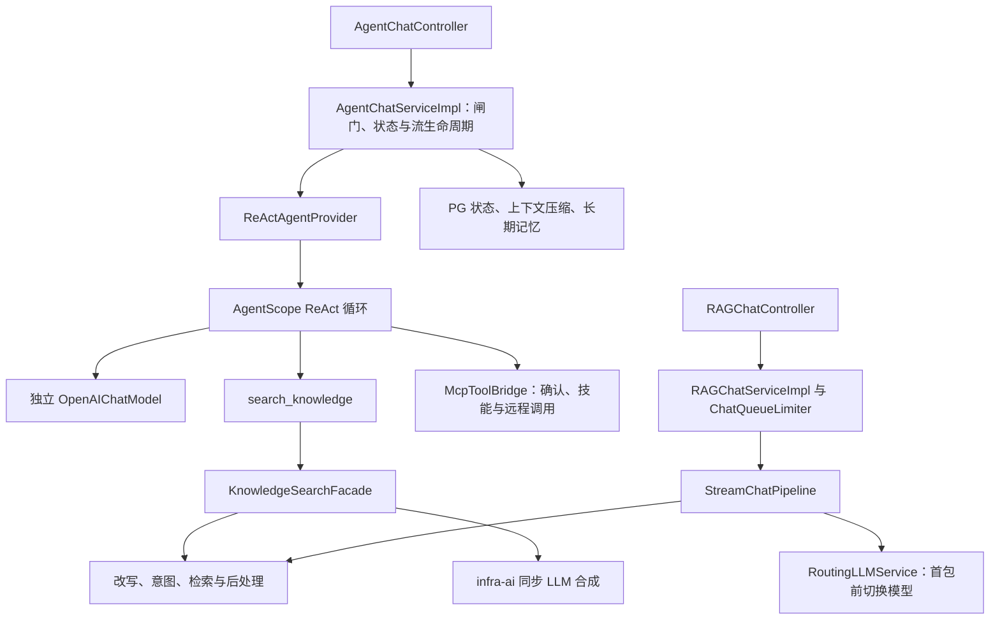

# Ragent 源码核验、贡献边界与面试亮点筛选

核验日期：2026-10-12（Asia/Shanghai）。本文件只交付第一阶段，不提前生成个人 STAR 或最终简历。

## 1. 结论与证据规则

推荐准备五个工程问题：**Agent 执行生命周期、MCP 写操作确认边界、检索排序与证据质量、记忆容量与并发提交、RAG 模型路由与首包容错**。它们目前都是上游能力，不能称为用户的原始实现。

用户已在本次对话明确“这个项目不是我做的”。因此个人原始开发贡献为零，不再把这一项保留为身份待核实。后续要核实的是实际部署、复现、修改、实验与技术掌握情况；这些尚未得到用户确认。Fork、阅读源码和本次生成文档不等于设计并实现这些模块。

所有结论使用以下标签：

- **[事实·源码]**：直接从当前源码、配置、SQL 或测试代码读到；证明实现或断言存在，不证明部署运行成功。
- **[事实·历史]**：提交记录直接支持变更及其记录的动机；提交描述不是生产日志或实测指标。
- **[事实·本次执行]**：本次实际运行的只读命令、Git/API 核验或文档检查。
- **[推演]**：解释场景、选型或边界；不代表作者曾遇到该场景。
- **[优化假设]**：尚未实施的改造、测试或实验，不能放进“我已经完成”的经历。

下面每个方案表都是技术比较；除明确标注历史记录者外，没有证据证明原作者曾逐项比较这些方案。表中性能与成本是定性分析，均不是本项目实测结果。

## 2. 固定源码基线与 Fork 边界

### 2.1 当前版本

| 项目 | 本次核验结果 | 证据与含义 |
| --- | --- | --- |
| 分析开始时 HEAD | 98e4217d0f85c92c33b0525a14301efdfdc9abf5 | 本次 git rev-parse HEAD |
| 业务源码基线 | bffe0e80831ac32e31b5469a223ef070f5a61ed7 | 98e4217d 的父提交；新增内容仅为四份 docs 文档 |
| 本地缓存 origin/main | bffe0e80 | 缓存引用，不代表 GitHub 当前主分支 |
| 本地 main | 98e4217d | 相对缓存 origin/main 仅多一个文档提交 |
| 当前工作分支 | feature/source-interview-phase-one | 本任务单独创建，遵循 feature/* 规范 |
| origin 远程 | nageoffer/ragent | 指向上游，不是用户 Fork |
| 用户 Fork | xuhuilun/ragent | GitHub API 返回 fork=true，parent/source 均为 nageoffer/ragent |
| Fork 远程 main | 98e4217d | 本次 git ls-remote 核验，与分析开始时本地 HEAD 相同 |
| 上游实时 main | 7402d876bbb906e354101fd398fee95061eddd5a | 本次 git ls-remote 核验；本报告不分析该新版，不把本地旧版结论扩展到它 |

GitHub 主数据来源：[用户 Fork](https://github.com/xuhuilun/ragent)、[上游仓库](https://github.com/nageoffer/ragent)。下方类与行号均属于固定业务源码基线 bffe0e80；本轮只新增分析文档。

本次复核的 Git 命令：

```bash
git status --short --branch
git remote -v
git branch -avv
git rev-parse HEAD
git diff --stat origin/main...HEAD
git log --format='%h %an <%ae> %s' origin/main..HEAD
git show --stat 98e4217d
git ls-remote https://github.com/xuhuilun/ragent refs/heads/main
git ls-remote https://github.com/nageoffer/ragent refs/heads/main
```

### 2.2 可证明与不可证明的个人贡献

**[事实·本次执行]** 分析开始时，origin/main...HEAD 的差异只有 ai-agent-five-highlights-interview.md 及三个 evidence 文档，合计四份文档、2099 行新增，没有 Java、测试、SQL 或配置变更。98e4217d 的作者身份为本机 Alexander；它证明文档提交身份，不能证明业务代码贡献。作者邮箱本身也不能用于确认一个人的真实身份。

**[事实·本次执行]** 工作区原有四份未跟踪文档：ai-application-engineer-resume-design.md、ai-application-engineer-resume.md、personalized-agent-resume.md、ragent-resume-interview-guide.md。它们没有被当作本报告的事实来源，也不在本轮修改范围。

| 表述 | 当前可信边界 |
| --- | --- |
| “这个开源项目实现了……” | 可以，但必须注明默认配置和验证层级 |
| “我阅读并复盘了……” | 阅读确实完成且能回答追问后可用；本报告不替用户证明掌握程度 |
| “我本地部署并复现了……” | 尚无用户确认与运行记录 |
| “我改造/设计/实现了这五个模块” | 当前不成立；用户已确认非本人实现 |
| “我解决过上游提交记录中的线上故障” | 不成立；有提交不等于本人亲历，也没有生产事故证据 |
| “我新增了某项验证或二次开发” | 必须先实际完成修改、测试和记录，再形成个人经历 |

推荐项目定位为“基于 Ragent 的源码研习与二次开发”。尚未实施的二次开发不能先写成完成态。最终简历要在后续贡献与掌握确认、故事检验之后生成。

## 3. 架构与实际调用链

### 3.1 模块职责

**[事实·源码]** 根 pom 声明 Java 17、Spring Boot 4.1.0、AgentScope 2.0.2、MCP SDK 1.1.2，包含 framework、infra-ai、system、rag、agent、bootstrap、mcp-server 七个 Maven 模块；前端 package.json 声明 React 18 与 Vite。[根依赖与模块声明][pom]，[前端依赖][frontend]

| 模块 | 关键职责 | 此次阅读重点 |
| --- | --- | --- |
| framework | 用户上下文、取消协议、SSE、调用追踪约定 | StreamTaskManager、TaskCancellation |
| infra-ai | Provider 适配、模型选择与健康状态、流式探测 | ModelSelector、ModelRoutingExecutor、ModelHealthStore、RoutingLLMService |
| system | 登录与用户上下文 | SaTokenConfig：登录检查与异步分派边界 |
| rag | 改写、意图、检索、Prompt、摄取、Workflow 编排 | RetrievalEngine、通道与后处理器、KnowledgeSearchFacade、摄取内核与 Sink |
| agent | ReAct 装配、工具目录、确认、状态、记忆、技能、追踪 | 仓库生命周期层与框架循环的责任边界 |
| bootstrap | 应用启动与有效缺省配置 | application.yaml 的开关、预算、模型档位 |
| mcp-server | MCP 工具注册与示例业务执行器 | annotations、Schema、读写工具与确认约定，详细证据见附录 |

本次建立了全仓 Java/配置/SQL 文件索引，索引中有 763 个 main Java 文件、110 个 test Java 文件；随后精读核心调用链及相关测试/历史。**这是核心链路审计，不表示逐行读完全部业务示例，也不是全仓安全审计。** 未以 README 或已有面试文档推断能力。



Agent 主模型与工具内部 RAG 合成是两次不同模型调用：**工具内可以经过 infra-ai 路由，不代表主 Agent 自带同样的 fallback。** Workflow RAG 入口仍存在；Agent 模式下 RetrievalEngine 跳过其旧 MCP 执行支路，避免从知识工具内部绕开 Agent 的确认与技能边界。[KnowledgeSearchFacade.search][facade]，[RetrievalEngine.buildSubQuestionContext][retrieval]。历史提交 [745d8bbd](https://github.com/nageoffer/ragent/commit/745d8bbdbeca71ffc926531579b7dbf16e38d69f) 明确记录模式区分与身份传递。

### 3.2 功能状态矩阵

| 能力 | 源码状态 | 当前 YAML 缺省 | 本次运行证据 |
| --- | --- | --- | --- |
| Agent 主入口与 ReAct | 已实现，框架提供循环 | engine=agent，max-iters=10，max-retries=1（含首次） | 未启动应用 |
| 主 Agent 多模型切换 | 当前装配为独立单模型 | agent.chat 引用独立 Provider/model | 不能以 RAG 路由证明此能力 |
| MCP 与 HITL | 已实现，外部服务需可达 | MCP server 指向 localhost:9099 | 未调用外部工具 |
| 长期记忆、摘要 | 已实现 | long-term-enabled=true、summary-enabled=true | 未跑 PG/模型回归 |
| PG 向量召回 | 已实现 | vector.type=pg、vector channel=true | 未连接数据库 |
| 关键词召回 | 已实现，可配置 | keyword.type=none、channel=false | 未启用 ES |
| 图谱召回 | 已实现，可配置 | graph.type=none、channel=false | 未启用 LightRAG |
| Web 召回 | 已实现，可配置 | channel=false | 未调用搜索 API |
| RRF | 已实现 | strategy=rrf；仅单路时主要执行候选截断 | 未比较多路效果 |
| Rerank 与证据闸门 | 已实现 | rerank=true、批次最高精排分下限0.2，配置 noop 后备 | 未调用精排模型 |
| infra-ai 路由/熔断 | 已实现 | 失败阈值2、开启时长30000ms、档位候选有序 | 未验证真实 Provider 故障 |
| Agent OTel/Langfuse | 已实现，可配置 | agent.trace.enabled=false | 未上报远程追踪 |
| RAG 本地 trace | 已实现 | rag.trace.enabled=true | 未生成本轮 trace |
| 知识库直接分块 | 已实现内核与 Sink | 需数据库、对象存储、模型 | 未执行摄取 |
| 知识库文档 PIPELINE 分块入口 | 有遗留方法，但当前主入口显式拒绝 | 提示“管道模式重构中” | 不能写成该入口可用；另 IngestionTask API 的存在不能代替它 |

配置证据：[Agent 默认值][config-agent]、[后端及检索开关][config-rag]、[检索预算][config-search]、[模型候选与档位][config-model]、[PIPELINE 拒绝分支][pipeline-disabled]。这些数值都是**配置值**，不是数据规模、性能结果或业务指标。

**[事实·本次执行]** /usr/bin/java 只是 macOS 启动器，java_home 报 Unable to locate a Java Runtime；没有可用 mvn 命令。未执行 Maven、启动应用、外部模型、Redis/PG 并发实验或压测。本次没有可据以宣称通过的测试报告。

## 4. 十二个候选工程难点与评分

评分每维0—5：技术深度 D、业务价值 B、岗位匹配 J、个人贡献可信度 P、可追问性 Q；合计满分25。P=0 表示**无个人原始实现证据且用户确认不是本人做的**，不是低质量代码。其他维度是本次选题判断，不是客观测量。五个入选项之间按问题边界分工，避免只按总分重复选择同一个生命周期问题。

| 编号 | 技术问题 | D | B | J | P | Q | 合计 | 筛选结论 |
| --- | --- | --- | --- | --- | --- | --- | --- | --- |
| C01 | 将 ReAct 循环接入可中断、可恢复的 Web 会话生命周期 | 5 | 5 | 5 | 0 | 5 | 20 | 入选 H1 |
| C02 | MCP 写工具确认与服务端执行边界 | 5 | 5 | 5 | 0 | 5 | 20 | 入选 H2 |
| C03 | 异构检索排序融合与候选预算 | 5 | 5 | 5 | 0 | 5 | 20 | 入选 H3 |
| C04 | 记忆容量、语义压缩与并发提交一致性 | 5 | 5 | 5 | 0 | 5 | 20 | 入选 H4 |
| C05 | RAG 模型故障切换与流式输出提交边界 | 5 | 5 | 5 | 0 | 5 | 20 | 入选 H5 |
| C06 | 意图误判、检索范围与弱证据拒绝 | 4 | 5 | 5 | 0 | 5 | 19 | 纳入 H3 深入追问 |
| C07 | 多层异步扇出与线程池饱和 | 5 | 4 | 5 | 0 | 5 | 19 | 纳入 H3/H5 性能边界 |
| C08 | 分布式公平排队与许可生命周期 | 5 | 4 | 5 | 0 | 5 | 19 | 后端补强候选 |
| C09 | 技能动态工具可见性与越界执行 | 4 | 4 | 4 | 0 | 5 | 17 | 纳入 H2，不能包装完整权限系统 |
| C10 | 文档索引替换与向量空间兼容 | 4 | 5 | 4 | 0 | 5 | 18 | 摄取工程候选 |
| C11 | 异步 Agent 追踪与内容采集边界 | 4 | 4 | 4 | 0 | 4 | 16 | 可观测性补强候选 |
| C12 | 跨节点取消、归属验证与副作用边界 | 5 | 4 | 5 | 0 | 5 | 19 | 纳入 H1/H2/H5 边界 |

### C01：ReAct 执行生命周期

**难题与触发场景 [推演]**：用户会在生成中断连、停止或提交第二条请求，Agent 又可能处在工具执行或等待确认状态。直接把框架 Flux 转成 SSE，不能自动解决状态恢复、并发占位和终态重复收尾。没有本项目真实并发用户规模证据。

| 方案 | 原理/复杂度 | 资源与性能 | 可靠性/风险 | 扩展与适用场景 |
| --- | --- | --- | --- | --- |
| 固定 Workflow | 显式业务步骤；低到中 | 调用数更可控 | 遇新问题需加分支，复杂工具组合僵硬 | 固定流程、确定性强的任务 |
| 框架 ReAct + 仓库生命周期层（当前） | 框架决策循环；自建服务边界，中高 | 动态轮次带来模型成本与波动 | 需约束迭代、状态、取消；模型仍不确定 | 多工具任务，可复用框架生态 |
| 自建持久化执行状态机 | 自行定义节点与重放；高 | 可定制调度，工程成本高 | 需独立解决恢复、顺序与工具副作用 | 强审计、跨进程长任务 |

**当前实现 [事实·源码]**：AgentChatServiceImpl 管理执行占位和状态，ReActAgentProvider 装配 AgentScope ReActAgent、工具与中间件；主循环来自框架。AgentRunHandle 管理订阅与结算，事件桥转 SSE。**选型解释 [推演]**：复用循环、把业务约束放到服务边界更易维护；不能证明原作者做过上表比较。[Agent 与记忆证据附录][agent-evidence]

**结果与局限**：代码提供这些治理机制；没有本轮运行通过证据。max-iters=10 是防止无限循环的配置，不保证答对，也不代表十步成本上限。取消不等于远端业务回滚。

**潜在追问**：Flux 结束、用户停止、断连谁先结算？状态恢复和确认恢复顺序？为什么按用户串行，而不是按会话？**贡献确认项**：原始实现无；待确认能否定位框架/仓库分界、是否做过停止与恢复复现。

### C02：MCP 写工具与 Human-in-the-Loop

**难题与触发场景 [推演]**：模型能生成工具参数，不代表获得用户业务授权；订单修改等工具存在副作用。示例工具存在不证明对接了真实生产业务。

| 方案 | 原理/复杂度 | 资源与性能 | 可靠性/风险 | 扩展与适用场景 |
| --- | --- | --- | --- | --- |
| 全自动远程调用 | schema+模型判断；低 | 低交互时延 | 误调用、错误参数和重复写入风险 | 只读、低风险任务 |
| 状态暂停+服务端参数恢复（当前） | 保存 ASKING 状态，确认后恢复；中高 | 增加人工等待与状态管理 | 防止确认接口替换原参数；仍需可信 annotations | 有明确写操作确认需求 |
| 下游授权工作流+幂等请求账本 | 服务端策略、操作ID、审计；高 | 存储和查询成本增加 | 更可查证，需设计未知结果与对账 | 强副作用、监管或财务业务 |

**当前实现 [事实·源码]**：McpToolBridge 桥接现有 MCP executor；requireConfirm 与未明确只读的 readOnlyHint 驱动确认。确认请求只携带同意/拒绝，执行参数从服务端 Agent 状态取。Agent 模式下 RAG 内部 MCP 支路关闭，维护唯一治理入口。根 pom 明确禁止 Agent 使用其旧版传递 MCP 客户端，统一复用 rag 连接桥。[MCP 依赖兼容注释][pom-mcp]，[模式判断][retrieval]，具体方法与测试见[附录][agent-evidence]。

**选择依据**：SDK 兼容注释与 [745d8bbd](https://github.com/nageoffer/ragent/commit/745d8bbdbeca71ffc926531579b7dbf16e38d69f) 支持工程约束；它们不证明实现了 OAuth 或完整下游权限体系。

**结果与局限**：可证明确认与参数恢复机制存在；不能证明 exactly-once。超时但下游已成功时，客户端不能仅凭超时决定重试写操作。_meta 身份透传不是独立认证；只读注解也需要信任远端。

**潜在追问**：确认前后参数谁保存？重复确认如何处理？超时后查不到执行结果怎么办？**贡献确认项**：原始实现无；待确认是否了解状态机、下游幂等与身份认证边界。

### C03：检索融合、精排与预算

**难题与触发场景 [推演]**：向量匹配适合语义，关键词更适合精确术语；两路分值量纲不同，直接排序会偏向某个通道。增加召回又会放大 rerank 成本与噪声。未找到真实业务语料规模和检索改进指标。

| 方案 | 原理/复杂度 | 资源与性能 | 可靠性/风险 | 扩展与适用场景 |
| --- | --- | --- | --- | --- |
| 单向量 TopK | 近邻召回；低 | 存储、模型与查询成本较低 | 精确术语及弱相关证据可能有缺口 | 小规模语义知识问答 |
| 归一化后加权原始分 | 标定各路分数；中高 | 融合计算便宜，但标定有维护成本 | 数据/模型漂移导致权重失效 | 有稳定评估集与分数校准 |
| 加权 RRF+有限候选池+Rerank（当前可配置） | 按排名投票再精排；中 | 多路查询与精排增加成本，预算约束输入 | 不依赖同量纲，但丢弃绝对分差，可能挤掉稀有证据 | 异构通道，需后续评估 |

**当前实现 [事实·源码]**：MultiChannelRetrievalEngine 并发启用通道，按 order 执行后处理；去重后仍用各路原始列表计算 weight/(k+rank+1)，不丢多路命中票。候选池截断后交给 Rerank，再经过证据闸门和元数据补充。[executeSearchChannels/executePostProcessors][multi]，[FusionPostProcessor.fuseByRrf][fusion]，[RerankPostProcessor.process][rerank]。

**选择依据**：Fusion 类注释明确说明量纲差异与粗排/精排分工，证明当前代码的设计说明；不证明历史上做过消融。缺省是单 PG 向量，k=20、候选上限40、最终TopK=10；单路不做多路融合，仅截断。没有找到专门的 FusionPostProcessorTest，不能宣称已有完整 RRF 算法回归。

**结果与局限**：机制与预算存在；没有“召回率提高X%”。noop 后备只截断，不提供精排分。后处理异常会跳过对应处理器；若没有有效精排分，证据闸门放行。

**潜在追问**：为什么用排名而不归一化分数？去重为什么不丢多路投票？如何证明候选40不是拍脑袋？**贡献确认项**：原始实现无；待确认能否手算RRF、设计同一批语料的消融与标注方案。

### C04：记忆容量与并发一致性

**难题与触发场景 [推演]**：长会话与大工具结果挤占上下文；摘要可能遗漏事实；多个会话为同一用户抽取长期记忆时还可能覆盖、重复写入或在遗忘后复活。

| 方案 | 原理/复杂度 | 资源与性能 | 可靠性/风险 | 扩展与适用场景 |
| --- | --- | --- | --- | --- |
| 固定最近N轮 | 丢弃旧消息；低 | 无额外模型成本 | 丢早期约束，按条裁剪可切断工具协议 | 短会话、可容忍遗忘 |
| 所有轮次写向量库检索 | 语义检索历史；中 | 额外嵌入与索引成本 | 召回不确定，冲突/遗忘治理仍需设计 | 大历史库、非结构化记忆 |
| 协议安全裁剪/摘要+结构化长期记忆（当前） | 短期容量控制，长期Judge/合并/提交；高 | 摘要与Judge增加模型和存储成本 | 版本、水位与锁解决部分竞争；摘要有损 | 跨会话偏好与有限窗口 |

**当前实现 [事实·源码]**：短期状态存在PG；压缩保护本轮及最近完成的循环、tool_use/result配对。长期记忆每会话claim，Judge在事务外，提交用用户控制行锁、revision与会话watermark校验。WRITTEN、NOOP、DROPPED推进水位，重复失败后主动跳过；纯NOOP不增加用户revision，发生容量合并/淘汰时仍可能改变revision。[附录中的完整调用链、SQL和测试][agent-evidence]

**选择依据 [推演]**：把模型计算移出事务减少持锁时间，以版本校验防止提交过期建议；这种解释不等于作者本人事故复盘。**结果与局限**：实现了容量与提交协议，不证明无限上下文、无损摘要、物理遗忘或跨节点完全线性一致。YAML为100000字符，而不是100000 token；失败透传使其不是硬容量上限。

**潜在追问**：revision与watermark分别防什么？遗忘与迟到抽取竞争怎么办？工具消息为何必须成对保留？**贡献确认项**：原始实现无；待确认PG事务/唯一约束知识与长会话复现经验。

### C05：模型路由、熔断与流式提交

**难题与触发场景**：**[事实·历史]** 上游 [9509b024](https://github.com/nageoffer/ragent/commit/9509b024f4f6b7202d3a7e3390b0a9f643457f12) 记录首包等待中断使HALF_OPEN名额可能一直占用，并加入带token许可与八个相关测试。这是原作者记录的问题；没有生产日志，且不是用户解决。**[推演]** Provider可能超时或无内容，输出开始后切模型会拼接不一致文本。

| 方案 | 原理/复杂度 | 资源与性能 | 可靠性/风险 | 扩展与适用场景 |
| --- | --- | --- | --- | --- |
| 单Provider固定重试 | 重放同一调用；低 | 实现便宜，故障时反复等待 | 无法隔离持续故障，可能放大成本 | 单模型、供应商有强保障 |
| 有序候选+健康状态+首包提交（当前RAG） | 分档选择，首包前切换；中高 | 故障时串行等待；正常流不全量缓存 | 避免首包前失败泄漏；不恢复输出中断 | 多Provider、接受首包后报错 |
| 外部网关+hedged requests | 集中路由与延迟竞争；高 | 多请求增加费用，可缩短尾延迟 | 重复调用、网关依赖；写工具不能盲目竞速 | 较大规模与统一运维 |

**当前实现 [事实·源码]**：ModelSelector按档位构造候选；ModelRoutingExecutor同步调用失败切下一项；ModelHealthStore用compute管理CLOSED/OPEN/HALF_OPEN。ProbeStreamBridge在首包探测前缓存回调，成功commit后透传；RoutingLLMService首包成功就返回句柄。[ModelSelector][selector]，[executeWithFallback][fallback]，[allowCall/releaseHalfOpenPermit][health]，[streamChat/awaitFirstPacket][routing]，[ProbeStreamBridge][probe]

**选择依据**：9509b024和67624931明确记录中断与取消分流；首包提交的总体利弊为[推演]。**结果与局限**：首包前可切换；thinking也会触发成功，所以“首包”不一定是答案首字。首包成功不能证明完整流健康；主Agent不继承此路由。健康状态是单JVM内存，不是全局熔断。

**潜在追问**：旧许可为什么不能释放新探测？首包后失败怎么办？取消为何不能计模型失败？**贡献确认项**：原始实现无；待确认能否解释并复现中断/令牌竞争，不得把#75写成本人修复。

### C06：意图范围与证据闸门

**难题与触发场景 [推演]**：高置信意图绑定了已删除的知识库，或者TopK里全部是“最像但没答案”的资料。单纯“检索有结果”不能证明相关。

| 方案 | 原理/复杂度 | 资源与性能 | 可靠性/风险 | 扩展与适用场景 |
| --- | --- | --- | --- | --- |
| 全库检索 | 不信意图；低 | 范围大、干扰多 | 降低路由误判漏召，但误召可能增加 | 少量统一知识库 |
| 严格命中库+逐条分数过滤 | 强收窄；中 | 查询小，节省输入 | 意图错判会整路漏召，阈值漂移 | 意图可靠、分数已校准 |
| 置信范围+补充路+批次精排闸门（当前） | 一次解析范围，全通道共读；中高 | 保底召回占预算，需真实校准 | 最高分达标保留整批，无分放行 | 允许漏判保底且重视可用性 |

**实现与依据 [事实·源码]**：最高KB意图分达到阈值才收窄；绑定与未删除知识库交集，去重意图节点；补充范围为其余有效库。最终存活chunk按库归属推意图，不能把召回后已丢弃的证据算命中。[RetrievalScopeResolver.resolve][scope]，[KbCollectionProvider.listActiveCollections][collections]，[deriveAttribution][attribution]。EvidenceGate只读rerankScore，忽略无效数，批次最高分低于阈值整批丢弃，缺分放行。[闸门实现][gate]；[16984b95](https://github.com/nageoffer/ragent/commit/16984b95454d3fc2a55b60ade1950fefeba339ec) 明确记录补闸门和区分精排分。

**结果与局限**：有删除库、低置信、去重、缺分、阈值边界测试源码；未执行。本范围来自有效库而非用户ACL，不能称多租户权限隔离；也不能声称闸门消除了幻觉。

**潜在追问**：为何读rerankScore而非RRF score？最高分达标为什么不逐条过滤？补充路会不会越权？**贡献确认项**：原始实现无；需证明能区分质量策略与授权策略。

### C07：异步扇出与线程池饱和

**难题与触发场景 [推演]**：一个问题拆成多个子问题，每个子问题再扇出通道与库查询。并发增长使线程、连接与外部请求数一起放大；“使用CompletableFuture”不自动提供容量上限。

| 方案 | 原理/复杂度 | 资源与性能 | 可靠性/风险 | 扩展与适用场景 |
| --- | --- | --- | --- | --- |
| 全串行 | 无扇出；低 | 小资源占用，时延相加 | 易分析，吞吐受阻塞I/O限制 | 低流量、成本严格限制 |
| 分层线程池+CallerRuns（当前） | 子问题/通道/内层分池，TTL透传；中 | 并发可降低等待，饱和反压调用线程 | 长任务仍占池；超时安装可被同步执行推迟 | 常规I/O负载，需要饱和验证 |
| 端到端deadline+有界并发与可取消客户端 | 统一预算、并发permit、下游超时；高 | 精细控制连接与排队，工程投入高 | 需处理中断不生效、结果迟到与资源回收 | 多通道高负载与严格时延 |

**当前实现 [事实·源码]**：[RetrievalEngine.retrieve][retrieval]用ragContextExecutor；[MultiChannelRetrievalEngine][multi]用ragRetrievalExecutor；[ThreadPoolExecutorConfig][pools]分池并以TTL包装。通道orTimeout降级为空，只放弃结果，不中断底层任务。

**关键边界 [推演·调用顺序可核验]**：supplyAsync提交调用先于withTimeout。SynchronousQueue饱和触发CallerRuns时，channel.search在提交线程同步运行，直到执行返回才安装orTimeout。因此15000ms不是整次请求的硬上限，现有慢通道测试没有模拟这种池饱和条件。[派发顺序L150][multi]，[线程池L85][pools]

**结果与局限**：已有部分失败/慢通道静态测试；没有吞吐、P99或资源回收实验。不同池降低直接嵌套等待风险，但共享下游连接仍可能耗尽。

**潜在追问**：池数量为何按CPU而不是I/O实测？CallerRuns在哪个线程执行？超时之后连接是否释放？**贡献确认项**：原始实现无；待确认线程池原理与饱和场景复现实验能力。

### C08：分布式排队与许可生命周期

**难题与触发场景 [推演]**：多个节点争抢有限模型容量，排队者取消、超时、拿到许可与提交执行可同时发生。实现公平顺序不等于限制了整个流式生命周期。

| 方案 | 原理/复杂度 | 资源与性能 | 可靠性/风险 | 扩展与适用场景 |
| --- | --- | --- | --- | --- |
| 本地Semaphore | JVM计数；低 | Redis开销为零 | 节点数增长时总量失控，公平仅本地 | 单实例 |
| Redis队列+Lua claim+过期许可（当前） | 排队顺序与Ticket CAS；高 | Redis轮询、通知、脚本成本 | 崩溃后TTL回收；需验证租约与业务生命周期 | 多实例排队入口 |
| 网关准入+流终态释放/续租 | 按活跃调用持有容量；高 | 长连接占许可，需续租与监控 | 更贴近下游容量，故障续租需fencing | 限制完整长流并发 |

**当前实现 [事实·源码]**：entry标记先于ZSet入队；Lua claim后才取permit，失败按原score重入队。Ticket用PENDING到GRANTED/TIMED_OUT/CANCELLED的CAS协调，拒绝执行释放已取得permit。[FairDistributedRateLimiter.acquire/grant/tryAcquireIfReady][limiter]，[ChatQueueLimiter.enqueue][queue]

**结果与局限 [推演·调用链支持]**：许可在onAcquired.run()的finally释放；RAGChatServiceImpl的回调最终执行StreamChatPipeline，模型首包成功后返回handle，后续SSE仍可持续。因此当前不能称“活跃SSE流始终不超过10”；lease=30s且这里未见续租，执行超过租约同样需要验证。[入口回调][rag-service]，[RoutingLLMService返回位置][routing]。Agent服务也不能仅因依赖rag模块就算接入了此队列。

**潜在追问**：公平性按什么保证？拿许可后Executor拒绝怎么办？许可到期但业务仍在跑呢？**贡献确认项**：原始实现无；待确认Redis Lua、租约和终态竞争理解。

### C09：技能与工具遮蔽

**难题与触发场景 [推演]**：把所有工具一直放入模型上下文会增加成本和误调用面；历史skill激活还可能与新轮次、技能修改不一致。

| 方案 | 原理/复杂度 | 资源与性能 | 可靠性/风险 | 扩展与适用场景 |
| --- | --- | --- | --- | --- |
| 全量工具常驻 | 所有schema每轮可见；低 | 上下文较大，工具选择负担高 | 模型可能选择业务无关工具 | 少量只读工具 |
| Skill映射+轮次遮蔽+调用前兜底（当前） | 动态计算可见工具与执行集合；中高 | 缩小schema集合，维护映射成本 | 异常fail-open等边界，不能代替权限 | 工具较多、技能有明确归属 |
| 独立服务端策略引擎 | 根据用户/资源/动作授权；高 | 增加鉴权查询与策略维护 | 守住真实业务权限，与模型提示解耦 | 多租户、敏感写操作 |

**当前实现 [事实·源码]**：AgentSkillMaskingMiddleware区分全局G、skill绑定L与活动skill集合，McpToolBridge执行前再检查可用性；技能遮蔽计算异常时模型可能看到全量工具。具体公式、方法行号与测试见[附录][agent-evidence]。

**选择依据 [推演]**：模型可见性与执行拦截分别减少误选和绕过风险。**结果与局限**：工具治理机制存在，没有注入攻击对照结果；无法称完整ACL、RBAC或防提示注入。

**潜在追问**：看不到的工具是否仍能被直接调用？skill改动后历史激活怎么处理？异常为何fail-open？**贡献确认项**：原始实现无；需区分编排集合与业务授权。

### C10：摄取、索引替换与向量空间

**难题与触发场景 [推演]**：文档更新需要同时替换关系库chunk和向量；Embedding服务可能返回错条数或维度，远程索引写失败又不受本地事务回滚控制。

| 方案 | 原理/复杂度 | 资源与性能 | 可靠性/风险 | 扩展与适用场景 |
| --- | --- | --- | --- | --- |
| 先删后写各后端 | 顺序更新；低 | 少存储成本 | 失败窗口可能造成缺失或新旧混合 | 可重建、小型索引 |
| 摄取内核+有序Sink+本地事务（当前） | 解析/分块/嵌入/扇出统一；中 | 一次解析复用，事务内写入占资源 | 同数据源可事务化，远程副作用不能一起回滚 | 默认PG与关系库组合 |
| 版本化索引+Outbox异步发布 | 新版本写齐再切指针；高 | 多版本存储与消费者开销 | 可补偿重试，但需去重、对账和清理 | 多异构索引、大批量更新 |

**当前实现 [事实·源码]**：DefaultIngestionKernel按MIME/档位解析→chunk→embed→index；ChunkEmbeddingService检查输出条数与dimension；ChunkIndexWriter在TransactionOperations中按Sink执行；VectorChunkSink先删后建。[内核run][ingest]，[embed校验][embedding-check]，[replaceDocument][index]，[VectorChunkSink][vector-sink]，[RelationalChunkSink][relational-sink]

**选择依据 [推演]**：固定内核与扩展Sink便于维护。**边界**：TransactionOperations不是分布式事务，配置Milvus/ES/图谱后不能凭这个包装声称全后端原子提交；知识库文档PIPELINE主入口还在拒绝使用。

**另一个待验证问题 [推演·调用链支持]**：摄取embedBatch(texts, modelId)固定单一模型，而PG查询embed(query)会走可降级候选。同维度不保证相同向量语义空间，查询降级到不同模型可能损害相似度；没有实测证明已发生。[RoutingEmbeddingService两种重载][embedding-route]，[PgVectorRetrieverService.embedAndNormalize][pg-retriever]

**潜在追问**：远程后端成功但本地回滚怎么办？为什么维度相同仍不能混用？如何无停机重建？**贡献确认项**：原始实现无；待确认索引故障注入与Embedding对照经验。

### C11：异步链路追踪

**难题与触发场景 [推演]**：模型首包等待、检索耗时与真实工具执行耗时不能只靠接口总时长区分；SSE方法返回时流尚未结束，普通AOP方法耗时不能代表完整响应。

| 方案 | 原理/复杂度 | 资源与性能 | 可靠性/风险 | 扩展与适用场景 |
| --- | --- | --- | --- | --- |
| 结构化日志+请求ID | 日志关联；低 | 成本低但跨并发分析繁琐 | 难还原嵌套和异步关系 | 小系统排查 |
| 本地RAG节点+可选Agent OTel（当前） | 入口/节点/工具span分别记录；中高 | 存储和上报开销，需内容预算 | 采集内容涉及隐私；导出失败不等于业务失败 | 有复杂Agent链路 |
| 统一采样/指标与追踪后端 | 集中保留与关联；高 | 大规模更可控，部分链路未采到 | 需定义采样、脱敏与故障隔离 | 多服务生产运维 |

**实现与依据 [事实·源码]**：RAG入口ForwardingStreamCallback的onFirstContent/onFinish记录TTFT及全流终态，清理提交线程ThreadLocal；Agent可选OTLP HTTP BatchSpanProcessor、内容采集与字段上限。追踪开关默认分别为RAG开、Agent关。[StreamChatTraceRunner.run][trace-runner]，[AgentTracingConfiguration][trace-agent]

**结果与局限**：有Agent静态场景测试，未连Langfuse。RAG标为USER_TTFT的计时从获准后的pipeline入口开始，不包含排队，更不是浏览器渲染时间；“上报成功”“零丢失”“故障定位提升”均无本次证据。

**潜在追问**：异步回调如何终结根span？排队时间算不算TTFT？关闭内容采集如何验证没漏参数？**贡献确认项**：原始实现无；待确认OTel、TTL与个人观测实践。

### C12：跨节点取消与副作用边界

**难题与触发场景 [推演]**：停止请求可能落在不同节点，甚至早于任务注册；如果只靠可预测taskId，可能停止别人的任务。用户停止时远端写工具可能已经成功。

| 方案 | 原理/复杂度 | 资源与性能 | 可靠性/风险 | 扩展与适用场景 |
| --- | --- | --- | --- | --- |
| 本地Future.cancel | 中断本机任务；低 | 低成本 | 跨节点无效，线程中断不保证取消远端操作 | 单机无副作用任务 |
| Redis属主/标记+广播+本地CAS（当前） | 注册时复核预埋标记；中 | Redis与Pub/Sub开销 | 消息与注册窗口可补部分状态；远端副作用未知 | 多实例SSE停止 |
| 持久化操作账本+下游取消/补偿 | 任务状态和业务状态分离；高 | 查询、补偿和对账成本 | 可定位未知结果，但补偿可能失败 | 长任务与不可重复写操作 |

**实现与依据 [事实·源码]**：StreamTaskManager写属主、取消标记并广播，执行端再次比对发起方；cancelled.compareAndSet协调本地取消。bindHandle解决停止早于句柄绑定；unregister后不创建幽灵任务。[StreamTaskManager][cancel]。TaskCancellation按中断/异常链识别取消，ModelRoutingExecutor不再切模型或记故障。[取消判据][cancellation]，[同步路由取消出口][fallback]。67624931记录统一取消分流。

**结果与局限**：有越权停止、预埋标记、注册后绑定等测试源码；未执行。Pub/Sub不是可靠投递队列，运行中丢广播后的补偿需要进一步验证；本地CAS也不等于远端exactly-once。

**潜在追问**：为什么发布端验证还不够？中断抛出后中断位为何要恢复？停止到底取消了哪个资源？**贡献确认项**：原始实现无；待确认并发时序与下游未知结果处理。

## 5. 五个入选亮点的准备边界

| 入选 | 推荐讨论的问题 | 首次追问的源码起点 | 当前可证明的结果 | 禁止提前归为个人成果 |
| --- | --- | --- | --- | --- |
| H1 | 框架ReAct如何融入可中断、可恢复的会话 | ReActAgentProvider→AgentChatServiceImpl→AgentRunHandle | 装配、闸门、持久化和终态控制代码存在 | 自研ReAct、生产并发提升、自行设计原架构 |
| H2 | 有副作用的MCP工具如何暂停并确认执行 | AgentToolCatalog→McpToolBridge→确认恢复→McpClientToolExecutor | 确认边界、服务端恢复参数和技能兜底存在 | OAuth、完整权限、幂等写入、事务回滚 |
| H3 | 如何平衡召回、排序质量与下游成本 | RetrievalEngine→Scope→Channels→Dedup→RRF→Rerank→Gate | 可配置多路漏斗、预算和证据策略存在 | 默认四路上线、检索指标提升、完整ACL |
| H4 | 长会话压缩与用户记忆如何避免错误覆盖 | CompactionMiddleware→Compactor；MemoryPipeline→Repository | 协议保护、revision/watermark/行锁协议存在 | 无损摘要、无限上下文、完整并发验证 |
| H5 | 哪些模型失败能切换，何时必须停止切换 | ModelSelector→HealthStore→RoutingLLMService→ProbeStreamBridge | 有序候选、首包前容错、半开permit持有者释放 | 主Agent自动fallback、流中无缝切换、#75本人修复 |

H1偏执行生命周期；H2偏授权交互和远程副作用；H3偏检索与质量；H4偏模型有损计算和数据库一致性；H5偏网络与流式提交边界。这样五条都有独立的追问空间。个人贡献可信度目前都不够写“我实现”，但它们仍是高价值源码学习主题。

本阶段不使用“绿色=用户已掌握”结论：尚未考查用户。源码可定位不等于本人能答。下一阶段将按用户的真实掌握与复现证据分级，再写口语故事。

## 6. 把理解转为个人成果的验证入口

以下全部为 **[优化假设]**，尚未编码或运行；仅作为下一阶段的证据补强任务，不算本阶段新增功能。

| 顺序 | 可交付任务 | 关键验收证据 | 对应亮点 |
| --- | --- | --- | --- |
| 1 | 建立可重复构建环境，执行现有核心测试 | JDK/Maven版本、完整命令、报告、失败记录；不修改结果分母 | 五项共同基线 |
| 2 | 首包故障与中断场景复现，分开记录首包前/后失败 | mock流故障时间线、健康状态断言、取消句柄记录，明确是复现上游 | H5 |
| 3 | 新增RRF定量算法回归与同数据检索消融 | 手算预期、重复chunk/空通道/权重/截断测试；标注集Recall@K/MRR或nDCG及耗时、调用数 | H3 |
| 4 | 用真实PG并发测试记忆claim、revision、遗忘竞争 | 双线程时序、事务提交结果、唯一约束冲突和水位变化；保留DROPPED | H4 |
| 5 | 模拟写工具“成功后响应丢失”，验证确认与未知结果策略 | 操作ID、调用计数与查询对账；如果加入幂等账本，记录真实补丁 | H2 |
| 6 | 停止与池饱和测试，复现超时安装和终态竞争 | 用户停止/断连/晚绑定/饱和场景的事件序列、线程与资源回收记录 | H1及C07 |

推荐先完成构建基线和H5复现，以隔离的mock实验建立第一份可展示证据；单纯重跑上游测试只证明验证实践，仍不是原功能开发。更大改造要另建feature分支、先写设计再实施；外部依赖安装与项目运行不在本轮分析范围。

## 7. 检索与稳定性的测试证据

此表核验的是测试代码与断言，全部**未在本次运行**。Agent/MCP/记忆的九组测试另列于附录，避免把mock结果当成真实基础设施验证。

| 测试文件与起始行 | 代表案例 | 静态断言与缺口 |
| --- | --- | --- |
| [MultiChannelRetrievalEngineTest](/Users/alexander/LLM/ragent/rag/src/test/java/com/nageoffer/ai/ragent/rag/core/retrieval/MultiChannelRetrievalEngineTest.java:121) | directedTimeoutKeepsScopeAndDegradesToMiss | 用慢/快mock通道检查降级及归属；实际Executor不是生产池饱和场景，不能证明CallerRuns时硬超时 |
| [RetrievalEngineTest](/Users/alexander/LLM/ragent/rag/src/test/java/com/nageoffer/ai/ragent/rag/core/retrieval/RetrievalEngineTest.java:175) | agentModeSkipsMcpOnRagChain、workflowModeStillExecutesMcpOnRagChain | 校验两种编排模式，避免重复工具支路；未实际调用MCP服务 |
| [RetrievalScopeResolverTest](/Users/alexander/LLM/ragent/rag/src/test/java/com/nageoffer/ai/ragent/rag/core/retrieval/channel/RetrievalScopeResolverTest.java:41) | lowConfidenceIntentFallsBackToGlobal、intentsOnRetiredCollectionsFallBackToGlobal、duplicatedIntentNodesAreDeduplicatedKeepingTopScore | 检查范围和意图节点去重；不是用户ACL测试 |
| [EvidenceGatePostProcessorTest](/Users/alexander/LLM/ragent/rag/src/test/java/com/nageoffer/ai/ragent/rag/core/retrieval/postprocessor/EvidenceGatePostProcessorTest.java:63) | dropsWholeBatchWhenTopRerankScoreIsBelowFloor、usesBatchMaxNotFirstChunk、passesThroughWhenRerankScoreIsAbsent | 分叉设置score与rerankScore，验证只读取精排分；没有真实模型阈值校准 |
| [ModelRoutingExecutorTest](/Users/alexander/LLM/ragent/infra-ai/src/test/java/com/nageoffer/ai/ragent/infra/model/ModelRoutingExecutorTest.java:41) | shouldRecognizeWrappedInterruptedExceptionAndRestoreInterruptFlag、shouldStillFallbackForRealModelFailure | 检查取消不降级、不累计故障与普通失败可降级；健康状态与client为mock |
| [RoutingLLMServiceHalfOpenRecoveryTest](/Users/alexander/LLM/ragent/rag/src/test/java/com/nageoffer/ai/ragent/infra/chat/RoutingLLMServiceHalfOpenRecoveryTest.java:92) | interruptedHalfOpenProbeReleasesPermit、staleHalfOpenPermitCannotReleaseCurrentPermit、cancelFailureStillReleasesPermit | 使用真实健康状态和模拟Provider/首包探测，检查持有者及中断时序；不是公网故障实验 |
| [ChatQueueLimiterTest](/Users/alexander/LLM/ragent/rag/src/test/java/com/nageoffer/ai/ragent/rag/service/ratelimit/ChatQueueLimiterTest.java:132) | shouldKeepUserContextWhenQueuedRequestIsAcquiredByScheduler、shouldKeepUserContextWhenQueuedRequestTimesOutOnScheduler | 校验异步TTL用户上下文；不覆盖完整Redis公平队列与长流许可续租 |
| [StreamTaskManagerTest](/Users/alexander/LLM/ragent/framework/src/test/java/com/nageoffer/ai/ragent/framework/web/StreamTaskManagerTest.java:77) | shouldRejectCancelFromNonOwner、shouldHonorOwnMarkerPlantedBeforeRegister、shouldNotResurrectTaskAfterUnregister | 校验属主、注册窗口和晚绑定；Redis为mock，未验证消息丢失/分区 |
| [AgentTraceScenarioTest](/Users/alexander/LLM/ragent/agent/src/test/java/com/nageoffer/ai/ragent/agent/trace/AgentTraceScenarioTest.java:158) | shouldTraceParallelToolsWithDistinctDurations、shouldEmitNoToolSpanWhileAwaitingConfirmation | 有工具粒度和确认场景断言；没有本轮远程后端回读 |

没有找到专门的FusionPostProcessor、AgentContextTrimmer/Compactor/Summarizer或真实PG记忆提交并发JUnit覆盖。这里是本次索引和调用链范围内的覆盖缺口，不是断言所有可能测试均不存在。

## 8. 本阶段自检与确认点

本轮修改范围只有本报告和Agent/记忆证据附录，不改业务源码或已有面试材料。文档自检核对引用路径、行号、方法/配置和候选数量；12个候选数量、全部评分加总及Markdown证据引用检查通过，本地文件链接和行号均有效。运行验证仍受JDK缺失限制，不能把文档检查当成Java测试。

Git交付遵循功能分支自检后本地提交、合并到main。本轮用户已明确接收仓库为xuhuilun/ragent，目标main；推送前复核远端为98e4217d且为本地main祖先，仅普通快进推送。origin继续指向上游，不修改远程配置、不推送上游。

进入下一阶段前，需要用户确认：

1. 本地实际做到哪一步：未运行、已部署、已跑核心测试、已改动源码；如有结果，提供可定位的命令/报告/提交。
2. H1—H5分别达到哪一级：0完全陌生；1能解释原理；2能定位代码并讲边界；3能自行修改和验证。
3. 个人贡献边界已确认无原始实现；后续只根据真实复现或新补丁写个人行动。

按用户原始协作要求，第一阶段完成后暂停；暂不生成个人STAR、最终简历或完整模拟问答。

### 后续进度：H1源码研习与口述准备

2026-10-12，用户回复“2”，暂按五项均自评2级（能定位代码并解释边界）推进；实际部署、实验与补丁尚未确认。本轮新增[H1：ReAct执行、取消与状态恢复](/Users/alexander/LLM/ragent/docs/source-interview-react-lifecycle.md)，包含90秒及3—5分钟研习口述稿、方案比较、十二个递进问答和验证计划。材料把原实现归于上游，不冒认个人开发；本人掌握待口述考查。H2—H5及最终简历尚未进入本轮，先检验H1回答。

## 源码定位索引

以下链接均指向本地实际文件及核验起始行。关键方法名在正文和附录列出；完整阅读以当前固定源码基线为准。

[pom]: /Users/alexander/LLM/ragent/pom.xml:18
[pom-mcp]: /Users/alexander/LLM/ragent/pom.xml:203
[frontend]: /Users/alexander/LLM/ragent/frontend/package.json:13
[config-agent]: /Users/alexander/LLM/ragent/bootstrap/src/main/resources/application.yaml:35
[config-rag]: /Users/alexander/LLM/ragent/bootstrap/src/main/resources/application.yaml:85
[config-search]: /Users/alexander/LLM/ragent/bootstrap/src/main/resources/application.yaml:152
[config-model]: /Users/alexander/LLM/ragent/bootstrap/src/main/resources/application.yaml:230
[agent-evidence]: /Users/alexander/LLM/ragent/docs/source-interview-agent-memory-evidence.md
[facade]: /Users/alexander/LLM/ragent/rag/src/main/java/com/nageoffer/ai/ragent/rag/service/KnowledgeSearchFacade.java:65
[retrieval]: /Users/alexander/LLM/ragent/rag/src/main/java/com/nageoffer/ai/ragent/rag/core/retrieval/RetrievalEngine.java:87
[multi]: /Users/alexander/LLM/ragent/rag/src/main/java/com/nageoffer/ai/ragent/rag/core/retrieval/MultiChannelRetrievalEngine.java:132
[attribution]: /Users/alexander/LLM/ragent/rag/src/main/java/com/nageoffer/ai/ragent/rag/core/retrieval/MultiChannelRetrievalEngine.java:104
[fusion]: /Users/alexander/LLM/ragent/rag/src/main/java/com/nageoffer/ai/ragent/rag/core/retrieval/postprocessor/FusionPostProcessor.java:80
[rerank]: /Users/alexander/LLM/ragent/rag/src/main/java/com/nageoffer/ai/ragent/rag/core/retrieval/postprocessor/RerankPostProcessor.java:64
[scope]: /Users/alexander/LLM/ragent/rag/src/main/java/com/nageoffer/ai/ragent/rag/core/retrieval/channel/RetrievalScopeResolver.java:54
[collections]: /Users/alexander/LLM/ragent/rag/src/main/java/com/nageoffer/ai/ragent/rag/core/retrieval/channel/KbCollectionProvider.java:45
[gate]: /Users/alexander/LLM/ragent/rag/src/main/java/com/nageoffer/ai/ragent/rag/core/retrieval/postprocessor/EvidenceGatePostProcessor.java:76
[selector]: /Users/alexander/LLM/ragent/infra-ai/src/main/java/com/nageoffer/ai/ragent/infra/model/ModelSelector.java:77
[fallback]: /Users/alexander/LLM/ragent/infra-ai/src/main/java/com/nageoffer/ai/ragent/infra/model/ModelRoutingExecutor.java:42
[health]: /Users/alexander/LLM/ragent/infra-ai/src/main/java/com/nageoffer/ai/ragent/infra/model/ModelHealthStore.java:63
[routing]: /Users/alexander/LLM/ragent/infra-ai/src/main/java/com/nageoffer/ai/ragent/infra/chat/RoutingLLMService.java:115
[probe]: /Users/alexander/LLM/ragent/infra-ai/src/main/java/com/nageoffer/ai/ragent/infra/chat/ProbeStreamBridge.java:44
[pools]: /Users/alexander/LLM/ragent/rag/src/main/java/com/nageoffer/ai/ragent/rag/config/ThreadPoolExecutorConfig.java:65
[queue]: /Users/alexander/LLM/ragent/rag/src/main/java/com/nageoffer/ai/ragent/rag/service/ratelimit/ChatQueueLimiter.java:64
[limiter]: /Users/alexander/LLM/ragent/rag/src/main/java/com/nageoffer/ai/ragent/rag/service/ratelimit/FairDistributedRateLimiter.java:138
[rag-service]: /Users/alexander/LLM/ragent/rag/src/main/java/com/nageoffer/ai/ragent/rag/service/impl/RAGChatServiceImpl.java:51
[ingest]: /Users/alexander/LLM/ragent/rag/src/main/java/com/nageoffer/ai/ragent/core/ingest/DefaultIngestionKernel.java:66
[embedding-check]: /Users/alexander/LLM/ragent/rag/src/main/java/com/nageoffer/ai/ragent/core/ingest/embed/ChunkEmbeddingService.java:49
[index]: /Users/alexander/LLM/ragent/rag/src/main/java/com/nageoffer/ai/ragent/core/ingest/sink/ChunkIndexWriter.java:46
[vector-sink]: /Users/alexander/LLM/ragent/rag/src/main/java/com/nageoffer/ai/ragent/rag/core/vector/sink/VectorChunkSink.java:47
[relational-sink]: /Users/alexander/LLM/ragent/rag/src/main/java/com/nageoffer/ai/ragent/knowledge/sink/RelationalChunkSink.java:56
[pipeline-disabled]: /Users/alexander/LLM/ragent/rag/src/main/java/com/nageoffer/ai/ragent/knowledge/service/impl/KnowledgeDocumentServiceImpl.java:281
[embedding-route]: /Users/alexander/LLM/ragent/infra-ai/src/main/java/com/nageoffer/ai/ragent/infra/embedding/RoutingEmbeddingService.java:59
[pg-retriever]: /Users/alexander/LLM/ragent/rag/src/main/java/com/nageoffer/ai/ragent/rag/core/vector/PgVectorRetrieverService.java:57
[trace-runner]: /Users/alexander/LLM/ragent/rag/src/main/java/com/nageoffer/ai/ragent/rag/trace/StreamChatTraceRunner.java:61
[trace-agent]: /Users/alexander/LLM/ragent/agent/src/main/java/com/nageoffer/ai/ragent/agent/trace/AgentTracingConfiguration.java:96
[cancel]: /Users/alexander/LLM/ragent/framework/src/main/java/com/nageoffer/ai/ragent/framework/web/StreamTaskManager.java:101
[cancellation]: /Users/alexander/LLM/ragent/framework/src/main/java/com/nageoffer/ai/ragent/framework/cancellation/TaskCancellation.java:39
