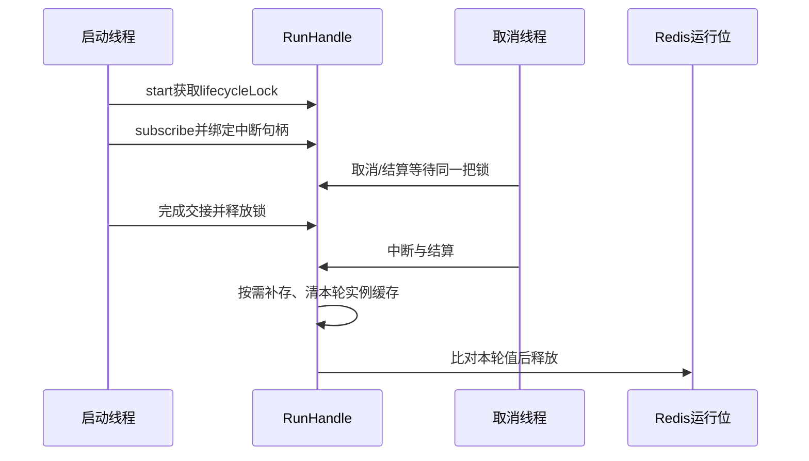

# H1：ReAct 执行、取消与状态恢复面试准备

日期：2026-10-12。业务源码基线：bffe0e80831ac32e31b5469a223ef070f5a61ed7；本轮开始时HEAD为ebde17df，新增分析文档不改变业务实现。

**贡献更正（2026-10-13，Asia/Shanghai）**：用户最新明确“这个项目就是我另一个账号全程主导的”。本文据此确认个人项目主导归属，应用层的装配、状态与生命周期治理可描述为主导设计实现；AgentScope 提供的 ReAct 循环仍属于框架能力。作者账号不同不再用于排除个人贡献。最新简历与贡献口径见 [Ragent 个性化简历](ragent-resume-personalization.md)。

用户回复“2”，本轮暂按五项均自评2级（能定位代码并解释边界）推进，只展开H1。这个判断尚未通过口述考查；部署、修改与实验经历仍未确认。

下面的第一人称稿保留**源码复盘形式的练习稿**，用于解释设计与实现边界，不限制用户只能写研习贡献。“主导、设计并实现”可按最新说明使用；具体线上故障处理、部署和性能结果仍需相应记录，不能仅由项目主导说明补出。

## 1. 本亮点到底讨论什么

核心问题是：**把框架提供的ReAct循环接入长时间运行的Web会话后，如何协调启动、订阅、中断、状态保存和资源释放？**

ReAct让模型选择工具、接收结果并继续决策；知识问答可能调用检索，业务请求可能调用MCP。动态工具组合是业务动机，不意味着每个任务都该用ReAct。真正值得讨论的仓库工程工作，是框架循环外面的生命周期治理。

- **[已验证事实·源码]**：AgentScope提供ReActAgent，仓库提供Provider、工具目录、中间件、RunGate、RunHandle、事件桥与PG状态适配。类与调用链见第3节。
- **[已验证事实·历史]**：上游5f3c35e3调整实际运行实例的缓存清理与闸门释放顺序；bffe0e80调整启动互斥和确认结算顺序。Git 作者名均为 ding.ma；个人项目主导归属按用户的最新账号说明确认，作者名不同不再视为无个人贡献。
- **[合理技术推演]**：这些顺序可以防止特定时序的旧流干扰新流，不能据此宣称发生过某次生产事故或所有并发问题都已解决。
- **[假设性优化]**：取消动作异常兜底、真实Redis/PG故障注入、版本或fencing机制尚未实施。

源码没有提供实际并发规模、P99、成本降幅或生产事故日志。默认max-iters=10、SSE超时900000ms都是配置。max-iters事件在事件桥中只发提示，仍允许框架后续结果，不等于“十次后立刻失败”。[Provider装配][provider-build]，[默认配置][config]，[EXCEED_MAX_ITERS处理][bridge-events]

## 2. STAR口述稿

下列S/T/A/R标记用于准备时定位，口述时不念。时长是按文本长度估算，最终要自己录音校准；类名和英文术语会放慢语速。

### 2.1 约90秒：首次介绍

**S：** 我研究Ragent时，重点看了Agent的流式执行。模型可能连续调用工具，而HTTP方法返回后，任务还在运行；用户这时可能关页面、停止生成，或者再发一个问题。

**T：** 我的分析目标是弄清楚：哪些机制来自AgentScope，仓库怎样避免旧任务收尾影响下一轮。

**A：** 我从Controller追到RunHandle，看到运行位覆盖的是整条流，不能在返回SseEmitter时释放。仓库按用户在Redis抢占运行位，释放时比对本轮标识，避免旧回调删掉新占位。

我又对照启动和取消时序：订阅、绑定中断能力和结算共用一把锁；取消如果先完成，就不会继续订阅。中断先通知框架，给它收尾机会，再dispose。释放时先按需补存状态、清本轮实际Agent的缓存，然后放行下一轮。上游提交确实记录过这个清理顺序的调整。

我还核对了失败路径：准备阶段失败单独清理，确认卡片结算失败不订阅。这些顺序有代码和测试断言支持。

**R：** 目前可引用的结果是这些实现和对应的时序测试代码，没有本轮集成测试或性能数据。

**反思：** 这里的保证有限：TTL不会停止旧任务，取消也不能撤销已经成功的远程写操作。这是我全程主导项目中应用层机制的边界，框架主循环由AgentScope提供。

证据映射：S为业务触发场景推演；T/A为研习行动模板与[Controller][controller]、[RunGate][gate]、[start][handle-start]、[中断][handle-interrupt]、[释放钩子][release]的静态事实；历史为[5f3c35e3](https://github.com/nageoffer/ragent/commit/5f3c35e355654f17a0a78dd5fad5b7dd78622347)。R不包含测试通过或效果提升。

### 2.2 约3—5分钟：技术展开

**S：** 我看的场景是基于开源Ragent的Agent聊天。它既能查知识，也能调用业务工具，一次回答可能经历多轮模型和工具交互。这个场景和普通接口有个区别：Controller返回SseEmitter后，后台还在运行。用户关页面或再发一条请求时，旧任务的工具执行、状态保存和缓存清理可能还没结束。

**T：** 我没有把框架循环当成自己的开发成果。我的复盘目标是还原这条执行链的生命周期，找到状态由谁保存、什么时候放行下一轮，以及取消能保证到哪一步。

**A：** 我先区分了固定Workflow和ReAct。固定流程的步骤清楚，调用成本也比较容易估计；需要模型根据结果继续选择工具时，ReAct更灵活，但轮次和输出不确定。当前代码复用AgentScope循环，把业务约束放在仓库服务层。这个权衡是我的技术分析，没有证据证明作者曾做过完整方案评测。

接着我从入口往下看。Service先抢用户级Redis运行位，拿到后再检查是否还有待确认操作。这样待确认检查和后续启动处在同一入口约束里。运行位的值包含taskId和conversationId，释放时用值比较再清空；如果旧位过期、下一轮已经占上，旧回调就不能把新位删掉。运行位有效期间，同用户的其他会话也会被拒绝启动；位过期或被提前释放后，旧任务不一定已停止。要改成会话粒度，还得另看用户级记忆和资源限额。

我重点对照了“准备完成”和“真正订阅”两个时刻。仅检查一个cancelled标志不够，因为检查通过后，取消仍可能先完成，随后才订阅。RunHandle把启动过程和结算放在同一把可重入锁里，订阅与中断句柄绑定一起交接。确认续跑也在这个区域先结算卡片，再订阅；卡片结算失败就不进入事件流订阅。但这仍不是数据库和远程业务之间的事务，结卡后进程崩溃的窗口还在。

取消时我没有把dispose解释成业务回滚。代码先调用agent.interrupt，最多等待两秒上游终止，再dispose；等待失败会标记需要补存框架状态。这个终止信号只能证明响应式链结束，不能代替数据库提交成功的证据。页面断开也要进入取消路径，否则只是浏览器不再收消息，后台可能继续消耗模型和工具资源。

另一个有历史依据的细节是Agent热重建。Provider会根据人设和工具目录签名更新缓存，但旧流仍持有旧实例。9月15日的上游提交把“通过Provider清当前实例”改成“清本轮实际使用的Agent”，并把清理排到释放运行位之前。我据此分析了两种风险：旧流清到新实例，以及下一轮刚加载状态又被上一轮清掉。当前释放钩子尝试先补存、清实际实例，再释放运行位，最后调度后台记忆抽取。

**R：** 我能确认仓库为这些时序写了测试，例如取消先结算后不再启动、启动交接完成前不释放，以及清缓存先于放行。这里是测试源码证据；本机没有JDK，本轮没有执行JUnit，也没有真实Redis、PG或多节点运行结果。

**反思：** 当前方案适合解释一个有边界的长流治理机制。固定TTL没有续租或下游fencing；状态upsert也没有revision条件。取消动作抛异常可能跳过收尾，这些都需要故障注入。更长任务或强副作用业务才有理由引入持久任务状态、幂等操作记录和结果对账，我不会把这些尚未做的能力写成已实现。

证据映射：方案比较与风险时序是合理推演；Redis、锁、取消、重建、释放顺序是第3节源码事实；9月15日变更有项目历史支持。个人项目主导归属已确认，具体部署、事故处理和运行数据没有新增记录，不能用文本估算代替。

## 3. 源码深入：先记住这条链

普通请求：

```text
AgentChatController.chat
  → AgentChatServiceImpl.streamChat
    → AgentRunGate.acquire
    → hasPendingConfirm（在抢位之后）
    → startRun
      → ReActAgentProvider.getAgent：取得Agent与目录成对快照
      → touchConversation
      → ensureExtractionBaseline
      → addUserMessage
      → launchStream
        → bindReleaseHooks + bindEmitterLifecycle
        → StreamTaskManager.register
        → agent.streamEvents（构造流）
        → AgentRunHandle.start（互斥区域）
          → settleConfirmCard（普通请求跳过）
          → events.subscribe
          → bindStream + taskManager.bindHandle
```

**[已验证事实·源码]** 构造Flux与订阅是两个位置；不能把streamEvents方法返回解释成所有工具已执行。框架实际循环不在本仓库Java文件内，不能仅凭调用点解释框架内部全部调度。[入口与启动][service-start]，[launchStream][launch]

| 关注点 | 类、方法和起始行 | 精确解释 |
| --- | --- | --- |
| 框架与仓库分界 | [ReActAgentProvider.buildAgent][provider-build]，L113 | builder接入模型、Toolkit、状态Store和中间件，循环由AgentScope提供 |
| 缓存与热重建 | [ReActAgentProvider.getAgent][provider]，L71 | volatile缓存、锁内再次检查；人设/目录指纹相同复用，变化时新建 |
| 目录一致性 | [ActiveAgent][active-agent]，L149 | 把Agent与构建时ResolvedCatalog成对交给本轮，不在事件桥重新读另一份目录 |
| 用户级运行位 | [AgentRunGate.acquire/release][gate]，L53/L83 | setIfAbsent带TTL；taskId与conversationId作为owner值；compareAndSet清位 |
| 同步启动失败 | [cleanupFailedStart][failed-start]，L125 | 分别尝试释放运行位、注销任务，不依赖正常流收尾 |
| 订阅交接 | [AgentRunHandle.start][handle-start]，L126 | 锁内检查已结算/已取消，再执行startup；启动失败已有disposable则尝试dispose |
| 终态协调 | [AgentRunHandle.settle][handle-settle]，L253 | settled在锁内先置位；后续complete/cancel/fail不再执行结算体 |
| 释放顺序 | [AgentChatServiceImpl.bindReleaseHooks][release]，L264 | 按需补存并清实际实例→运行位→异步记忆；单个普通Exception由RunHandle记录后继续 |
| 中断机会 | [interruptUpstream/awaitUpstreamTermination][handle-interrupt]，L169/L206 | interrupt→等待上游终止最多2000ms→dispose；不保证远端请求停止 |
| SSE容器回调 | [bindEmitterLifecycle][emitter]，L364 | timeout/error/completion在未结算时发取消；避免单靠Controller finally |
| 多节点停止入口 | [StreamTaskManager.cancelByUser/cancelLocal][task-owner]，L146/L203 | Redis属主与广播执行端复核；标记早于注册时register再检查 |
| 迟到句柄 | [StreamTaskManager.bindHandle][task-bind]，L120 | 已取消且仍有任务记录时，补触发取消动作；注销后不重新建记录 |
| 框架状态 | [PgAgentStateStore.save/get][state-store]，L49/L59 | 框架codec序列化到JSONB，不是重放前端聊天文字 |
| 状态并发边界 | [AgentStateMapper.upsert][state-sql]，L33 | user/session/state_key唯一键upsert，无revision CAS；不等于防止一切迟到写 |
| 业务消息与前端结束 | [AgentStreamEventBridge.onComplete/onError][bridge-complete]，L174/L206 | 业务消息快照落库并发送终态；状态Store和消息表不是一个原子事务 |

### 3.1 启动交接期间的取消竞争



这展示一种启动先获得锁的时序。取消若先完成结算，start检查settled后直接返回。实际取消协议还涉及StreamTaskManager标记和回调，不能把图当成所有线程交错的完整形式证明。

### 3.2 取消、终止、保存的三个不同含义

| 状态 | 能证明什么 | 不能证明什么 |
| --- | --- | --- |
| cancelled标记 | 当前任务已被请求取消 | 工具已停止、下游没成功 |
| Flux doFinally终止 | 响应式链已发出终止信号 | PG保存成功、全部网络I/O退出 |
| saveAgentState调用返回成功 | 该次保存调用未报错 | 与业务消息、远端写操作原子提交 |
| Redis运行位被释放/过期 | 下一轮可重新竞争运行位 | 旧线程必定退出、不再有迟到写 |
| 本地settled=true | 本句柄不再执行第二个结算体 | 分布式exactly-once或前端必定收到DONE |

## 4. 技术决策复盘

### 4.1 为什么用框架ReAct和仓库生命周期层

以下定性比较为**合理技术推演**，没有原作者逐项决策记录。当前接线、默认值及部分顺序变更是已验证事实。

| 方案 | 实现与维护 | 资源、时延 | 可靠性与风险 | 扩展与适用场景 |
| --- | --- | --- | --- | --- |
| 固定Workflow | 步骤显式，复杂度低至中；扩展需增加路径 | 模型次数容易约束 | 分支可测试；新组合不灵活 | 固定审批、抽取、规则明确的流程 |
| 框架ReAct+生命周期层（当前） | 复用循环，在服务层约束状态；复杂度中高 | 多轮模型/工具带来成本和时延波动 | 能治理入口与终态；依赖框架状态、模型仍不确定 | 工具组合随结果变化的交互任务 |
| 自建持久任务/工作流执行器 | 节点、重试、恢复自建；维护成本高 | 多次状态落库、队列和调度成本 | 可持久恢复与审计，但仍需下游幂等 | 长任务、严格恢复与强副作用业务 |

当前的推荐是继续讲透仓库生命周期层，不把自建执行器当作默认改造。只有任务跨进程恢复、运行时长和副作用审计成为明确需求，才值得支付后一种方案的成本。

### 4.2 为什么不直接用synchronized或请求防重

本地synchronized只协调本JVM，对多节点不够。请求方法finally又在返回emitter时结束，覆盖不了整条流。当前Redis入口运行位负责跨节点同用户竞争，本地lifecycleLock负责本句柄的启动/结算交接；两者保护对象不同。[RunGate][gate]，[RunHandle.start][handle-start]

它仍不是通用分布式锁完整方案：固定TTL、无续租、无写入fencing。compareAndSet只保护释放动作不误删新占位，不能阻止旧运行过期后继续写PG。

### 4.3 有历史记录的两个改变

| 上游提交 | 修改前后 | 直接支持的结论 | 不能据此推断 |
| --- | --- | --- | --- |
| [5f3c35e3，2026-09-15](https://github.com/nageoffer/ragent/commit/5f3c35e355654f17a0a78dd5fad5b7dd78622347) | Provider清当前缓存→清本轮agent；放行钩子提前→排在状态清理后 | 项目记录了旧实例误清与释放顺序问题，并增加顺序测试 | 具体线上事故经历、状态零丢失 |
| [bffe0e80，2026-09-18](https://github.com/nageoffer/ragent/commit/bffe0e80831ac32e31b5469a223ef070f5a61ed7) | pending检查移到闸门内；启动/清理拆分；结卡移到订阅前的互斥启动段 | 代码与提交记录支持启动和确认结算时序治理 | 确认与远端执行形成事务、不会重复执行 |

复核方式：本次实际读取git show的提交正文及相关diff。提交时间是代码变更时间，不是故障发生时间；Git 作者名属于仓库记录，个人项目主导归属按用户另一账号全程主导的最新说明确认，不能仅凭账号名差异排除贡献。

## 5. 严格面试：十二个递进问题

所有回答以**解释当前实现**为口径，源码事实与技术推演在各题标出。每题的标准回答可以口述；“进一步追问”用于检查是否只背了结论。

### Q1：业务为什么需要ReAct，为什么不用固定流程？

**口语回答：** 如果问题需要根据一次工具结果再决定下一步，固定流程会不断增加分支，ReAct可以把选择交给模型。但固定审批或规则明确的任务，Workflow更容易控制和测试。当前仓库把ReAct用于动态工具交互，外面仍保留确定的状态和生命周期约束。我不会因为接了模型就默认所有业务都适合Agent。

**源码依据：** [Provider.buildAgent][provider-build]装配框架循环及工具；[AgentToolCatalog.resolve][catalog]挂知识检索及MCP工具。具体业务适用性为合理推演，没有两种架构效果对照。

**进一步追问：** 模型连续选错工具或达到迭代上限怎么办？

**反例/极端场景：** 三个字段校验后提交固定表单，ReAct多轮推理可能只增加成本与不确定性。

**常见错误回答：** “Agent比Workflow高级，所以全部替换。”

**盲区与补强：** 需要能估计模型调用数、选择可控流程，理解max-iters只限制循环阶段，不能代表业务正确率。

### Q2：这个ReAct到底是谁实现的，你做了什么？

**口语回答：** 我通过另一个账号全程主导Ragent。主循环复用AgentScope，我主导设计实现的是模型和工具装配、SSE事件适配、运行位、确认与状态收尾。框架能力和项目应用层能力需要分清；部署效果、性能指标与具体故障经历按各自记录说明。

**源码依据：** [ReActAgentProvider.buildAgent][provider-build]调用io.agentscope.core.ReActAgent.builder；[Service.launchStream][launch]和[RunHandle][handle-settle]属于项目应用层代码。个人主导归属以2026-10-13最新用户说明为准。

**进一步追问：** 把AgentScope换掉，你需要重写哪些边界？

**反例/极端场景：** 换框架时ToolUseBlock、ASKING状态、事件类型与state codec都可能变化，不能只换一个依赖坐标。

**常见错误回答：** “我从零实现了ReAct推理引擎。”

**盲区与补强：** 区分框架算法、仓库接线和个人补丁，能画出依赖方向和状态契约。

### Q3：Controller返回SseEmitter后，为什么不能在finally里释放运行位？

**口语回答：** 返回emitter只结束同步入口，流和工具还在后台执行。如果这里放行第二条请求，两轮可能同时读写状态，上一轮还可能清掉下一轮刚加载的缓存。当前运行位交给RunHandle的释放钩子，在流结算时归还；启动失败则走单独清理。关键是区分请求方法结束和运行生命周期结束。

**源码依据：** [Controller.chat][controller]L49—51返回emitter；[streamChat][service-start]L90取得释放动作；[bindReleaseHooks][release]L281登记释放；[cleanupFailedStart][failed-start]单独覆盖启动失败。

**进一步追问：** 请求已经失败，但流订阅已经成功，谁负责停止它？

**反例/极端场景：** 同一个用户在第一条回答仍生成时打开第二个标签页发问。

**常见错误回答：** “HTTP返回就说明Agent执行完成了。”

**盲区与补强：** 需要理解Servlet异步响应、Reactor订阅、终态回调和资源owner。

### Q4：为什么按用户串行，而不是按conversationId？

**口语回答：** 当前key只带userId，所以运行位未过期且未提前释放时，会拒绝同用户跨会话的新运行。这是代码事实，可能简化用户级状态和资源竞争，但作者为什么选择这个粒度没有完整历史说明。改成会话粒度可以提升多会话体验，同时会放开同用户跨会话竞争，长期记忆和用户限额要另外处理。我不会说必须按用户锁。

**源码依据：** [AgentRunGate.runningKey][gate-key]L96；[acquire][gate]L53。选型动机为合理推演。

**进一步追问：** 会话锁之外，还要加哪些用户级限制？

**反例/极端场景：** 一个人同时开十个会话，业务上允许，但模型配额和用户记忆可能共用。

**常见错误回答：** “用户锁保证所有长期记忆写入绝不冲突。”后台记忆抽取发生在释放运行位后。

**盲区与补强：** 区分用户配额、会话状态与用户长期记忆的保护范围；后台抽取用另一套并发协议。

### Q5：释放运行位为什么要比较值？有TTL为什么还不够？

**口语回答：** TTL是崩溃后的回收出口。如果旧位过期，新请求已经写入自己的占位，无条件delete会把新请求的位删掉。现在释放会比对taskId和conversationId，只清自己的值。但它只保护删除动作：旧任务如果没停，TTL之后仍可能继续写状态，所以TTL和CAS不能合起来叫严格互斥。

**源码依据：** [AgentRunGate.release/ttl][gate-release]L83—93；[AgentRunGateTest.shouldReleaseOnlyOwnSlot][gate-test]L78只验证compareAndSet调用，Redis为mock。

**进一步追问：** 要防旧任务的迟到写，需要在哪里校验fencing token？

**反例/极端场景：** 旧任务卡住超过1800000ms，新任务拿到位，随后旧数据库请求恢复。

**常见错误回答：** “TTL到期会自动杀掉旧线程”“比较删除就保证分布式exactly-once”。

**盲区与补强：** 需要区分租约、owner值和单调fencing token；数据库也必须拒绝过期写才能形成保护。

### Q6：检查cancelled之后再subscribe不行吗，为什么共用一把锁？

**口语回答：** 单次检查和订阅之间还有窗口。检查通过后取消可能先结算并释放运行位，然后旧线程才订阅工具。当前start把检查、订阅和句柄交接放在lifecycleLock里，结算也用这把锁；取消先结算时start直接返回，启动先进入时收尾等交接完成。锁要可重入，因为同步完成的Flux可能在subscribe里回调结算。

**源码依据：** [AgentRunHandle.start][handle-start]L126、[settle][handle-settle]L253；[Service.launchStream][launch]L248—252；[shouldKeepGateUntilStartupHandoffCompletes][handle-test-start]用latch固定竞争时序。

**进一步追问：** 如果subscribe同步阻塞十秒，取消是否也可能等待？

**反例/极端场景：** Flux.defer在订阅阶段阻塞，取消线程竞争同一把锁，不能承诺停止按钮立即生效。

**常见错误回答：** “volatile cancelled足以把检查和订阅变成原子操作。”

**盲区与补强：** 需要讲清可见性与原子性、可重入、订阅可能同步执行，以及锁内阻塞的代价。

### Q7：为什么先interrupt再dispose？两秒以后就保证状态存盘了吗？

**口语回答：** 先通知框架，可以给它处理循环中断和保存状态的机会，直接dispose可能切断正常收尾。仓库最多等两秒上游终止；没等到就标记补存需要，再尝试断流。但doFinally只是链终止的信号，不能证明PG提交成功，补存失败也只记日志。因此这里是有兜底的尝试，不是状态零丢失保证。

**源码依据：** [interruptUpstream][handle-interrupt]L169—217；[launchStream.doFinally][launch]L245—247；[补存异常处理][release]L270—275；[PgAgentStateStore.save][state-store]L49。

**进一步追问：** 若补存失败后已经放行下一轮，你如何告诉用户旧状态不完整？

**反例/极端场景：** 工具完成后PG不可用，上游终止但状态没写入；下一轮可能从旧快照继续。

**常见错误回答：** “等到doFinally说明数据库一定提交了”“dispose自动回滚本轮工具”。

**盲区与补强：** 需要区分控制流终止、持久化确认和业务提交，设计可观测的save-failed状态属于后续优化。

### Q8：Provider热重建后，旧流为什么要清自己的Agent？

**口语回答：** Provider已经换成新实例时，旧流还可能在旧实例上运行。旧流通过Provider清缓存，会命中新实例；所以当前释放闭包捕获本轮实际agent，只清它，并在释放运行位前完成清理。目录也和实例成对传入事件桥，避免旧流展示用到另一份工具信息。不过这不证明所有旧缓存都已跨节点失效。

**源码依据：** [Provider.getAgent][provider]L71—95；[bindReleaseHooks][release]L277—283；[上游5f3c35e3](https://github.com/nageoffer/ragent/commit/5f3c35e355654f17a0a78dd5fad5b7dd78622347)实际diff；[shouldClearStateCacheBeforeReleasingGate][service-test-clear]L352。

**进一步追问：** 新旧实例都曾缓存同一会话，清旧实例是否够？

**反例/极端场景：** 提前读取状态的旁路、其他节点缓存、旧实例迟到保存；当前SQL没有revision检查。

**常见错误回答：** “Provider是单例，所以只有一个Agent永远不变”“热重建会把全部历史清掉”。

**盲区与补强：** 需要理解单例Provider与可替换缓存条目，进一步验证框架状态缓存和所有读取路径。

### Q9：确认卡片结算和工具执行是否原子？

**口语回答：** 不是。当前把卡片结算延迟到启动准备完成之后，在互斥段里先结卡再订阅；结卡失败则不进入事件流订阅，这解决的是本地启动时序。如果结卡成功后进程崩溃，工具可能还没执行；工具成功后响应丢失，又可能出现相反的不一致。卡片、PG状态和远程业务没有共享事务。

**源码依据：** [Service.startConfirmRun][service-confirm]L161；[launchStream][launch]L248—252；[settleConfirmCard][settle-card]L308；[shouldNotSubscribeWhenConfirmationSettlementFails][service-test-confirm]L506。

**进一步追问：** 重复确认或未知结果时，应该以卡片状态还是下游操作状态为准？

**反例/极端场景：** 卡片已标批准，subscribe之前kill进程；不能从批准态推断已提交订单。

**常见错误回答：** “放进synchronized后就是一个事务”“用户批准后一定只执行一次”。

**盲区与补强：** 需要理解进程内互斥和跨系统原子性的差别；具体业务操作ID、幂等记录和结果查询属于H2深入内容。

### Q10：并发量增加十倍，这个设计先在哪里遇到问题？

**口语回答：** 用户运行位只限制同用户重叠，没有限制不同用户的全局总量。我会先测模型与MCP并发、连接池、PG写入、Redis往返，以及取消回调等待。按CPU配置线程池不代表容量已经合适。下一步应根据同一批负载测入口排队、首包、终态和资源回收，再决定全局准入与每用户会话并发。

**源码依据：** [RunGate.runningKey][gate-key]是用户维度；[Provider][provider]复用实例；[scheduleMemoryExtraction][memory-background]使用boundedElastic；RAG的ChatQueueLimiter不能仅凭模块依赖就算接入Agent入口。容量判断为合理推演。

**进一步追问：** 上游线程没退出，许可却释放了，你会怎样计入活跃负载？

**反例/极端场景：** 一千个不同用户各开一条流，用户位全部成功，下游只有几十个可用连接。

**常见错误回答：** “用了Redis用户锁，所以系统最多一条请求”“多加线程就能线性扩容”。

**盲区与补强：** 需要掌握排队、连接预算、活跃流与残留任务的区别；压测值不能由配置推导。

### Q11：网络超时或用户停止，但下游已经成功执行怎么办？

**口语回答：** 超时代表没拿到结果，不能证明下游失败；用户停止也只表达不再继续这次交互。写操作应带稳定业务操作ID，下游记录幂等结果，调用方在未知状态下先查询或对账，再决定重试和补偿。当前RunHandle只治理运行生命周期，没有实现通用业务账本，所以这部分只能作为后续设计。

**源码依据：** [StreamTaskManager.cancelLocal][task-cancel]调用取消动作和本地收尾；[RunHandle.interruptUpstream][handle-interrupt]尝试中断/断流，没有业务撤销协议。操作ID与对账为假设性优化。

**进一步追问：** 查询结果也超时怎么办？幂等记录与业务写入不同事务会发生什么？

**反例/极端场景：** 请假单已经创建，但返回响应丢失；换模型重新调用可能创建第二张单。

**常见错误回答：** “超时就重试”“取消Reactor订阅就撤销远程业务”。

**盲区与补强：** 需要理解未知结果、幂等key生存周期、补偿失败和人工对账；不能把一次结算当业务exactly-once。

### Q12：你如何证明这套治理有效，而不是只背源码？

**口语回答：** 我会先验证明确的不变量：取消先结算后订阅数是零，启动交接完成前不放位，旧release不删除新位，结算体在竞争下只执行一次。上游已有部分mock和latch测试，本轮未运行。再补真实Redis、PG以及取消动作抛异常的故障注入，记录成功、失败和未覆盖情况。源码存在只能证明机制，不能证明吞吐或稳定性提升。

**源码依据：** [RunHandleTest][handle-test-start]、[RunGateTest][gate-test]、[Service时序测试][service-test-race]；第6节区分mock断言与真实基础设施。

**进一步追问：** 为什么用CountDownLatch固定时序，比Thread.sleep更有说服力？

**反例/极端场景：** 顺序调用cancel→complete→fail通过，不代表三线程同时竞争与真实Redis故障已验证。

**常见错误回答：** “有单元测试就证明生产稳定”“我优化后P99下降30%”，但没有实验。

**盲区与补强：** 需要设计可重复故障点、观测调用次数/资源归属，懂得测试的覆盖边界；本次新增的验证或补丁成果按实际记录，原有项目主导归属已确认。

## 6. 运行证据与测试覆盖

本次再次确认java_home报告没有Java Runtime；未安装JDK，也未运行Maven/JUnit、项目启动、Redis/PG或压测。以下均为**测试代码存在及其静态断言**。

| 测试 | 静态断言 | 不能扩大为 |
| --- | --- | --- |
| [AgentRunGateTest，L58/L78][gate-test] | 默认TTL1800000ms、CAS清本轮owner值 | 真实Redis租约到期、多节点和迟到写已验证 |
| [RunHandleTest，L130][handle-test-start] | 取消先结算后不运行startup | 任意网络/调度下绝不执行工具 |
| [RunHandleTest，L140][handle-test-start] | latch固定启动窗口，100ms内release尚未发生 | 停止按钮时延有100ms保证 |
| [RunHandleTest，L209][handle-test-settle] | 顺序触发三出口只注销/释放一次 | 三线程真实同时竞争全部覆盖 |
| [RunHandleTest，L117][handle-test-errors] | unregister及前一个hook抛普通Exception仍尝试后续释放 | Error、dispose异常和进程kill也保证清理 |
| [ServiceTest，L352][service-test-clear] | clearStateCache先于releaseGate；清本轮agent | 框架缓存全部读取路径和跨节点失效完整验证 |
| [ServiceTest，L490/L506][service-test-confirm] | 准备完成后结卡，结卡失败订阅数为零 | PG卡片与远程执行原子提交 |
| [ServiceTest，L561/L566][service-test-race] | 订阅卡住时cancel等待，交接后dispose且release一次 | 真实MCP中断与远端回滚 |
| [ProviderTest，L111/L122/L139][provider-test] | 目录一次解析、同快照建Toolkit、变化时新建实例 | 全部技能/工具业务语义正确 |

### 6.1 不能抹掉的异常边界

**[已验证事实·源码；后果为合理推演]**：StreamTaskManager.cancelLocal先置cancelled，再调用cancelAction，随后finalizer；两者之间没有try/finally。取消动作若抛异常，finalizer可能跳过，后续取消因CAS不再执行这段。[cancelLocal L216—227][task-cancel]

RunHandle能兜住interrupt.run抛普通Exception，但current.dispose没有自己的兜底。释放hook只捕获Exception，不能称任何Throwable都不影响后续释放。严重Error不应被一句“加catch(Throwable)”草率处理，应先界定可恢复错误与进程级故障。[interruptUpstream L180—203][handle-interrupt]，[runReleaseHook L287—293][hook-errors]

上述是可定位的控制流缺口；本轮没有实验或生产证据证明它们实际发生。不能写成已经复现并修复的个人成果。

### 6.2 推荐的一项个人补强任务

**[假设性优化]** 下一项可实施成果建议聚焦“取消动作异常时仍能结算”，范围限定在取消协议，不顺带改造整个Agent：

1. 用可控制的取消动作抛IllegalStateException，建立“仍调用finalizer”的失败测试；同时检查重复取消、注销与release次数。
2. 区分上游interrupt错误与dispose错误，保留错误日志，同时让可恢复的取消异常不阻断后续结算。
3. 用latch检查取消与正常完成竞争，再验证注册前取消、句柄晚绑定和Executor/线程池中断边界。
4. 接真实Redis后验证owner CAS、TTL过期和迟到释放；接PG后验证失败保存会怎样影响下一轮。

验收不能只检查finalizer被调用一次。如果dispose失败且旧流仍活跃，收尾释放运行位可能放进新任务；还要观察残留上游、迟到写与新旧运行重叠，明确错误状态和隔离策略。“结算可达”与“上游已停止”必须分别验收。

代码尚未改，测试尚未写。验收应保存补丁、命令、报告和错误路径记录。要形成“我修复”的经历，必须先真正完成前述改动；单纯复跑上游测试只能称复现/验证实践。

## 7. 关键词、追问入口与知识树

本节是准备映射，**不是最终简历**。用户自评2级尚未通过问答，掌握风险暂按黄色处理。

| 关键词 | 源码可证状态 | 适合引导的追问 | 个人表述风险 |
| --- | --- | --- | --- |
| ReAct装配与工具目录快照 | 可定位 | 循环由谁实现，目录变化为何重建？ | 黄色：项目主导与应用层设计实现可写，需讲清框架边界 |
| 流生命周期与用户运行位 | 可定位 | 为何不能Controller finally？为何不用会话锁？ | 黄色：需要独立讲出两个时序 |
| 启动与结算互斥 | 有代码和latch测试 | volatile为什么不够？subscribe同步回调怎么办？ | 黄色：不应声称任意异常下完整保证 |
| 中断与状态补存 | 可定位 | doFinally是否等于持久化成功？ | 黄色：没有集成验证 |
| 热重建与缓存清理顺序 | 有代码、diff、顺序测试 | 旧流为何只清旧实例？跨节点缓存呢？ | 黄色：可讲主导项目的实现，具体事故经历需另有记录 |
| 分布式exactly-once、远端回滚、零状态丢失 | 无此完整机制 | 下游已成功但超时怎么办？ | 红色：不应作为已实现关键词 |

连续追问链：ReAct与Workflow原理→Provider与Service分工→Redis运行位选型→start/settle/释放顺序源码→取消异常与PG失败→多节点/十倍负载→“去掉用户串行或TTL先过期会怎样”的反事实挑战。

| 层级 | 需要掌握的内容 | H1具体落点 |
| --- | --- | --- |
| 直接技术 | ReAct、Toolkit、RuntimeContext、SSE、Disposable | 入口→框架→工具→事件桥与运行句柄 |
| Java并发 | volatile、synchronized、可重入、CountDownLatch、异常与finally | 缓存安全发布、启动/结算互斥、时序测试 |
| 响应式基础 | 冷流/订阅、同步回调、取消与终止、阻塞调度 | streamEvents与subscribe区分，interrupt/dispose顺序 |
| 分布式基础 | owner值CAS、TTL、租约、Pub/Sub可靠性、fencing | 运行位、取消标记与迟到写边界 |
| 数据一致性 | JSONB upsert、版本条件、多个事实源、事务边界 | 框架状态、业务消息、确认卡片与下游副作用 |
| 工程验证 | latch固定时序、mock覆盖、故障注入、真实基础设施 | 不变量验证与无JDK的证据限制 |

## 8. 本人的口述验收

先不看标准回答，用30—60秒回答：

> Controller已经返回SseEmitter了，为什么运行位还不能释放？请给出一个会出错的具体交错顺序，并说明当前代码在哪里释放。

通过条件：能区分同步入口与后台流，能说出旧流/新流竞争，能定位bindReleaseHooks与启动失败的独立清理。仅复述“防止并发”不算通过。随后检验Q5/Q6/Q7，再进入H2；本节结果待用户作答，不预先记为通过。

本轮只新增这份准备文档并更新主报告进度，不修改业务代码、配置、接口或数据库，无新增依赖。文档引用与题目字段可静态自检；运行仍需JDK与相应基础设施。按既有授权，在feature分支提交、自检后合并本地main并普通推送至xuhuilun/ragent。

## 源码定位

[config]: /Users/alexander/LLM/ragent/bootstrap/src/main/resources/application.yaml:43
[controller]: /Users/alexander/LLM/ragent/agent/src/main/java/com/nageoffer/ai/ragent/agent/controller/AgentChatController.java:46
[provider]: /Users/alexander/LLM/ragent/agent/src/main/java/com/nageoffer/ai/ragent/agent/config/ReActAgentProvider.java:71
[provider-build]: /Users/alexander/LLM/ragent/agent/src/main/java/com/nageoffer/ai/ragent/agent/config/ReActAgentProvider.java:113
[active-agent]: /Users/alexander/LLM/ragent/agent/src/main/java/com/nageoffer/ai/ragent/agent/config/ReActAgentProvider.java:149
[catalog]: /Users/alexander/LLM/ragent/agent/src/main/java/com/nageoffer/ai/ragent/agent/tool/AgentToolCatalog.java:79
[gate]: /Users/alexander/LLM/ragent/agent/src/main/java/com/nageoffer/ai/ragent/agent/service/handler/AgentRunGate.java:53
[gate-release]: /Users/alexander/LLM/ragent/agent/src/main/java/com/nageoffer/ai/ragent/agent/service/handler/AgentRunGate.java:83
[gate-key]: /Users/alexander/LLM/ragent/agent/src/main/java/com/nageoffer/ai/ragent/agent/service/handler/AgentRunGate.java:96
[service-start]: /Users/alexander/LLM/ragent/agent/src/main/java/com/nageoffer/ai/ragent/agent/service/impl/AgentChatServiceImpl.java:83
[failed-start]: /Users/alexander/LLM/ragent/agent/src/main/java/com/nageoffer/ai/ragent/agent/service/impl/AgentChatServiceImpl.java:125
[service-confirm]: /Users/alexander/LLM/ragent/agent/src/main/java/com/nageoffer/ai/ragent/agent/service/impl/AgentChatServiceImpl.java:161
[launch]: /Users/alexander/LLM/ragent/agent/src/main/java/com/nageoffer/ai/ragent/agent/service/impl/AgentChatServiceImpl.java:221
[release]: /Users/alexander/LLM/ragent/agent/src/main/java/com/nageoffer/ai/ragent/agent/service/impl/AgentChatServiceImpl.java:264
[settle-card]: /Users/alexander/LLM/ragent/agent/src/main/java/com/nageoffer/ai/ragent/agent/service/impl/AgentChatServiceImpl.java:308
[memory-background]: /Users/alexander/LLM/ragent/agent/src/main/java/com/nageoffer/ai/ragent/agent/service/impl/AgentChatServiceImpl.java:343
[emitter]: /Users/alexander/LLM/ragent/agent/src/main/java/com/nageoffer/ai/ragent/agent/service/impl/AgentChatServiceImpl.java:364
[handle-start]: /Users/alexander/LLM/ragent/agent/src/main/java/com/nageoffer/ai/ragent/agent/service/handler/AgentRunHandle.java:126
[handle-interrupt]: /Users/alexander/LLM/ragent/agent/src/main/java/com/nageoffer/ai/ragent/agent/service/handler/AgentRunHandle.java:169
[handle-settle]: /Users/alexander/LLM/ragent/agent/src/main/java/com/nageoffer/ai/ragent/agent/service/handler/AgentRunHandle.java:253
[hook-errors]: /Users/alexander/LLM/ragent/agent/src/main/java/com/nageoffer/ai/ragent/agent/service/handler/AgentRunHandle.java:287
[task-owner]: /Users/alexander/LLM/ragent/framework/src/main/java/com/nageoffer/ai/ragent/framework/web/StreamTaskManager.java:146
[task-bind]: /Users/alexander/LLM/ragent/framework/src/main/java/com/nageoffer/ai/ragent/framework/web/StreamTaskManager.java:120
[task-cancel]: /Users/alexander/LLM/ragent/framework/src/main/java/com/nageoffer/ai/ragent/framework/web/StreamTaskManager.java:203
[state-store]: /Users/alexander/LLM/ragent/agent/src/main/java/com/nageoffer/ai/ragent/agent/state/PgAgentStateStore.java:49
[state-sql]: /Users/alexander/LLM/ragent/agent/src/main/java/com/nageoffer/ai/ragent/agent/dao/mapper/AgentStateMapper.java:33
[bridge-events]: /Users/alexander/LLM/ragent/agent/src/main/java/com/nageoffer/ai/ragent/agent/service/handler/AgentStreamEventBridge.java:151
[bridge-complete]: /Users/alexander/LLM/ragent/agent/src/main/java/com/nageoffer/ai/ragent/agent/service/handler/AgentStreamEventBridge.java:174
[gate-test]: /Users/alexander/LLM/ragent/agent/src/test/java/com/nageoffer/ai/ragent/agent/service/handler/AgentRunGateTest.java:57
[handle-test-start]: /Users/alexander/LLM/ragent/agent/src/test/java/com/nageoffer/ai/ragent/agent/service/handler/AgentRunHandleTest.java:129
[handle-test-settle]: /Users/alexander/LLM/ragent/agent/src/test/java/com/nageoffer/ai/ragent/agent/service/handler/AgentRunHandleTest.java:208
[handle-test-errors]: /Users/alexander/LLM/ragent/agent/src/test/java/com/nageoffer/ai/ragent/agent/service/handler/AgentRunHandleTest.java:116
[service-test-clear]: /Users/alexander/LLM/ragent/agent/src/test/java/com/nageoffer/ai/ragent/agent/service/impl/AgentChatServiceImplTest.java:351
[service-test-confirm]: /Users/alexander/LLM/ragent/agent/src/test/java/com/nageoffer/ai/ragent/agent/service/impl/AgentChatServiceImplTest.java:489
[service-test-race]: /Users/alexander/LLM/ragent/agent/src/test/java/com/nageoffer/ai/ragent/agent/service/impl/AgentChatServiceImplTest.java:560
[provider-test]: /Users/alexander/LLM/ragent/agent/src/test/java/com/nageoffer/ai/ragent/agent/config/ReActAgentProviderTest.java:110
